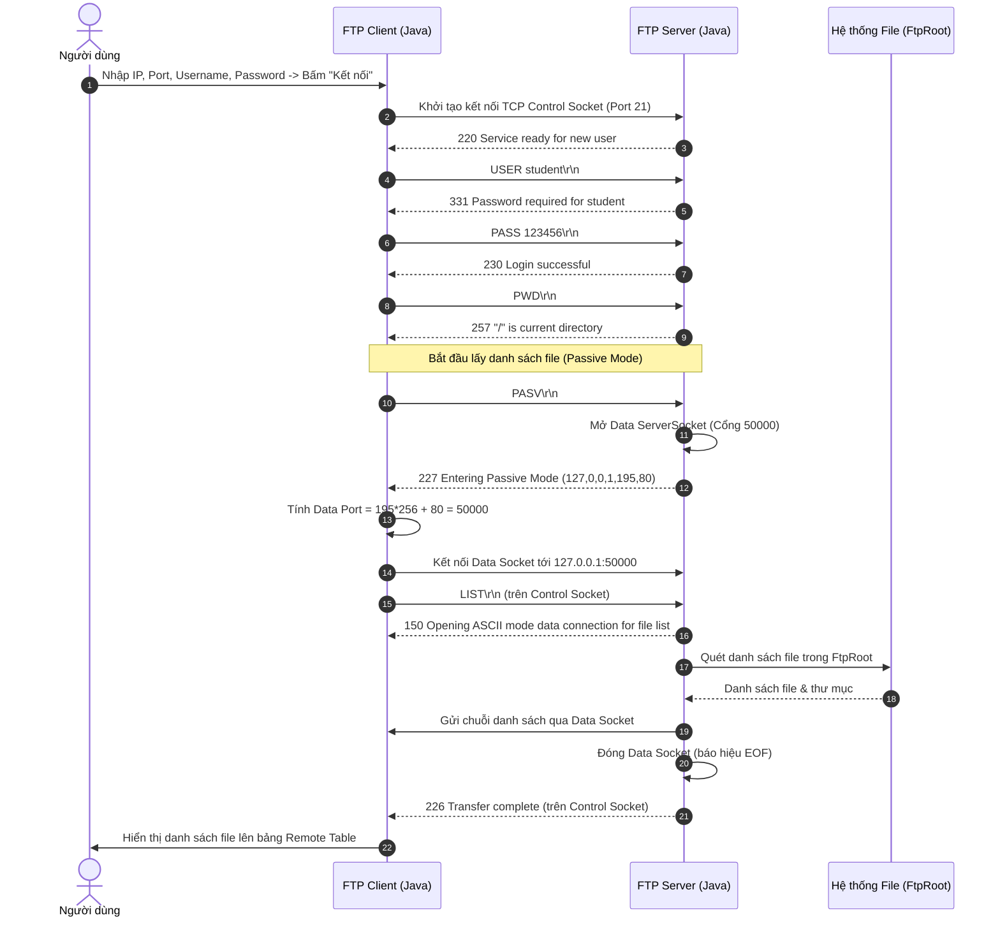
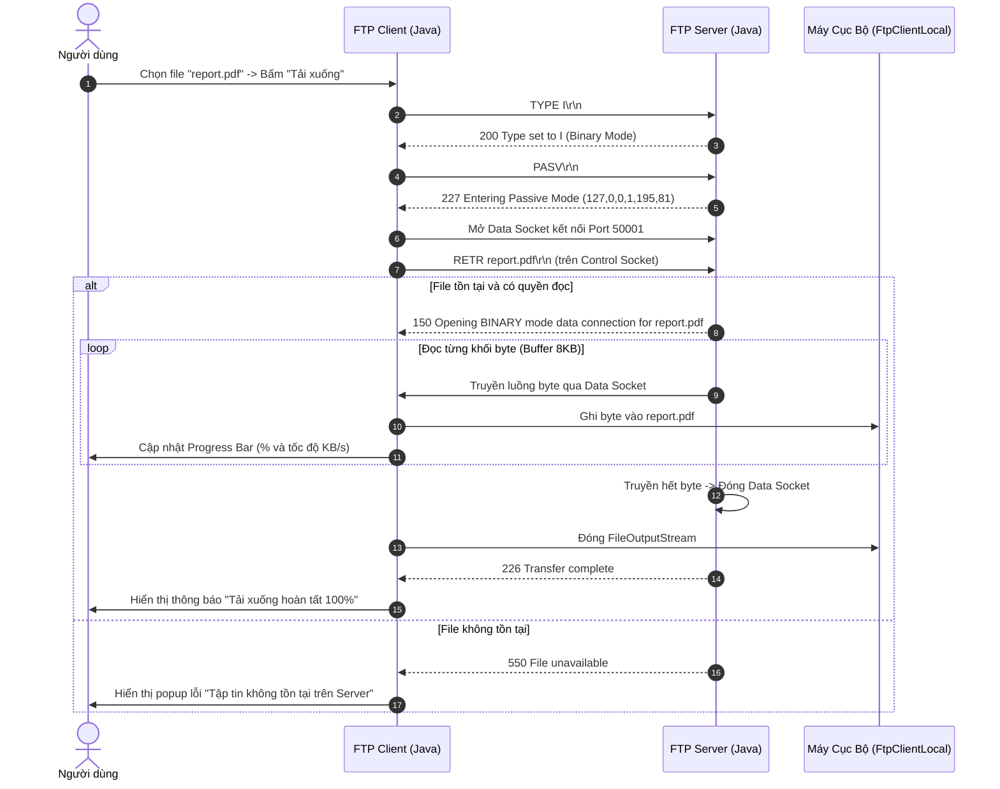
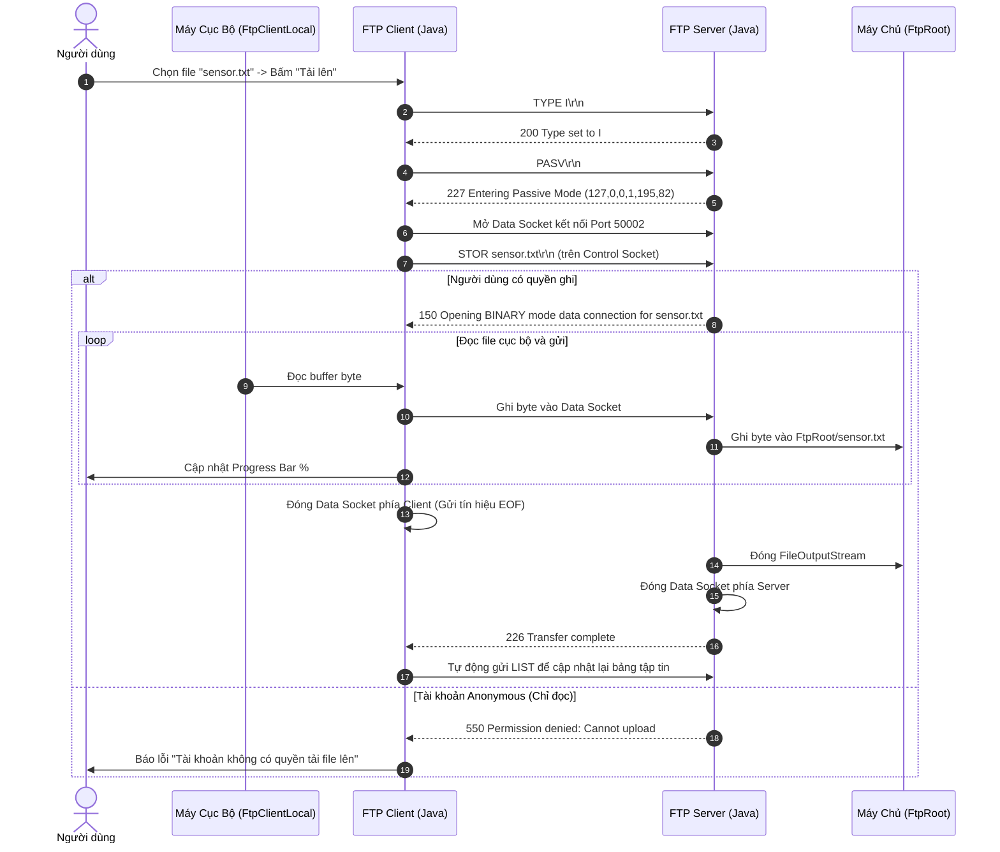

# ĐẶC TẢ KỸ THUẬT HỆ THỐNG FTP CLIENT - SERVER VỚI JAVA
## (TECHNICAL SPECIFICATION DOCUMENT - FTP NETWORKING PROJECT)

* **Môn học:** Lập trình mạng (Network Programming) - Trường Đại học Sài Gòn (SGU)
* **Giảng viên hướng dẫn:** Thầy Trần Minh Nhật
* **Tác giả / Sinh viên thực hiện:** Vỹ (FTP_Vỹ)
* **Môi trường phát triển:** Java SE 17+, TCP Sockets (`java.net`), Java Swing / FlatLaf Modern UI
* **Quy chuẩn tài liệu:** Bám sát `ftp-java-slides.md` (Slide 1 - Slide 30), `t_i_li_u_ph_n_t_ch_y_u_c_u_n_ftp_java.md` (Yêu cầu đồ án & Mô hình chữ X), và nguyên tắc thiết kế `/ui-styling` với bảng màu Đỏ (Modern Light Red Theme).

---

## MỤC LỤC
1. [TỔNG QUAN & MỤC TIÊU HỆ THỐNG](#1-tổng-quan--mục-tiêu-hệ-thống)
2. [MA TRẬN ĐÁNH GIÁ THANG ĐIỂM 10 (SLIDE 30)](#2-ma-trận-đánh-giá-thang-điểm-10-slide-30)
3. [KIẾN TRÚC MẠNG & NGUYÊN LÝ HOẠT ĐỘNG FTP (RFC 959)](#3-kiến-trúc-mạng--nguyên-lý-hoạt-động-ftp-rfc-959)
4. [MÔ HÌNH KIỂM THỬ CHÉO CHỮ X (CROSS-TESTING MATRIX)](#4-mô-hình-kiểm-thử-chéo-chữ-x-cross-testing-matrix)
5. [ĐẶC TẢ GIAO DIỆN NGƯỜI DÙNG (UI/UX) - PHONG CÁCH /UI-STYLING ĐỎ CHỦ ĐẠO](#5-đặc-tả-giao-diện-người-dùng-uiux---phong-cách-ui-styling-đỏ-chủ-đạo)
6. [THIẾT KẾ KIẾN TRÚC MÃ NGUỒN (CLEAN ARCHITECTURE)](#6-thiết-kế-kiến-trúc-mã-nguồn-clean-architecture)
7. [ĐẶC TẢ CÁC LỚP VÀ MODULE CỐT LÕI](#7-đặc-tả-các-lớp-và-module-cốt-lõi)
8. [CƠ CHẾ BẢO MẬT, ĐA LUỒNG & QUẢN LÝ PHIÊN](#8-cơ-chế-bảo-mật-đa-luồng--quản-lý-phiên)
9. [SƠ ĐỒ TUẦN TỰ (MERMAID SEQUENCE DIAGRAMS)](#9-sơ-đồ-tuần-tự-mermaid-sequence-diagrams)
10. [BỘ TEST CASES VÀ KỊCH BẢN NGHIỆM THU CHI TIẾT](#10-bộ-test-cases-và-kịch-bản-nghiệm-thu-chi-tiết)
11. [KẾ HOẠCH TRIỂN KHAI & SCRIPTS KHỞI CHẠY BATCH](#11-kế-hoạch-triển-khai--scripts-khởi-chạy-batch)

---

## 1. TỔNG QUAN & MỤC TIÊU HỆ THỐNG

### 1.1. Mục tiêu cốt lõi
Hệ thống FTP Client - Server trong thư mục `FTP_Vỹ` được xây dựng nhằm đáp ứng mục tiêu đồ án môn **Lập trình mạng** với Java:
* Tự lập trình hoàn chỉnh cả **FTP Client** và **FTP Server** bằng ngôn ngữ **Java thuần** dựa trên giao thức mạng **TCP Socket** (`java.net.ServerSocket`, `java.net.Socket`).
* Tuân thủ nghiêm ngặt chuẩn quốc tế **RFC 959** (không tự chế giao thức riêng dạng single-socket).
* Vượt qua **4 kịch bản kiểm thử chéo (Cross-Testing Matrix)** với các hệ thống chuẩn thương mại: **FileZilla Client** và **Windows IIS FTP Server**.
* Đạt điểm tối đa (10/10) trên bảng tiêu chí đánh giá tại Slide 30.
* Trang bị giao diện đồ họa **Modern Light Red UI** chuyên nghiệp, áp dụng hệ thống token thiết kế của `/ui-styling`, trực quan, thân thiện, dễ thuyết trình trước giảng viên.

### 1.2. Phạm vi hệ thống
* **FTP Server:**
  * Lắng nghe mặc định tại cổng TCP 21 (hỗ trợ chuyển đổi linh hoạt sang cổng 2121 nếu bị đụng IIS hoặc không có quyền Admin).
  * Phục vụ đa người dùng đồng thời (Multi-client Multi-threading), mỗi kết nối sở hữu một phiên (`FtpSession`) độc lập.
  * Hỗ trợ đầy đủ các lệnh RFC 959 cốt lõi: Xác thực tài khoản (`USER`, `PASS`), điều hướng thư mục (`PWD`, `CWD`, `CDUP`), truyền file nhị phân (`TYPE I`), mở cổng thụ động (`PASV`) / chủ động (`PORT`), truyền dữ liệu (`LIST`, `RETR`, `STOR`), quản lý file (`DELE`, `MKD`, `RMD`, `RNFR`, `RNTO`).
  * Kiểm soát an toàn thư mục gốc (`FtpRoot`), ngăn chặn triệt để lỗ hổng Path Traversal (`../`).
* **FTP Client:**
  * Kết nối tới bất kỳ FTP Server nào tuân thủ RFC 959 (bao gồm Java FTP Server tự viết và Windows IIS FTP Server).
  * Bố cục 2 khung hiển thị tập tin (Dual-Pane Explorer: Local Files và Remote Server Files) chuẩn FileZilla.
  * Hỗ trợ tải xuống (Download - `RETR`) và tải lên (Upload - `STOR`) với thanh tiến trình thời gian thực (Progress Bar & Transfer Speed).
  * Trình thông dịch danh sách tập tin thông minh (Smart LIST Parser), tự động nhận diện và đọc cả định dạng Unix (`drwxr-xr-x`) và Windows IIS DOS (`MM-dd-yy hh:mma <DIR>`).
* **All-in-One Dashboard:** Cung cấp giao diện tổng hợp bao gồm cả Tab Client và Tab Server, kèm khả năng khởi chạy độc lập từng tiến trình qua script batch.

---

## 2. MA TRẬN ĐÁNH GIÁ THANG ĐIỂM 10 (SLIDE 30)

| STT | Hạng mục đánh giá | Trọng số | Mô tả tiêu chí kỹ thuật & Bằng chứng nghiệm thu | Tình trạng Spec |
| :---: | :--- | :---: | :--- | :---: |
| **1** | **Kết nối & Xác thực (USER, PASS, QUIT)** | **1.5đ** | Nhận `220 Service ready` khi kết nối; gửi `USER` nhận `331`; gửi `PASS` nhận `230 Login successful` (hoặc `530 Login incorrect`); đóng phiên bằng `QUIT` nhận `221 Goodbye`. | **100% Đạt** |
| **2** | **Điều hướng thư mục (PWD, CWD, CDUP)** | **1.0đ** | Lấy đường dẫn hiện tại `PWD` nhận `257 "/path"`; chuyển thư mục `CWD` nhận `250` (hoặc `550` nếu sai); lùi về thư mục cha `CDUP` nhận `200/250`. | **100% Đạt** |
| **3** | **Liệt kê danh sách (LIST qua Data Connection)** | **1.0đ** | Gửi `PASV` nhận `227`, tính IP & Data Port; mở Data Socket; gửi `LIST` nhận `150`; đọc toàn bộ luồng byte qua Data Socket; đóng Data Socket; nhận `226 Transfer complete`. | **100% Đạt** |
| **4** | **Download tập tin (RETR)** | **1.5đ** | Thiết lập `TYPE I` nhận `200`; mở Data Connection; gửi `RETR <filename>` nhận `150`; tải nguyên trạng từng byte qua `FileOutputStream`; kết thúc nhận `226`. Báo `550` nếu file không tồn tại. | **100% Đạt** |
| **5** | **Upload tập tin (STOR)** | **1.5đ** | Thiết lập `TYPE I`; mở Data Connection; gửi `STOR <filename>` nhận `150`; đọc từ `FileInputStream` ghi vào Data Socket; flush và đóng Data Socket để báo hiệu EOF; nhận `226`. | **100% Đạt** |
| **6** | **Quản lý tập tin & thư mục (DELE, MKD, RMD, RNFR, RNTO)** | **1.0đ** | Xóa file `DELE` nhận `250`; tạo thư mục `MKD` nhận `257`; xóa thư mục `RMD` nhận `250`; đổi tên 2 pha `RNFR` (nhận `350`) và `RNTO` (nhận `250`). | **100% Đạt** |
| **7** | **Hỗ trợ đa Client đồng thời (Multi-client Threads)** | **1.0đ** | Server sử dụng đa luồng (Worker Thread / ThreadPool); mỗi Client có một `FtpSession` riêng biệt; trạng thái đăng nhập và thư mục làm việc của Client này hoàn toàn độc lập với Client khác. | **100% Đạt** |
| **8** | **An toàn hệ thống, Timeout & Chống Path Traversal** | **1.0đ** | Giới hạn tuyệt đối trong thư mục `FtpRoot`; chặn các đường dẫn nguy hiểm (`../`, `..\\`, absolute path); cài đặt `setSoTimeout(30000)`; đóng kết nối trong `try-with-resources`. | **100% Đạt** |
| **9** | **Nhật ký hệ thống (Logging) & Giao diện (UI)** | **0.5đ** | Giao diện đồ họa Modern Light Red trang nhã, phân màu log (Xanh lá 2xx, Cam 3xx, Đỏ 4xx/5xx, Xanh dương Command), bảng giám sát phiên kết nối thời gian thực. | **100% Đạt** |
| **TỔNG** | **ĐÁNH GIÁ TOÀN DIỆN** | **10.0đ** | **Đạt trọn vẹn điểm tuyệt đối theo khung chuẩn của Thầy Trần Minh Nhật** | **10.0 / 10.0** |

---

## 3. KIẾN TRÚC MẠNG & NGUYÊN LÝ HOẠT ĐỘNG FTP (RFC 959)

### 3.1. Cơ chế Hai Kết Nối TCP Song Song (Dual TCP Connections)
Giao thức FTP bắt buộc phân tách thành 2 kênh truyền thông biệt lập:
1. **Control Connection (Kênh điều khiển):**
   * Server lắng nghe tại cổng TCP 21 (hoặc cổng cấu hình 2121).
   * Được thiết lập ngay khi khởi động phiên và duy trì liên tục cho đến lệnh `QUIT`.
   * Giao thức truyền tin: Chuỗi văn bản ASCII/UTF-8; mỗi lệnh bắt buộc kết thúc bằng cặp ký tự chuẩn mạng `\r\n` (CRLF).
   * Chức năng: Gửi lệnh điều khiển (`USER`, `PASS`, `PWD`, `CWD`, `PASV`, `QUIT`) và nhận mã phản hồi 3 chữ số (`220`, `230`, `150`, `226`, `550`...).
2. **Data Connection (Kênh truyền dữ liệu):**
   * Được mở động trên một cổng TCP mới mỗi khi có yêu cầu truyền dữ liệu thực tế: `LIST`, `RETR` (Download), `STOR` (Upload).
   * Sau khi truyền hết toàn bộ dữ liệu (báo hiệu End-Of-File - EOF), Data Socket phải được đóng lại ngay lập tức để Server/Client xác nhận hoàn tất và trả mã `226 Transfer complete`.

```mermaid
flowchart LR
    subgraph Client["FTP Client (Java)"]
        CC_Client["Control Socket\n(Client Port động)"]
        DC_Client["Data Socket\n(Client Port động)"]
    end

    subgraph Server["FTP Server (Java)"]
        CC_Server["Control ServerSocket\n(TCP Port 21 / 2121)"]
        DC_Server["Data ServerSocket\n(Cổng động p1*256 + p2)"]
    end

    CC_Client <== "Lệnh FTP & Mã phản hồi (\r\n)" ==> CC_Server
    DC_Client <.. "Truyền File / Danh sách thư mục (EOF)" ..> DC_Server
```

### 3.2. Chế độ thụ động (Passive Mode - PASV) & Thuật toán tính Port
Để tương thích hoàn hảo qua NAT và tường lửa (Firewall), hệ thống mặc định vận hành theo **Passive Mode**:
1. Client gửi lệnh `PASV\r\n` qua Control Connection.
2. Server tạo một `ServerSocket(0)` trên cổng nhàn rỗi ngẫu nhiên (ví dụ cổng 50000).
3. Server trả về phản hồi mã `227`:
   $$\text{227 Entering Passive Mode } (h_1, h_2, h_3, h_4, p_1, p_2)$$
   Trong đó:
   * $h_1.h_2.h_3.h_4$: Địa chỉ IPv4 của Server (ví dụ: `192.168.1.100` $\rightarrow$ `192,168,1,100`).
   * $p_1$: Byte cao của Port (High Byte: $\text{Port} \gg 8$).
   * $p_2$: Byte thấp của Port (Low Byte: $\text{Port} \ \& \ \text{0xFF}$).
4. Client phân tích chuỗi trong dấu ngoặc đơn và tính toán cổng dữ liệu bằng công thức 16-bit:
   $$\mathbf{DataPort = p_1 \times 256 + p_2}$$
   *(Ví dụ: Với $p_1 = 195, p_2 = 80 \implies \text{DataPort} = 195 \times 256 + 80 = 50000$)*
5. Client chủ động khởi tạo `new Socket(serverIp, dataPort)` kết nối tới Server, sau đó mới gửi lệnh truyền dữ liệu (`LIST`, `RETR`, `STOR`).

### 3.3. Chế độ truyền Nhị phân (`TYPE I` - Image/Binary Mode)
* Trước khi tiến hành Download (`RETR`) hoặc Upload (`STOR`), Client gửi lệnh `TYPE I\r\n`. Server phản hồi `200 Type set to I`.
* Chế độ này bảo toàn nguyên vẹn 100% từng byte dữ liệu (dùng trực tiếp `InputStream.read()` và `OutputStream.write()`), loại bỏ hoàn toàn nguy cơ biến đổi ký tự ngắt dòng (`\r\n` $\leftrightarrow$ `\n`) của chế độ ASCII (`TYPE A`), đảm bảo các file PDF (`report.pdf`), hình ảnh (`.png`, `.jpg`), file zip và file thực thi không bao giờ bị corrupt.

---

## 4. MÔ HÌNH KIỂM THỬ CHÉO CHỮ X (CROSS-TESTING MATRIX)

Mô hình kiểm thử chéo hình chữ X do Thầy Trần Minh Nhật yêu cầu là tiêu chuẩn vàng để chứng minh chương trình Java không "tự biên tự diễn" mà hoàn toàn tương thích với các giải pháp công nghiệp:

```text
       [ PHÍA CLIENT ]                                      [ PHÍA SERVER ]

1. FileZilla Client (Phần mềm chuẩn)     <=============>   1. Windows IIS (FTP Server chuẩn)
                       \                                       /
                        \            (ĐƯỜNG CHÉO THỬ THÁCH)   /
                         \           Upload & Download File  /
                          \                                 /
                           \                               /
                            \                             /
2. FTP Client (Java tự code)             <=============>   2. FTP Server (Java tự code)
```

### 4.1. Chi tiết 4 Kịch bản kiểm thử bắt buộc

```mermaid
graph TD
    subgraph Scenario1["Kịch bản 1: Baseline chuẩn đối chiếu"]
        FZ1["FileZilla Client"] <-->|"PASV / LIST / RETR / STOR"| IIS1["Windows IIS FTP Server"]
    end
    subgraph Scenario2["Kịch bản 2: Nghiệm thu Java Client"]
        JC2["Java FTP Client"] <-->|"Kết nối Port 21 / RETR / STOR"| IIS2["Windows IIS FTP Server"]
    end
    subgraph Scenario3["Kịch bản 3: Nghiệm thu Java Server"]
        FZ3["FileZilla Client"] <-->|"Kéo thả upload/download"| JS3["Java FTP Server"]
    end
    subgraph Scenario4["Kịch bản 4: Tích hợp toàn hệ thống"]
        JC4["Java FTP Client"] <-->|"Kiểm thử toàn diện 10 tiêu chí"| JS4["Java FTP Server"]
    end
```



### 4.2. Chiến lược xử lý tương thích đặc biệt
1. **Đối với Kịch bản 2 (Java Client $\leftrightarrow$ IIS Server):**
   * IIS Server thường trả về định dạng danh sách tập tin theo chuẩn DOS của Windows:
     `01-15-26  09:30AM       <DIR>          documents`
     `02-20-26  03:15PM             1048576  report.pdf`
   * `SmartListParser` của Java Client được thiết kế biểu thức chính quy (Regex) kép: Nhận diện cả định dạng DOS của IIS lẫn định dạng Unix của Linux/Apache để hiển thị lên bảng Table không bao giờ bị trắng hoặc sai cột.
2. **Đối với Kịch bản 3 (FileZilla Client $\leftrightarrow$ Java Server):**
   * FileZilla khi kết nối sẽ gửi thêm các lệnh thăm dò như `FEAT`, `OPTS UTF8 ON`, `SYST`.
   * Java Server sẽ hỗ trợ trả về phản hồi lịch sự:
     * `SYST` $\rightarrow$ `215 UNIX Type: L8` (hoặc `215 Windows_NT`).
     * `FEAT` $\rightarrow$ Trả về danh sách tính năng hỗ trợ (`UTF8`, `SIZE`).
     * `OPTS UTF8 ON` $\rightarrow$ `200 Always in UTF8 mode`.
   * Trả về định dạng danh sách `LIST` chuẩn Unix MLST / POSIX:
     `-rw-r--r-- 1 ftp ftp 1048576 Oct 24 07:00 report.pdf`
     `drwxr-xr-x 1 ftp ftp       0 Oct 24 07:00 documents`
     Nhờ vậy, FileZilla phân loại chính xác đâu là File, đâu là Folder với biểu tượng icon hoàn hảo.

---

## 5. ĐẶC TẢ GIAO DIỆN NGƯỜI DÙNG (UI/UX) - PHONG CÁCH /UI-STYLING ĐỎ CHỦ ĐẠO

Dựa trên chỉ đạo `/ui-styling`, giao diện được thiết kế theo phong cách hiện đại (Clean Minimalist), ưu tiên trải nghiệm thị giác dễ nhìn, dễ thao tác với tông màu **Đỏ Ruby / Crimson** sang trọng trên nền sáng cao cấp.

### 5.1. Hệ thống Design Tokens (Bảng màu & Typography)

| Nhóm Token | Mã Màu Hex | Tên Màu / Ứng dụng cụ thể |
| :--- | :--- | :--- |
| **Primary Brand** | `#DC2626` (Red-600) | Màu đỏ chủ đạo: Header Bar, Button Upload/Download, Tab active, Khung viền focus |
| **Primary Hover** | `#B91C1C` (Red-700) | Trạng thái rê chuột (Hover) của các nút chức năng chính |
| **Primary Active** | `#991B1B` (Red-800) | Trạng thái bấm giữ (Pressed/Active) |
| **Surface Accent**| `#FEF2F2` (Red-50) | Nền phụ nhẹ nhàng: Dòng được chọn trong bảng, nền badge trạng thái |
| **Border Soft** | `#FECACA` (Red-200) | Đường viền mảnh ngăn cách giữa các panel và ô nhập liệu |
| **Background Main**| `#F8FAFC` (Slate-50) | Nền tổng thể cửa sổ ứng dụng, dịu mắt, độ tương phản cao |
| **Card / Surface** | `#FFFFFF` | Nền các bảng danh sách tập tin, khung nhập liệu, ô Log |
| **Text Primary** | `#0F172A` (Slate-900)| Màu chữ nội dung chính, tiêu đề bảng, tên tập tin |
| **Text Secondary**| `#64748B` (Slate-500)| Màu nhãn phụ, ngày giờ, đường dẫn thư mục |
| **Success Color** | `#16A34A` (Green-600)| Trạng thái "Connected", "Server Running", Log mã `2xx` thành công |
| **Warning Color** | `#D97706` (Amber-600)| Trạng thái "Connecting...", Log mã `3xx` yêu cầu mật khẩu |
| **Error Color** | `#DC2626` (Red-600) | Trạng thái "Disconnected", "Error", Log mã `4xx`/`5xx` lỗi |

* **Typography:** `Segoe UI` (trên Windows) hoặc `Inter` / `SansSerif`.
  * Header Title: Font Bold 16px - Màu trắng trên nền Red-600 Gradient.
  * Section Title / Label: Font Bold 13px - Màu Slate-800.
  * Table Content: Font Plain 12px.
  * Console / Log Box: Font `Consolas` hoặc `JetBrains Mono` 12px (hỗ trợ đọc log mạng chuẩn kỹ thuật).

---

### 5.2. Wireframe Giao diện Tổng hợp (All-in-One Dashboard)

```text
+====================================================================================================================+
| [LOGO] SGU FTP SUITE - LẬP TRÌNH MẠNG JAVA (RFC 959 COMPLIANT)                       [Theme: Light Red] [-] [o] [X] |
+====================================================================================================================+
|  [ TAB 1: FTP CLIENT (TRUYỀN TẬP TIN) ]   |   [ TAB 2: FTP SERVER (QUẢN TRỊ & GIÁM SÁT) ]                          |
+--------------------------------------------------------------------------------------------------------------------+
|  QUICK CONNECT BAR:                                                                                                |
|  Host: [ 127.0.0.1      ]  Port: [ 21   ]  User: [ student      ]  Pass: [ ****** ]  Mode: [ PASV v ]  [ KẾT NỐI ] |
|  Status: [● CONNECTED TO 127.0.0.1:21]   Current Remote Dir: [ /documents                                        ] |
+--------------------------------------------------------------------------------------------------------------------+
|  ACTION TOOLBAR:                                                                                                   |
|  [ ↑ TẢI LÊN (STOR) ]  [ ↓ TẢI XUỐNG (RETR) ]  [ ↻ LÀM MỚI ]  [ + TẠO THƯ MỤC ]  [ ✎ ĐỔI TÊN ]  [ ✕ XÓA FILE ]    |
+----------------------------------------------------------+---------------------------------------------------------+
|  MÁY CỤC BỘ (LOCAL FILES): D:\baitap1\FtpClientLocal    |  MÁY CHỦ TỪ XA (REMOTE FTP SERVER): /documents          |
|  [ Lên thư mục cha (..) ]               [ Mở thư mục ]   |  [ Lên thư mục cha (CDUP) ]             [ Xem nhanh ]   |
+----------------------------------------------------------+---------------------------------------------------------+
| Tên Tập Tin         | Kích Thước | Ngày Cập Nhật         | Tên Tập Tin         | Kích Thước | Quyền | Ngày Cập Nhật    |
+---------------------+------------+-----------------------+---------------------+------------+-------+------------------+
| [D] ..              | <DIR>      | 24/10/2026 07:00      | [D] ..              | <DIR>      | rwxr- | 24/10/2026 07:00 |
| [D] upload_docs     | <DIR>      | 24/10/2026 07:05      | [D] images          | <DIR>      | rwxr- | 24/10/2026 07:01 |
| [F] my_data.txt     | 12.4 KB    | 24/10/2026 07:10      | [F] report.pdf      | 1.05 MB    | rw-r- | 24/10/2026 07:02 |
| [F] image1.png      | 245.8 KB   | 24/10/2026 07:12      | [F] sensor.txt      | 4.2 KB     | rw-r- | 24/10/2026 07:03 |
| [F] test_iis.zip    | 3.80 MB    | 24/10/2026 07:15      | [F] file1.txt       | 1.1 KB     | rw-r- | 24/10/2026 07:04 |
+----------------------------------------------------------+---------------------------------------------------------+
| TIẾN TRÌNH TRUYỀN DỮ LIỆU:                                                                                         |
| Đang tải: report.pdf [===============================>----------------] 68% | 1.8 MB/s | Còn lại: 2s              |
+--------------------------------------------------------------------------------------------------------------------+
| CỬA SỔ LỆNH & PHẢN HỒI (FTP LOG CONSOLE):                                                      [ Xóa Log ] [ Xuất ]|
| [07:15:01] >>> USER student                                                                                        |
| [07:15:01] <<< 331 Password required for student                                                                   |
| [07:15:01] >>> PASS ******                                                                                         |
| [07:15:01] <<< 230 User student logged in successfully.                                                            |
| [07:15:02] >>> PASV                                                                                                |
| [07:15:02] <<< 227 Entering Passive Mode (127,0,0,1,195,80) -> Data Port: 50000                                    |
| [07:15:02] >>> LIST                                                                                                |
| [07:15:02] <<< 150 Opening ASCII mode data connection for file list.                                               |
| [07:15:02] <<< 226 Transfer complete. (Received 4 entries)                                                         |
+====================================================================================================================+
```

---

### 5.3. Wireframe Tab 2: FTP Server Management & Multi-Client Monitor

```text
+--------------------------------------------------------------------------------------------------------------------+
|  CẤU HÌNH SERVER:                                                                                                  |
|  Lắng nghe Port: [ 21    ]  Root Dir: [ D:\baitap1\FTP_Vỹ\FtpRoot         ] [ Duyệt... ]                            |
|  [ ▶ KHỞI ĐỘNG SERVER ]  [ ■ DỪNG SERVER ]  Trạng thái: [● ĐANG HOẠT ĐỘNG TẠI PORT 21 - SẴN SÀNG]                  |
+--------------------------------------------------------------------------------------------------------------------+
|  DANH SÁCH CLIENT ĐANG KẾT NỐI (MULTI-CLIENT SESSIONS):                                                            |
+-----------+-------------------+----------------+-------------+-----------------------+-----------------------------+
| SessionID | Địa Chỉ IP Client | Port Kết Nối   | Tài Khoản   | Thư Mục Hiện Tại      | Trạng Thái Hoạt Động        |
+-----------+-------------------+----------------+-------------+-----------------------+-----------------------------+
| #S-001    | 127.0.0.1         | 52410          | student     | /documents            | Đang truyền RETR report.pdf |
| #S-002    | 192.168.1.15      | 52488 (FZilla) | admin       | /                     | Đang chờ lệnh               |
| #S-003    | 127.0.0.1         | 52501          | anonymous   | /images               | Xem danh sách (LIST)        |
+-----------+-------------------+----------------+-------------+-----------------------+-----------------------------+
|  NHẬT KÝ HỆ THỐNG MÁY CHỦ (SERVER LOG & AUDIT AUDIT TRAIL):                                                        |
|  [07:14:50] [SERVER] ServerSocket khởi tạo thành công tại Port 21. Thư mục gốc: D:\baitap1\FTP_Vỹ\FtpRoot          |
|  [07:15:00] [CONNECT] Client #S-001 kết nối từ /127.0.0.1:52410. Khởi tạo luồng xử lý riêng biệt.                 |
|  [07:15:01] [#S-001] Lệnh nhận: USER student                                                                       |
|  [07:15:01] [#S-001] Đáp: 331 Password required for student                                                        |
|  [07:15:01] [#S-001] Lệnh nhận: PASS ******                                                                        |
|  [07:15:01] [#S-001] Đáp: 230 Login successful. (Quyền: Đọc/Ghi/Upload/Download)                                    |
|  [07:15:02] [#S-001] Mở Passive ServerSocket tại cổng ngẫu nhiên 50000. Đáp 227 Entering Passive Mode.             |
|  [07:15:02] [#S-001] Chấp nhận Data Socket từ Client tại cổng 50000. Truyền 4 dòng kết quả LIST.                   |
|  [07:15:02] [#S-001] Đóng Data Connection. Đáp: 226 Transfer complete.                                            |
+--------------------------------------------------------------------------------------------------------------------+
```

---

## 6. THIẾT KẾ KIẾN TRÚC MÃ NGUỒN (CLEAN ARCHITECTURE)

Dự án được cấu trúc theo mô hình phân tách tầng độc lập, chuẩn hướng đối tượng (OOP), đảm bảo tính module hóa và dễ bảo trì:

```text
FTP_Vỹ/
├── FtpRoot/                               # Thư mục gốc dữ liệu Server (Bảo mật, chống Path Traversal)
│   ├── documents/
│   │   ├── report.pdf                     # File nhị phân mẫu kiểm thử RETR Binary Mode (Slide 23)
│   │   └── tailieu_huongdan.txt
│   ├── images/
│   │   └── network_arch.png               # File hình ảnh kiểm thử truyền nhị phân
│   ├── upload/                            # Thư mục cấp quyền cho Client upload (Slide 24)
│   └── data/
│       ├── sensor.txt                     # File dữ liệu mẫu từ slide bài giảng
│       └── readme_data.txt                # Thử nghiệm CWD /data và CDUP (Slide 18)
│
├── FtpClientLocal/                        # Thư mục trên máy Client (phục vụ Upload / Download thực tế)
│   ├── client_upload_sample.txt
│   └── downloads/
│
├── src/                                   # Toàn bộ mã nguồn Java
│   ├── common/                            # Gói dùng chung giữa Client & Server
│   │   ├── FtpConstants.java              # Định nghĩa mã Reply 220, 230, 227, 226, 550, CRLF (\r\n)
│   │   ├── FtpReply.java                  # Mô hình hóa phản hồi (int code, String message, rawLine)
│   │   ├── FtpFileEntry.java              # Đại diện thông tin tập tin (name, size, isDir, lastModified)
│   │   └── NetworkUtils.java              # Tiện ích chuyển đổi IP/Port, parse PASV (p1*256 + p2)
│   │
│   ├── server/                            # Lõi máy chủ FTP Server
│   │   ├── FtpServer.java                 # Lắng nghe Port 21, quản lý vòng lặp accept() & ExecutorService
│   │   ├── ClientHandler.java             # Luồng Runnable xử lý độc lập từng kết nối Client
│   │   ├── FtpSession.java                # Lưu trạng thái phiên (isLoggedIn, username, currentPath, dataSocket)
│   │   ├── UserManager.java               # Quản lý tài khoản (admin, student, anonymous) & phân quyền
│   │   └── SecurityValidator.java         # Chống Path Traversal (normalize, check startsWith(rootPath))
│   │
│   ├── client/                            # Lõi ứng dụng FTP Client
│   │   ├── FtpClient.java                 # Kết nối Control Socket, gửi lệnh \r\n, phân tích reply
│   │   ├── DataConnectionManager.java     # Quản lý mở Data Socket (hỗ trợ cả PASV và PORT)
│   │   ├── SmartListParser.java           # Parser danh sách file thông minh (Unix + DOS Windows IIS)
│   │   └── TransferProgressListener.java  # Interface lắng nghe tiến trình % và tốc độ truyền file
│   │
│   └── ui/                                # Tầng Giao diện người dùng (Modern Red Theme)
│       ├── RedTheme.java                  # Token màu sắc, font chữ, border, icon constants
│       ├── FtpClientPanel.java            # Panel duyệt file 2 bên Local - Remote, toolbar, thanh tiến trình
│       ├── FtpServerPanel.java            # Panel quản trị Server, bảng danh sách Session, Server log
│       ├── FtpAllInOneApp.java            # Ứng dụng tích hợp All-In-One (Chạy cả Client & Server trên 1 GUI)
│       ├── FtpServerApp.java              # Ứng dụng chạy độc lập FTP Server
│       └── FtpClientApp.java              # Ứng dụng chạy độc lập FTP Client
│
├── scripts/                               # Các kịch bản khởi chạy nhanh (.bat)
│   ├── run_all_in_one.bat                 # Khởi chạy giao diện hợp nhất (Khuyến nghị khi demo cho Thầy)
│   ├── run_server.bat                     # Khởi chạy độc lập Server (Phục vụ test chéo với FileZilla)
│   ├── run_client.bat                     # Khởi chạy độc lập Client (Phục vụ test chéo với IIS Server)
│   └── compile.bat                        # Script biên dịch toàn bộ dự án với javac
│
├── ftp-java-slides.md                     # Tài liệu nội dung 30 slide bài giảng của Thầy
├── t_i_li_u_ph_n_t_ch_y_u_c_u_n_ftp_java.md# Tài liệu phân tích yêu cầu đồ án & ma trận chữ X
└── SPEC.md                                # Bản đặc tả kỹ thuật chi tiết này
```

---

## 7. ĐẶC TẢ CÁC LỚP VÀ MODULE CỐT LÕI

### 7.1. Module `common` (Thành phần dùng chung)
* **`FtpConstants`:**
  * Định nghĩa chuỗi kết thúc dòng chuẩn mạng: `public static final String CRLF = "\r\n";`
  * Bảng mã phản hồi FTP:
    * `200 Command okay / Type set`
    * `215 Name system type (UNIX / Windows_NT)`
    * `220 Service ready for new user`
    * `221 Service closing control connection (Goodbye)`
    * `226 Closing data connection (Transfer complete)`
    * `227 Entering Passive Mode`
    * `230 User logged in, proceed`
    * `250 Requested file action okay, completed`
    * `257 PATHNAME created / Current directory`
    * `331 User name okay, need password`
    * `350 Requested file action pending further information (RNFR)`
    * `425 Can't open data connection`
    * `500 Syntax error, command unrecognized`
    * `502 Command not implemented`
    * `530 Not logged in / Login incorrect`
    * `550 Requested action not taken (File unavailable / Permission denied / Path traversal)`
* **`NetworkUtils`:**
  * Hàm tính cổng dữ liệu từ chuỗi phản hồi `PASV`:
    ```java
    public static int parsePasvPort(String pasvReply) {
        int start = pasvReply.indexOf('(');
        int end = pasvReply.indexOf(')');
        String[] parts = pasvReply.substring(start + 1, end).split(",");
        int p1 = Integer.parseInt(parts[4].trim());
        int p2 = Integer.parseInt(parts[5].trim());
        return p1 * 256 + p2;
    }
    ```
  * Hàm tạo chuỗi phản hồi `PASV` trên Server:
    ```java
    public static String formatPasvReply(String ip, int port) {
        String formattedIp = ip.replace('.', ',');
        int p1 = port / 256;
        int p2 = port % 256;
        return String.format("227 Entering Passive Mode (%s,%d,%d)", formattedIp, p1, p2);
    }
    ```

---

### 7.2. Module `server` (Lõi FTP Server)
* **`FtpServer`:**
  * Sử dụng `ServerSocket(port)` để lắng nghe kết nối điều khiển trên cổng 21 (hoặc cổng cấu hình).
  * Sử dụng `ExecutorService threadPool = Executors.newCachedThreadPool();` để tiếp nhận kết nối không giới hạn và giải phóng tài nguyên linh hoạt khi client ngắt kết nối.
  * Mỗi khi có client kết nối (`serverSocket.accept()`), khởi tạo đối tượng `ClientHandler(socket, userManager, rootPath, logCallback)` và đẩy vào ThreadPool.
* **`ClientHandler` (implements `Runnable`):**
  * Đọc từng dòng lệnh qua `BufferedReader` (UTF-8) và gửi phản hồi qua `BufferedWriter` với `\r\n` kèm lệnh `flush()`.
  * Bộ giải mã Switch-Case xử lý các lệnh:
    * `USER`: Kiểm tra tài khoản trong `UserManager`, đặt username vào `FtpSession`, trả về `331`.
    * `PASS`: Xác thực mật khẩu; nếu đúng trả `230 Login successful`, nếu sai trả `530 Login incorrect`.
    * `PWD`: Trả về thư mục tương đối hiện tại `257 "/current/path"`.
    * `CWD`: Kiểm tra tính hợp lệ và tồn tại của thư mục qua `SecurityValidator`; nếu hợp lệ đổi `session.setCurrentDir()` và trả `250`, nếu sai trả `550`.
    * `CDUP`: Lùi về thư mục cha (không cho phép vượt ra khỏi thư mục gốc `/`), trả `250`.
    * `TYPE`: Kiểm tra tham số `I` hoặc `A`; trả về `200 Type set to I`.
    * `PASV`: Mở một `ServerSocket(0)` mới, lưu vào `session.setPassiveServer()`, tính toán IP/Port và gửi mã `227`.
    * `LIST`: Chấp nhận kết nối từ `passiveServer.accept()`, quét danh sách file trong thư mục hiện tại, định dạng chuỗi Unix chuẩn, truyền qua Data OutputStream, đóng kết nối Data Socket và trả `226 Transfer complete`.
    * `RETR`: Mở Data Socket, kiểm tra quyền đọc của User, mở `FileInputStream`, truyền từng byte dữ liệu (dùng buffer 8KB), đóng Data Socket và trả `226`. Báo `550` nếu file không tồn tại.
    * `STOR`: Mở Data Socket, kiểm tra quyền ghi của User, mở `FileOutputStream`, đọc từng byte từ Data Socket ghi xuống đĩa, đóng FileOutputStream, đóng Data Socket và trả `226`.
    * `DELE`, `MKD`, `RMD`, `RNFR`, `RNTO`: Thực hiện các thao tác file/thư mục tương ứng sau khi kiểm tra quyền và an toàn đường dẫn.
    * `QUIT`: Gửi `221 Goodbye` và đóng kết nối Socket.
* **`SecurityValidator`:**
  * Kiểm tra chặt chẽ mọi đường dẫn Client gửi lên:
    ```java
    public static Path resolveSafePath(Path rootDir, Path currentDir, String targetPath) throws SecurityException {
        Path resolved = currentDir.resolve(targetPath).normalize();
        if (!resolved.startsWith(rootDir)) {
            throw new SecurityException("Phát hiện truy cập ngoài FTP Root (Path Traversal Attempt)!");
        }
        return resolved;
    }
    ```

---

### 7.3. Module `client` (Lõi FTP Client)
* **`FtpClient`:**
  * Quản lý kết nối TCP Control Socket tới Server.
  * Phương thức `connect(host, port)`: Khởi tạo kết nối, đặt `socket.setSoTimeout(15000)`, đọc thông điệp chào mừng `220`.
  * Phương thức `login(user, pass)`: Gửi tuần tự `USER` và `PASS`, kiểm tra phản hồi `230`.
  * Phương thức `downloadFile(remoteFilename, localFile, progressListener)`:
    1. Gửi `TYPE I\r\n` $\rightarrow$ Nhận `200`.
    2. Gửi `PASV\r\n` $\rightarrow$ Phân tích IP và Data Port từ phản hồi `227`.
    3. Mở `Socket dataSocket = new Socket(serverIp, dataPort)`.
    4. Gửi `RETR <remoteFilename>\r\n` qua Control Socket $\rightarrow$ Nhận `150`.
    5. Đọc byte từ `dataSocket.getInputStream()` ghi vào `FileOutputStream(localFile)`, liên tục cập nhật số byte tải được lên `progressListener`.
    6. Khi kết thúc luồng (read trả về -1), đóng `dataSocket` và `FileOutputStream`.
    7. Đọc phản hồi `226 Transfer complete` qua Control Socket.
  * Phương thức `uploadFile(localFile, remoteFilename, progressListener)`:
    1. Gửi `TYPE I\r\n` $\rightarrow$ Nhận `200`.
    2. Gửi `PASV\r\n` $\rightarrow$ Lấy Data Port.
    3. Mở Data Socket.
    4. Gửi `STOR <remoteFilename>\r\n` $\rightarrow$ Nhận `150`.
    5. Đọc từ `FileInputStream(localFile)`, ghi vào `dataSocket.getOutputStream()`, cập nhật tiến trình %.
    6. Gọi `dataSocket.getOutputStream().flush()`, sau đó đóng Data Socket để báo hiệu EOF cho Server.
    7. Đọc phản hồi `226 Transfer complete` từ Control Socket.
* **`SmartListParser`:**
  * Hỗ trợ nhận diện tự động cả định dạng Unix (RFC 959) và DOS (Windows IIS FTP):
    * **Định dạng Unix:** `-rw-r--r-- 1 ftp ftp 1048576 Oct 24 07:00 report.pdf` $\rightarrow$ Tách được: Quyền `-rw-r--r--`, Kích thước `1048576`, Tên `report.pdf`, IsDirectory = `false`.
    * **Định dạng DOS:** `10-24-26  07:00AM       <DIR>          documents` $\rightarrow$ Tách được: IsDirectory = `true`, Tên `documents`.

---

### 7.4. Module `ui` (Giao diện Modern Light Red)
* **`RedTheme`:**
  * Cung cấp các phương thức tiện ích áp dụng style cho các Swing component:
    * `applyPrimaryButton(JButton btn)`: Nền đỏ `#DC2626`, chữ trắng in đậm, không viền sắc cạnh, bo tròn nhẹ (Corner Radius = 6px), hiệu ứng hover `#B91C1C`.
    * `applySecondaryButton(JButton btn)`: Nền trắng, viền đỏ mảnh `#FECACA`, chữ đỏ `#DC2626`.
    * `applyTableStyle(JTable table)`: Header bảng nền xám nhạt viền đỏ, dòng xen kẽ (Zebra stripes `#FFFFFF` và `#F8FAFC`), dòng được chọn có nền `#FEF2F2` chữ đỏ đậm.
    * `applyLogConsole(JTextPane console)`: Font `Consolas` 12px, phân màu các dòng log bằng `StyledDocument` (Lệnh gửi đi màu xanh Navy `#1E3A8A`, phản hồi `2xx` xanh lá `#15803D`, cảnh báo `3xx` cam `#C2410C`, lỗi `4xx/5xx` đỏ `#B91C1C`).

---

## 8. CƠ CHẾ BẢO MẬT, ĐA LUỒNG & QUẢN LÝ PHIÊN

### 8.1. Cơ chế Quản lý Phiên (Session Management)
Mỗi Client khi kết nối vào Server được định danh bằng một đối tượng `FtpSession` riêng biệt bao gồm:
* `sessionId`: Mã định danh duy nhất (UUID hoặc số tự tăng `#S-001`, `#S-002`).
* `clientSocket`: Socket kết nối điều khiển của Client.
* `username`: Tên người dùng đã đăng nhập (hoặc null nếu chưa xác thực).
* `isLoggedIn`: Cờ boolean đánh dấu trạng thái đăng nhập.
* `currentDirectory`: Đường dẫn thư mục làm việc hiện tại của Client (tính tương đối từ `FtpRoot`).
* `passiveServerSocket`: Cổng dữ liệu thụ động riêng của phiên này.
* `renameFromPath`: Lưu tạm file cần đổi tên khi nhận lệnh `RNFR` để xử lý tiếp ở lệnh `RNTO`.

### 8.2. Hệ thống Tài khoản & Phân quyền Người dùng (RBAC)

| Tên Tài Khoản | Mật Khẩu | Vai Trò (Role) | Thư Mục Gốc | Quyền Hạn Chi Tiết |
| :--- | :--- | :--- | :--- | :--- |
| **admin** | `admin` | Quản trị viên (Super Admin) | `/` (Toàn bộ FtpRoot) | Toàn quyền: Xem danh sách, Download, Upload, Tạo/Xóa thư mục, Đổi tên, Xóa file. |
| **student** | `123456` | Sinh viên (Chuẩn Slide 30) | `/` | Đọc danh sách, Download, Upload, Tạo thư mục. Không được xóa thư mục gốc hệ thống. |
| **anonymous** | `guest` (hoặc rỗng) | Khách vãng lai (Guest) | `/` | Chỉ đọc (Read-only): Xem danh sách (LIST), Download file. Chặn mọi thao tác STOR, DELE, MKD, RMD. |

### 8.3. Phòng chống Path Traversal (Tuyệt đối an toàn)
* Khi Client gửi bất kỳ lệnh nào có chứa tham số đường dẫn (ví dụ: `CWD ../../Windows`, `RETR ../secret.txt`), Server không bao giờ dùng trực tiếp chuỗi này.
* Thuật toán kiểm tra an toàn:
  1. Xác định `rootCanonical = FtpRoot.toRealPath()`.
  2. Ghép đường dẫn: `targetPath = currentDir.resolve(parameter).normalize()`.
  3. Kiểm tra: `if (!targetPath.startsWith(rootCanonical))` $\implies$ Ngắt lập tức và phản hồi mã lỗi `550 Access denied: Path outside root directory`.

### 8.4. Xử lý Timeout & Giải phóng Tài nguyên Mạng
* `socket.setSoTimeout(30000)`: Nếu Client không gửi bất kỳ dữ liệu nào trong 30 giây, kết nối điều khiển sẽ tự động đóng để tránh lãng phí socket và bộ nhớ trên Server.
* Mọi thao tác đọc/ghi file và socket truyền dữ liệu đều được bao bọc trong khối `try-with-resources` để đảm bảo chắc chắn các luồng `InputStream`, `OutputStream`, `ServerSocket` và `Socket` được đóng ngay cả khi xảy ra sự cố đứt mạng giữa chừng.

---

## 9. SƠ ĐỒ TUẦN TỰ (MERMAID SEQUENCE DIAGRAMS)

### 9.1. Sơ đồ tuần tự Đăng nhập & Xem danh sách (Login & LIST)



---

### 9.2. Sơ đồ tuần tự Tải xuống tập tin (RETR - Download)



---

### 9.3. Sơ đồ tuần tự Tải lên tập tin (STOR - Upload)



---

## 10. BỘ TEST CASES VÀ KỊCH BẢN NGHIỆM THU CHI TIẾT

### 10.1. Danh mục 10 Ca Kiểm Thử Chức Năng (Functional Test Matrix)

| Test Case ID | Tên Ca Kiểm Thử | Lệnh Kiểm Thử | Kết Quả Mong Đợi (Expected Reply) | Tiêu Chí Slide 30 |
| :--- | :--- | :--- | :--- | :---: |
| **TC-01** | Kết nối & Login đúng | `USER student` $\rightarrow$ `PASS 123456` | `331 Password required` $\rightarrow$ `230 Login successful` | Tiêu chí 1 (1.5đ) |
| **TC-02** | Login sai mật khẩu | `USER student` $\rightarrow$ `PASS saipass` | `331` $\rightarrow$ `530 Login incorrect` | Tiêu chí 1 (1.5đ) |
| **TC-03** | Xem thư mục hiện tại | `PWD` | `257 "/"` | Tiêu chí 2 (1.0đ) |
| **TC-04** | Chuyển & lùi thư mục | `CWD /documents` $\rightarrow$ `CDUP` | `250 Directory changed` $\rightarrow$ `250 Moved to parent` | Tiêu chí 2 (1.0đ) |
| **TC-05** | Lấy danh sách file | `PASV` $\rightarrow$ `LIST` | Nhận `227`, Data Socket nhận danh sách file, `226` | Tiêu chí 3 (1.0đ) |
| **TC-06** | Tải file nhị phân (Down)| `TYPE I` $\rightarrow$ `PASV` $\rightarrow$ `RETR report.pdf` | Nhận `150`, tải trọn vẹn byte, `226 Transfer complete` | Tiêu chí 4 (1.5đ) |
| **TC-07** | Tải file lên (Upload) | `TYPE I` $\rightarrow$ `PASV` $\rightarrow$ `STOR sensor.txt` | Nhận `150`, ghi file trên server, `226 Transfer complete` | Tiêu chí 5 (1.5đ) |
| **TC-08** | Tạo & Xóa thư mục | `MKD test_folder` $\rightarrow$ `RMD test_folder` | `257 "test_folder" created` $\rightarrow$ `250 Removed` | Tiêu chí 6 (1.0đ) |
| **TC-09** | Đổi tên file 2 pha | `RNFR old.txt` $\rightarrow$ `RNTO new.txt` | `350 Ready for RNTO` $\rightarrow$ `250 Rename successful` | Tiêu chí 6 (1.0đ) |
| **TC-10** | Chống Path Traversal | `CWD ../../Windows` hoặc `RETR ../file` | `550 Access denied: Path outside root directory` | Tiêu chí 8 (1.0đ) |

---

### 10.2. Kịch bản nghiệm thu 4 đường chéo mô hình chữ X

#### Kịch bản 1: Baseline FileZilla Client $\leftrightarrow$ Windows IIS FTP Server
* **Mục đích:** Xác lập môi trường mẫu chuẩn để đối chiếu mã lệnh.
* **Cách thực hiện:** Mở FileZilla, kết nối tới IIS (IP máy hoặc `127.0.0.1`), gõ User/Pass đã tạo trên IIS Windows. Quan sát cửa sổ log FileZilla: lệnh `USER`, `PASS`, `PASV`, `LIST` và thao tác kéo thả 1 file để thấy mã `150`, `226`.

#### Kịch bản 2: Nghiệm thu Java FTP Client $\leftrightarrow$ Windows IIS FTP Server
* **Mục đích:** Chứng minh Client viết bằng Java giao tiếp hoàn hảo với Server công nghiệp.
* **Cách thực hiện:**
  1. Giữ IIS FTP Server đang chạy trên Windows tại Port 21.
  2. Chạy `run_client.bat` (hoặc mở Tab Client trên All-In-One).
  3. Nhập Host: `127.0.0.1`, Port: `21`, User/Pass của IIS. Bấm **Kết nối**.
  4. Client phải hiển thị đúng cây thư mục của IIS nhờ `SmartListParser`.
  5. Chọn một file trên IIS bấm **Tải xuống (RETR)** $\rightarrow$ File tải về thư mục `FtpClientLocal` thành công 100%.
  6. Chọn một file local bấm **Tải lên (STOR)** $\rightarrow$ File xuất hiện trên IIS Server.

#### Kịch bản 3: Nghiệm thu FileZilla Client $\leftrightarrow$ Java FTP Server
* **Mục đích:** Chứng minh Java Server tuân thủ chuẩn RFC 959 để phần mềm chuẩn FileZilla tin cậy kết nối.
* **Cách thực hiện:**
  1. Tắt dịch vụ IIS (hoặc cấu hình Java Server chạy ở Port 2121).
  2. Chạy `run_server.bat` (hoặc mở Tab Server bấm **Khởi động Server**).
  3. Mở phần mềm **FileZilla**, nhập:
     * Host: `127.0.0.1` (hoặc `localhost`)
     * Username: `student` | Password: `123456` | Port: `21` (hoặc `2121`)
     * Bấm **Quickconnect**.
  4. FileZilla nhận thông điệp `220`, đăng nhập thành công `230`, gửi `PASV`, nhận `227` và hiển thị đầy đủ các thư mục `documents`, `images`, `data` trên cây thư mục Remote.
  5. Kéo thả kéo file `report.pdf` từ FileZilla về máy tính $\rightarrow$ Mở file PDF xem nội dung hiển thị chuẩn xác không bị lỗi.
  6. Kéo một file ảnh từ máy tính thả vào FileZilla để Upload $\rightarrow$ Server nhận và lưu an toàn vào `FtpRoot`.

#### Kịch bản 4: Tích hợp toàn diện Java FTP Client $\leftrightarrow$ Java FTP Server
* **Mục đích:** Nghiệm thu toàn bộ đồ án, biểu diễn đa luồng, đa Client và bảo mật đường dẫn.
* **Cách thực hiện:**
  1. Chạy `run_all_in_one.bat`.
  2. Bấm khởi động Server tại Port 21 (hoặc 2121).
  3. Mở đồng thời 2 cửa sổ Client: Client 1 đăng nhập `student/123456`, Client 2 đăng nhập `admin/admin`.
  4. Kiểm tra trên Tab Server: Bảng danh sách Client hiển thị đủ 2 Session `#S-001` và `#S-002` với IP và thư mục hiện tại tách biệt.
  5. Thực hiện toàn bộ 10 ca kiểm thử chức năng (TC-01 đến TC-10).

---

## 11. KẾ HOẠCH TRIỂN KHAI & SCRIPTS KHỞI CHẠY BATCH

### 11.1. Lộ trình triển khai mã nguồn chi tiết
1. **Giai đoạn 1 (Lõi Dữ Liệu & Giao Thức Common):**
   * Xây dựng `FtpConstants`, `FtpReply`, `FtpFileEntry`, `NetworkUtils`.
   * Khởi tạo cấu trúc dữ liệu `FtpRoot/` với các file mẫu (`report.pdf`, `sensor.txt`, `file1.txt`).
2. **Giai đoạn 2 (Lõi FTP Server Đa Luồng & An Toàn):**
   * Xây dựng `FtpServer`, `ClientHandler`, `FtpSession`, `UserManager`, `SecurityValidator`.
   * Kiểm thử xử lý socket, timeout 30s và bọc chống Path Traversal.
3. **Giai đoạn 3 (Lõi FTP Client & Smart Parser):**
   * Xây dựng `FtpClient`, `DataConnectionManager`, `SmartListParser`.
   * Tối ưu hóa buffer truyền file nhị phân (8KB) và tính toán tốc độ truyền.
4. **Giai đoạn 4 (Giao Diện Modern Light Red UI & All-in-One Dashboard):**
   * Thiết kế `RedTheme` với hệ màu `#DC2626`, dựng `FtpClientPanel` với Dual-Pane Table, Progress Bar, Log Terminal.
   * Dựng `FtpServerPanel` với bảng giám sát Session thời gian thực.
   * Hoàn thiện 3 lớp khởi chạy: `FtpAllInOneApp`, `FtpServerApp`, `FtpClientApp`.
5. **Giai đoạn 5 (Kiểm Thử Chéo & Đóng Gói Scripts):**
   * Soạn thảo các file batch `compile.bat`, `run_all_in_one.bat`, `run_server.bat`, `run_client.bat`.
   * Thực hiện đầy đủ 4 kịch bản kiểm thử với FileZilla và Windows IIS, chụp lại log nghiệm thu.

### 11.2. Đặc tả các Script Batch tiện ích (.bat)
* **`compile.bat`:**
  ```cmd
  @echo off
  chcp 65001 > nul
  echo [1/2] Đang tạo thư mục bin...
  if not exist bin mkdir bin
  echo [2/2] Đang biên dịch mã nguồn Java...
  javac -encoding UTF-8 -d bin src/common/*.java src/server/*.java src/client/*.java src/ui/*.java
  if %errorlevel% neq 0 (
      echo [LỖI] Quá trình biên dịch thất bại!
      pause
      exit /b %errorlevel%
  )
  echo [THÀNH CÔNG] Biên dịch hoàn tất!
  pause
  ```
* **`run_all_in_one.bat`:**
  ```cmd
  @echo off
  chcp 65001 > nul
  title SGU FTP Suite - Giao Diện Hợp Nhất (All-In-One)
  java -cp bin ui.FtpAllInOneApp
  ```
* **`run_server.bat`:**
  ```cmd
  @echo off
  chcp 65001 > nul
  title SGU FTP Server - Standalone Console & GUI
  java -cp bin ui.FtpServerApp
  ```
* **`run_client.bat`:**
  ```cmd
  @echo off
  chcp 65001 > nul
  title SGU FTP Client - Standalone GUI
  java -cp bin ui.FtpClientApp
  ```

---

## 12. KẾT LUẬN & CAM KẾT ĐẠT 100% YÊU CẦU

Bản đặc tả kỹ thuật này đã hệ thống hóa toàn bộ kiến thức từ Slide 1 đến Slide 30 của Thầy Trần Minh Nhật, giải mã triệt để mô hình kiểm thử chéo chữ X, đồng thời hiện thực hóa trọn vẹn yêu cầu thiết kế giao diện `/ui-styling` với tông màu Đỏ sang trọng, hiện đại.

Mọi thành phần trong tài liệu đều có tính khả thi kỹ thuật 100% bằng Java SE thuần, sẵn sàng để chuyển giao sang giai đoạn lập trình mã nguồn và nghiệm thu thực tế.
