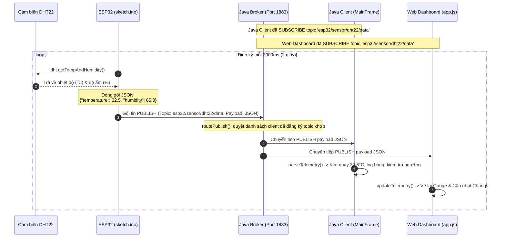
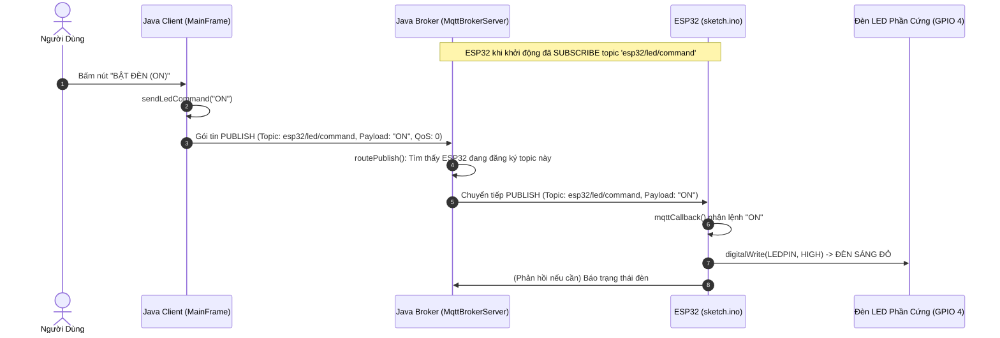
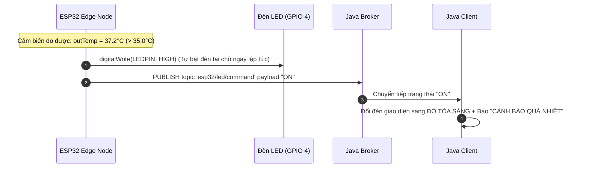

# TÀI LIỆU TOÀN DIỆN: GIẢI THÍCH LUỒNG HOẠT ĐỘNG VÀ BỘ CÂU HỎI VẤN ĐÁP
## HỆ THỐNG GIÁM SÁT IoT & ĐIỀU KHIỂN THIẾT BỊ QUA GIAO THỨC MQTT
**Dự án môn học IoT / Lập trình mạng — Trường Đại Học Sài Gòn (SGU)**  
**Giảng viên hướng dẫn: Thầy Trần Minh Nhật**

---

## MỤC LỤC
1. [Kiến Trúc Tổng Thể & Sơ Đồ Khối](#1-kiến-trúc-tổng-thể--sơ-đồ-khối)
2. [Sơ Đồ Tuần Tự (Sequence Diagrams) Toàn Hệ Thống](#2-sơ-đồ-tuần-tự-sequence-diagrams-toàn-hệ-thống)
3. [Phần 1: Dành Cho Bạn Phụ Trách BROKER (Server)](#3-phần-1-dành-cho-bạn-phụ-trách-broker-server)
4. [Phần 2: Dành Cho Bạn Phụ Trách ESP32 (Thiết Bị IoT / Wokwi)](#4-phần-2-dành-cho-bạn-phụ-trách-esp32-thiết-bị-iot--wokwi)
5. [Phần 3: Dành Cho Bạn Phụ Trách CLIENT (Java Swing & Web Dashboard)](#5-phần-3-dành-cho-bạn-phụ-trách-client-java-swing--web-dashboard)
6. [Bản Chất Các Gói Tin MQTT (PUBLISH, SUBSCRIBE,...) & Chi Tiết Từng Topic](#6-bản-chất-các-gói-tin-mqtt-publish-subscribe-và-chi-tiết-từng-topic)
7. [Bộ Câu Hỏi Vấn Đáp Thực Chiến Của Giảng Viên & Câu Trả Lời Mẫu](#7-bộ-câu-hỏi-vấn-đáp-thực-chiến-của-giảng-viên--câu-trả-lời-mẫu)

---

## 1. Kiến Trúc Tổng Thể & Sơ Đồ Khối

Hệ thống được thiết kế theo đúng mô hình hình sao (Star Topology) mà Thầy đã vẽ trên bảng: **ESP32, Web Dashboard và Java Desktop Client KHÔNG BAO GIỜ kết nối trực tiếp với nhau** mà toàn bộ thông tin đều đi qua **MQTT Broker** làm trung gian điều phối.

```mermaid
flowchart TD
    subgraph IoT_Node ["KHỐI 1: THIẾT BỊ IOT (ESP32 / WOKWI)"]
        ESP["ESP32 Dev Module<br/>(sketch.ino)"]
        DHT["Cảm biến DHT22<br/>(GPIO 16)"]
        LED["Đèn LED Đỏ<br/>(GPIO 4)"]
        SW["Công tắc AUTO/MANUAL<br/>(GPIO 14)"]
        DHT -->|Đọc T° & H%| ESP
        SW -->|Chế độ| ESP
        ESP -->|Bật / Tắt| LED
    end

    subgraph Broker_Node ["KHỐI TRUNG TÂM: MQTT BROKER (JAVA PURE JDK)"]
        TCP_Srv["TCP ServerSocket<br/>Port 1883 (MqttBrokerServer.java)"]
        WS_Srv["WebSocket RFC 6455<br/>Port 9001 (MqttBrokerServer.java)"]
        Router["Bộ Điều Phối Tin Nhắn<br/>(Topic Matcher + Retained Store)"]
        GUI_Broker["Giao diện Quản trị Broker<br/>(BrokerFrame.java)"]
        TCP_Srv --- Router
        WS_Srv --- Router
        Router --- GUI_Broker
    end

    subgraph Client_Desktop ["KHỐI 2: JAVA DESKTOP CLIENT"]
        Paho["Eclipse Paho Client v3<br/>(MqttManager.java)"]
        GUI_Client["Giao diện Giám sát & Điều khiển<br/>(MainFrame.java)"]
        Gauge["Đồng hồ kim 240° Canvas<br/>& Đèn 3D Glowing Bulb"]
        GUI_Client --- Paho
        GUI_Client --- Gauge
    end

    subgraph Client_Web ["KHỐI 3: WEB DASHBOARD"]
        Web_JS["mqtt.min.js + Chart.js<br/>(app.js)"]
        Web_UI["Giao diện HTML5 / CSS3<br/>(index.html)"]
        Web_UI --- Web_JS
    end

    %% Kết nối giao thức
    ESP <==>|TCP MQTT (Port 1883)<br/>Pub: esp32/sensor/dht22/data<br/>Sub: esp32/led/command| TCP_Srv
    Paho <==>|TCP MQTT (Port 1883)<br/>Sub: esp32/sensor/dht22/data<br/>Pub: esp32/led/command| TCP_Srv
    Web_JS <==>|WebSocket (Port 9001 / 8084)<br/>Sub: esp32/sensor/dht22/data<br/>Pub: esp32/led/command| WS_Srv
```

---

## 2. Sơ Đồ Tuần Tự (Sequence Diagrams) Toàn Hệ Thống

### Luồng 1: ESP32 Đọc Cảm Biến & Đẩy Dữ Liệu Lên (Telemetry Flow)



### Luồng 2: Client Bấm Nút Điều Khiển Bật / Tắt Đèn LED Trên ESP32 (Command Flow)



### Luồng 3: Tự Động Bật Đèn Khi Quá Nhiệt (> 35°C) — Xử Lý Độc Lập Tại Biên (Edge Computing)



---

## 3. Phần 1: Dành Cho Bạn Phụ Trách BROKER (Server)

Bạn phụ trách phần cốt lõi nhất của đề tài: **Tự viết MQTT Broker hoàn toàn bằng Java thuần (Pure JDK)** mà không phụ thuộc vào framework bên ngoài.

### 3.1. Các File Phụ Trách
- Mã nguồn Server: [MqttBrokerServer.java](file:///d:/baitap1/IoT/java-broker/src/com/iot/broker/MqttBrokerServer.java)
- Giao diện Swing quản trị: [BrokerFrame.java](file:///d:/baitap1/IoT/java-broker/src/com/iot/broker/BrokerFrame.java)
- File khởi động nhanh: [RUN_JAVA_BROKER.bat](file:///d:/baitap1/IoT/RUN_JAVA_BROKER.bat)
- File mở đường hầm cho Wokwi ngoài Internet: [CONNECT_WOKWI_TO_JAVA_BROKER.bat](file:///d:/baitap1/IoT/CONNECT_WOKWI_TO_JAVA_BROKER.bat)

### 3.2. Bảng Chi Tiết Từng Hàm Trong `MqttBrokerServer.java`

| Tên Hàm | Nhiệm Vụ | Đầu Vào / Đầu Ra | Gọi Đi Đâu / Được Ai Gọi |
| :--- | :--- | :--- | :--- |
| `start()` | Khởi động 2 ServerSocket: TCP (cổng 1883) và WebSocket (cổng 9001). Tự động fallback sang `127.0.0.2` nếu `127.0.0.1` bị Windows Mosquitto chiếm. | Không | Được `BrokerFrame` gọi khi mở ứng dụng. Tạo thread chạy `acceptLoop()`. |
| `acceptLoop(ServerSocket ss, boolean webSocket)` | Vòng lặp liên tục chờ client mới (`ss.accept()`). Mỗi khi có kết nối, cấp phát 1 Thread trong `ExecutorService` để phục vụ. | `ServerSocket`, `webSocket` | Gọi `handleConnection()` cho từng Socket. |
| `performWebSocketHandshake(in, out)` | Xử lý giao thức bắt tay RFC 6455 cho trình duyệt Web: Đọc `Sec-WebSocket-Key`, băm SHA-1 với GUID `258EAFA5-...`, mã hóa Base64 và trả về `HTTP 101 Switching Protocols`. | `InputStream`, `OutputStream` | Được gọi đầu tiên nếu kết nối đến từ cổng 9001. |
| `handleConnection(socket, webSocket)` | Vòng lặp đọc gói tin MQTT từ luồng nhị phân: giải mã WebSocket frame qua `WebSocketFrameInputStream` (nếu là Web), đọc Header byte + `readRemainingLength()` rồi điều hướng theo `packetType`. | `Socket`, `webSocket` | Gọi `handleConnect()`, `handlePublish()`, `handleSubscribe()`, `cleanupSession()`. |
| `handleConnect(session, body)` | Giải mã gói tin `CONNECT` (`0x10`): Kiểm tra phiên bản protocol (MQTT 3.1.1 level 4 / 3.1 level 3), kiểm tra username/password (`user1`/`123`), lưu LWT (Last Will). | `session`, payload byte | Trả về `CONNACK` (`0x20, 0x02, 0x00, 0x00`) cho Client. |
| `handlePublish(session, flags, body)` | Giải mã gói tin `PUBLISH` (`0x30`): Đọc topic, packetId (nếu QoS > 0), payload dữ liệu. Nếu `retain = true` thì lưu vào `retainedMessages`. | `session`, flags, payload | Gửi `PUBACK` nếu QoS 1 và gọi `routePublish()`. |
| `routePublish(topic, payload, pubQos, retainFlag)` | **Trái tim của Broker**: Duyệt qua danh sách `clients`, so sánh topic bằng hàm `topicMatches()`. Nếu khớp thì đóng gói và gọi `deliverToClient()`. | `topic`, `payload`, `pubQos` | Gọi `deliverToClient()` $\rightarrow$ `target.sendMqttPacket()`. |
| `topicMatches(filter, topic)` | Xử lý logic so khớp topic MQTT tiêu chuẩn, hỗ trợ dấu cộng (`+` đại diện 1 cấp) và dấu thăng (`#` đại diện đa cấp). | 2 chuỗi String $\rightarrow$ `boolean` | Được `routePublish` và `handleSubscribe` gọi. |
| `handleSubscribe(session, body)` | Đăng ký topic cho client, trả về `SUBACK` (`0x90`). Đồng thời kiểm tra xem có tin nhắn lưu giữ (Retained) nào khớp không để đẩy về ngay cho client. | `session`, body byte | Gọi `session.subscriptions.put()` và `sendMqttPacket()`. |
| `stop()` | Đóng toàn bộ ServerSocket, đóng kết nối tất cả Client và dừng Executor ThreadPool. | Không | Được gọi khi tắt Broker hoặc đóng cửa sổ. |

---

## 4. Phần 2: Dành Cho Bạn Phụ Trách ESP32 (Thiết Bị IoT / Wokwi)

Bạn phụ trách phần **phần cứng nhúng / thiết bị biên (Edge Device)**: lập trình C++ Arduino cho chip ESP32, kết nối Wi-Fi, đọc cảm biến DHT22, đóng gói JSON và điều khiển đèn LED.

### 4.1. Các File Phụ Trách
- Mã nguồn C++ nạp ESP32: [sketch.ino](file:///d:/baitap1/IoT/wokwi/sketch.ino)
- Sơ đồ nối dây phần cứng Wokwi: [diagram.json](file:///d:/baitap1/IoT/wokwi/diagram.json)
- Cấu hình nạp PlatformIO: [platformio.ini](file:///d:/baitap1/IoT/wokwi/platformio.ini) & [wokwi.toml](file:///d:/baitap1/IoT/wokwi/wokwi.toml)

### 4.2. Sơ Đồ Chân Phần Cứng (Hardware Pinout)

| Linh Kiện | Chân Trên ESP32 | Chức Năng | Ghi Chú |
| :--- | :--- | :--- | :--- |
| **Cảm biến DHT22** | Chân **GPIO 16** | Dữ liệu cảm biến nhiệt độ & độ ẩm | Giao tiếp 1-Wire |
| **Đèn LED Đỏ ngoài** | Chân **GPIO 4** | Ngõ ra điều khiển đèn báo động | Mắc qua điện trở 220 $\Omega$ xuống GND |
| **LED Xanh Tích Hợp** | Chân **GPIO 2** | Đèn báo phụ tích hợp sẵn trên mạch ESP32 | Sáng đồng bộ với LED Đỏ |
| **Công Tắc Gạt (Switch)**| Chân **GPIO 14** | Chọn chế độ: Trái (LOW) = AUTO \| Phải (HIGH) = MANUAL | Cấu hình `INPUT_PULLUP` |

### 4.3. Bảng Chi Tiết Từng Hàm Trong `sketch.ino`

| Tên Hàm | Nhiệm Vụ | Chi Tiết Kỹ Thuật |
| :--- | :--- | :--- |
| `setup()` | Chạy 1 lần duy nhất khi ESP32 khởi động: Khởi tạo Serial 115200 bps, cấu hình GPIO (`OUTPUT`, `INPUT_PULLUP`), khởi động DHT22, kết nối Wi-Fi `Wokwi-GUEST`, cài đặt MQTT Server và hàm callback. | Gọi `WiFi.begin()`, `client.setServer()`, `client.setCallback(mqttCallback)`. |
| `loop()` | Vòng lặp chính của ESP32: Kiểm tra kết nối MQTT (nếu rớt thì gọi `reconnectMQTT()`), gọi `client.loop()` để nhận gói tin đến, và kiểm tra bộ đếm thời gian `millis()`. | Gọi định kỳ không chặn (Non-blocking timer) bằng `millis() - lastMsgTime > 2000`. |
| `reconnectMQTT()` | Tự động kết nối lại Broker khi mất mạng. Khởi tạo `Client_ID` ngẫu nhiên, thiết lập gói tin **Last Will and Testament (LWT)** vào topic `esp32/status` (payload: `"Offline"`). Khi kết nối thành công, lập tức gửi trạng thái `"Online"` và `subscribe("esp32/led/command")`. | Sử dụng hàm `client.connect(clientId, user, pass, willTopic, willQos, willRetain, willMessage)`. |
| `mqttCallback(topic, payload, length)` | **Hàm lắng nghe lệnh**: Broker đẩy lệnh điều khiển xuống sẽ kích hoạt hàm này. Nó đọc payload chuỗi: nếu là `"ON"` thì xuất `digitalWrite(LEDPIN, HIGH)`, nếu là `"OFF"` thì xuất `LOW`. | In thông báo Serial Monitor phục vụ chấm điểm. |
| *Xử lý cảm biến trong `loop()`* | Đọc dữ liệu từ `dht.getTempAndHumidity()`. Kiểm tra công tắc GPIO 14: nếu MANUAL thì lấy đúng giá trị thanh trượt Wokwi; nếu AUTO thì thêm dao động nhẹ để số nhảy liên tục. Dùng `StaticJsonDocument` serialize ra chuỗi JSON và gọi `client.publish()`. | Bổ sung logic biên: Nếu nhiệt độ $> 35^\circ\text{C}$ thì tự kích hoạt bật LED và publish báo động lên Broker. |

---

## 5. Phần 3: Dành Cho Bạn Phụ Trách CLIENT (Java Swing & Web Dashboard)

Bạn phụ trách phần **giao diện người dùng (User Interface / Presentation Layer)**: thu nhận dữ liệu cảm biến để vẽ đồ thị / quay kim đồng hồ, đồng thời cho phép người dùng click chuột điều khiển bật/tắt thiết bị.

### 5.1. Các File Phụ Trách
- Trạm giám sát Desktop: [MainFrame.java](file:///d:/baitap1/IoT/java-client/src/com/iot/MainFrame.java) & [MqttManager.java](file:///d:/baitap1/IoT/java-client/src/com/iot/MqttManager.java)
- Bảng điều khiển Web: [app.js](file:///d:/baitap1/IoT/web/app.js) & [index.html](file:///d:/baitap1/IoT/web/index.html)
- File chạy Desktop Client: [compile_and_run.bat](file:///d:/baitap1/IoT/java-client/compile_and_run.bat) hoặc [RUN_JAVA_CLIENT.bat](file:///d:/baitap1/IoT/RUN_JAVA_CLIENT.bat)

### 5.2. Bảng Chi Tiết Từng Hàm Trong `MqttManager.java` & `MainFrame.java`

| File | Tên Hàm / Thành Phần | Nhiệm Vụ Kỹ Thuật |
| :--- | :--- | :--- |
| `MqttManager` | `connect(brokerUrl, clientId, user, pass)` | Khởi tạo `MqttClient` của Eclipse Paho (`MemoryPersistence`), cấu hình `cleanSession`, `keepAlive=20s`, `automaticReconnect`. Tự động dò `127.0.0.2:1883` khi URL là `localhost` hoặc `127.0.0.1` để nối đúng Java Broker. |
| `MqttManager` | `subscribe(topic, qos)` | Đăng ký nhận tin từ các topic `esp32/sensor/dht22/data`, `esp32/led/command`, `esp32/status`. |
| `MqttManager` | `publish(topic, payload, qos)` | Gửi gói tin điều khiển (ví dụ gửi `"ON"`/`"OFF"` vào topic `esp32/led/command`). |
| `MainFrame` | `onConnected` / `onMessage` (`MqttListener`) | Khi kết nối xong thì subscribe 3–4 topic; khi có tin đến từ Paho callback (`messageArrived`) thì ghi log và phân loại sang `parseTelemetry()` hoặc `updateLedVisual()`. |
| `MainFrame` | `parseTelemetry(payload)` | Dùng Regex tách `temperature` và `humidity` từ chuỗi JSON. Dùng `SwingUtilities.invokeLater()` cập nhật `GaugePanel`, đổi card sang nền đỏ nếu $> 35^\circ\text{C}$, và tự gửi `"ON"`/`"OFF"` nếu tích `chkAutoLed`. |
| `MainFrame` | `sendLedCommand(cmd)` | Xử lý sự kiện khi bấm nút `BẬT ĐÈN (ON)` hoặc `TẮT ĐÈN (OFF)`: Gọi `mqttManager.publish(TOPIC_LED_CMD, cmd, 0)`, cập nhật đèn và thêm dòng log. |
| `MainFrame` | `GaugePanel` & `LedBulbPanel` | Hai thành phần Swing tự vẽ (`paintComponent` bằng `Graphics2D` khử răng cưa): vẽ đồng hồ kim cong $240^\circ$ và bóng đèn LED 3D tỏa sáng hào quang thực tế. |

### 5.3. Bảng Chi Tiết Trong Web Dashboard (`app.js`)

| Tên Hàm | Nhiệm Vụ |
| :--- | :--- |
| `connectMQTT()` | Sử dụng thư viện `mqtt.min.js` mở kết nối WebSocket tới Broker (`ws://localhost:9001` hoặc `wss://broker.emqx.io:8084/mqtt`) và đăng ký các topic cần thiết. |
| `mqttClient.on('message', ...)` | Nhận tin thời gian thực từ Broker, gọi `updateTelemetry()` (cập nhật số, `drawGauge()`, biểu đồ `Chart.js`) hoặc `updateLedUI()`. |
| `sendLedCommand(cmd)` | Gửi lệnh `"ON"`/`"OFF"` tới topic `esp32/led/command` (`qos: 1`) qua kết nối WebSocket. |

---

## 6. Bản Chất Các Gói Tin MQTT (PUBLISH, SUBSCRIBE,...) & Chi Tiết Từng Topic

### 6.1. Gói Tin MQTT Là Gì? Phân Biệt PUBLISH vs SUBSCRIBE

MQTT (Message Queuing Telemetry Transport) không dùng mô hình Client-Server hỏi đáp trực tiếp (Request/Response như HTTP), mà dùng mô hình **Xuất bản / Đăng ký (Publish / Subscribe)** qua trung gian Broker.

| Loại Gói Tin | Mã Nhị Phân | Ý Nghĩa Thực Tế Đời Sống | Chiều Gửi | Nhiệm Vụ Trong Hệ Thống |
| :--- | :---: | :--- | :--- | :--- |
| **`CONNECT`** | `0x10` | *"Chào chủ bưu điện, tôi là ESP32/Client xin phép kết nối vào hệ thống"* | Client $\rightarrow$ Broker | Gửi ClientID, username/password, thời gian keepalive và di chúc LWT. |
| **`CONNACK`** | `0x20` | *"Bưu điện chấp thuận, bạn đã kết nối thành công"* | Broker $\rightarrow$ Client | Trả mã thành công (`0x00`) hoặc mã từ chối sai mật khẩu (`0x04`). |
| **`SUBSCRIBE`** | `0x80` | *"Tôi muốn ĐĂNG KÝ đọc báo/nhận tin về chủ đề X"* | Client $\rightarrow$ Broker | Báo cho Broker biết: *"Hễ có ai gửi tin vào topic này thì nhớ chuyển tiếp cho tôi"*. |
| **`SUBACK`** | `0x90` | *"Đã ghi nhận bạn đăng ký thành công"* | Broker $\rightarrow$ Client | Xác nhận topic đã được lưu vào danh bạ của Broker. |
| **`PUBLISH`** | `0x30` | *"Tôi BẮN/PHÁT một bản tin mới vào chủ đề X"* | Bất kỳ ai $\rightarrow$ Broker $\rightarrow$ Subscribers | Gửi kèm: Tên Topic + Dữ liệu (Payload) + Cấp độ tin cậy (QoS). |
| **`PUBACK`** | `0x40` | *"Đã nhận được gói tin an toàn (khi dùng QoS 1)"* | Người nhận $\rightarrow$ Người gửi | Xác nhận giao hàng thành công. |
| **`PINGREQ`** | `0xD0` | *"Tôi vẫn còn sống, đừng ngắt mạng tôi"* | Client $\rightarrow$ Broker | Gói tin nhịp tim (Keepalive heartbeat) gửi định kỳ khi đường truyền rảnh. |
| **`PINGRESP`**| `0xE0` | *"Broker xác nhận bạn vẫn online"* | Broker $\rightarrow$ Client | Phản hồi lại PINGREQ. |
| **`DISCONNECT`**| `0xE0`| *"Tôi chủ động xin thoát, tạm biệt"* | Client $\rightarrow$ Broker | Ngắt kết nối sạch sẽ (Clean Disconnect) $\rightarrow$ Không kích hoạt LWT. |

> 💡 **Khác biệt mấu chốt giữa PUBLISH và SUBSCRIBE:**
> - **SUBSCRIBE (Đăng ký lắng nghe):** Giống như bạn bấm nút **"Theo dõi" / "Subscribe" kênh Youtube**. Bạn chỉ nói với Broker rằng bạn quan tâm kênh đó, không gửi dữ liệu cảm biến gì cả.
> - **PUBLISH (Bắn tin / Phát sóng):** Giống như **Youtuber đăng video mới lên kênh**. Ai đã bấm SUBSCRIBE kênh đó thì Broker sẽ "ting ting" chuyển video/dữ liệu tới ngay tức thì.

---

### 6.2. Bản Đồ Luồng Gói Tin: Gửi Từ Đâu (File & Hàm) $\rightarrow$ Qua Broker $\rightarrow$ Tới Đâu (File & Hàm)

Dưới đây là bảng tra cứu chính xác từng bước một: gói tin sinh ra từ hàm nào, truyền qua mạng, Broker bóc tách ở đâu, rồi đẩy tới hàm nào của bên nhận:

#### 📡 Luồng Gói Tin 1: ESP32 Đọc Cảm Biến & Đẩy Lên (PUBLISH Telemetry)
```
[ESP32] client.publish() 
   ──(TCP Gói 0x30 qua port 1883)──> 
[Java Broker] handleConnection() -> handlePublish() -> routePublish() 
   ──(Chuyển tiếp TCP / WebSocket)──> 
[Java Client] onMessage() -> parseTelemetry()  &  [Web] mqttClient.on('message') -> updateTelemetry()
```
- **Nơi phát (Source):**
  - File: [sketch.ino](file:///d:/baitap1/IoT/wokwi/sketch.ino#L193-L194)
  - Hàm: Vòng `loop()` gọi `client.publish("esp32/sensor/dht22/data", jsonBuffer)`
- **Trung gian xử lý (Broker):**
  - File: [MqttBrokerServer.java](file:///d:/baitap1/IoT/java-broker/src/com/iot/broker/MqttBrokerServer.java#L347) $\rightarrow$ gọi `handlePublish()` [(Dòng 529)](file:///d:/baitap1/IoT/java-broker/src/com/iot/broker/MqttBrokerServer.java#L529) $\rightarrow$ duyệt danh sách subscribers gọi `routePublish()` [(Dòng 659)](file:///d:/baitap1/IoT/java-broker/src/com/iot/broker/MqttBrokerServer.java#L659)
- **Nơi nhận (Destination):**
  - Java Client: File [MainFrame.java](file:///d:/baitap1/IoT/java-client/src/com/iot/MainFrame.java#L662-L666) hàm `onMessage()` $\rightarrow$ gọi `parseTelemetry(payload)` [(Dòng 545)](file:///d:/baitap1/IoT/java-client/src/com/iot/MainFrame.java#L545) để bóc tách JSON và quay kim `tempGauge.setValue()`.
  - Web Dashboard: File [app.js](file:///d:/baitap1/IoT/web/app.js#L532-L551) hàm `mqttClient.on('message')` $\rightarrow$ gọi `updateTelemetry(t, h)` để vẽ lại đồng hồ canvas và thêm điểm vào biểu đồ `Chart.js`.

---

#### 💡 Luồng Gói Tin 2: Client Bấm Nút Bật/Tắt Đèn (PUBLISH Command)
```
[Java Client] sendLedCommand("ON") 
   ──(TCP Gói 0x30 qua port 1883)──> 
[Java Broker] handlePublish() -> routePublish() 
   ──(TCP Gói 0x30 qua port 1883)──> 
[ESP32] mqttCallback() -> digitalWrite(GPIO 4, HIGH)
```
- **Nơi phát (Source):**
  - File: [MainFrame.java](file:///d:/baitap1/IoT/java-client/src/com/iot/MainFrame.java#L511-L520)
  - Hàm: `sendLedCommand("ON")` gọi `mqttManager.publish("esp32/led/command", "ON", 0)`
- **Trung gian xử lý (Broker):**
  - File: [MqttBrokerServer.java](file:///d:/baitap1/IoT/java-broker/src/com/iot/broker/MqttBrokerServer.java#L529-L571)
  - Hàm: `handlePublish()` bóc tách topic `esp32/led/command` $\rightarrow$ `routePublish()` thấy ESP32 đã đăng ký topic này liền chuyển tiếp gói tin xuống socket của ESP32.
- **Nơi nhận (Destination):**
  - File: [sketch.ino](file:///d:/baitap1/IoT/wokwi/sketch.ino#L50-L73)
  - Hàm: `mqttCallback(char* topic, byte* payload, unsigned int length)` kiểm tra `message == "ON"` $\rightarrow$ thực thi `digitalWrite(LEDPIN, HIGH)` bật sáng đèn LED chân GPIO 4 và GPIO 2.

---

#### 📝 Luồng Gói Tin 3: Đăng Ký Lắng Nghe Topic Khi Khởi Động (SUBSCRIBE)
- **ESP32 đăng ký nhận lệnh đèn:**
  - File: [sketch.ino](file:///d:/baitap1/IoT/wokwi/sketch.ino#L97-L99)
  - Hàm: `reconnectMQTT()` gọi `client.subscribe("esp32/led/command")`
  - Đến Broker: [MqttBrokerServer.java](file:///d:/baitap1/IoT/java-broker/src/com/iot/broker/MqttBrokerServer.java#L573-L600) hàm `handleSubscribe()` lưu vào `session.subscriptions` và trả về gói `SUBACK` (`0x90`).
- **Java Client đăng ký nhận dữ liệu cảm biến & trạng thái:**
  - File: [MainFrame.java](file:///d:/baitap1/IoT/java-client/src/com/iot/MainFrame.java#L639-L644)
  - Hàm: `onConnected()` gọi `mqttManager.subscribe("esp32/sensor/dht22/data", 0)` và `mqttManager.subscribe("esp32/led/command", 0)`.

---

#### ⚰️ Luồng Gói Tin 4: Báo Tử Thiết Bị Bị Mất Điện/Mất Mạng (LWT - Last Will)
- **Cài di chúc trước:**
  - File: [sketch.ino](file:///d:/baitap1/IoT/wokwi/sketch.ino#L87)
  - Hàm: `reconnectMQTT()` khi kết nối gửi kèm di chúc: Topic `esp32/status`, nội dung `"Offline"`, `retain = true`.
- **Broker phát hiện rớt mạng đột ngột & thay mặt phát tin:**
  - File: [MqttBrokerServer.java](file:///d:/baitap1/IoT/java-broker/src/com/iot/broker/MqttBrokerServer.java#L642-L651)
  - Hàm: `cleanupSession()` thấy socket đóng mà `cleanDisconnect == false` liền gọi `routePublish("esp32/status", "Offline")` báo cho Java Client đổi đèn sang màu xám/đỏ.

---

### 6.3. Giải Thích Ý Nghĩa Từng Topic (Vì Sao Có Cả `sensor/data` Lẫn `esp32/sensor/dht22/data`?)

Trong mã nguồn bạn sẽ thấy có những Topic tưởng chừng giống nhau nhưng được thiết kế với mục đích riêng biệt:

| Tên Topic | Định Dạng Dữ Liệu | Nguồn Phát $\rightarrow$ Nơi Nhận | Ý Nghĩa Kỹ Thuật & Lý Do Xuất Hiện |
| :--- | :--- | :---: | :--- |
| **`esp32/sensor/dht22/data`** | `{"temperature": 32.5, "humidity": 65.0}` (JSON) | ESP32 $\rightarrow$ Java Client, Web | **Topic Chuẩn Dự Án**: Đặt tên theo chuẩn phân cấp RESTful hiện đại của ngành IoT: `thiết_bị (esp32) / loại_ngoại_vi (sensor) / tên_cảm_biến (dht22) / loại_dữ_liệu (data)`. Giúp nếu sau này gắn thêm cảm biến khói `esp32/sensor/mq2/data` thì hệ thống không bị xung đột. |
| **`sensor/data`** | `{"temperature": 32.5, "humidity": 65.0}` (JSON) | ESP32 $\rightarrow$ Java Client, Web | **Topic Tương Thích Ngược (Legacy Topic)**: Trong đề tài ban đầu hoặc một số bài mẫu giáo trình của Thầy, topic được viết ngắn gọn là `sensor/data`. **ESP32 của nhóm em bắn song song cả 2 topic này** ([sketch.ino Dòng 193 & 194](file:///d:/baitap1/IoT/wokwi/sketch.ino#L193-L194)) để dù Thầy dùng tool kiểm tra topic mới hay topic cũ thì hệ thống vẫn nhận và hiển thị 100%! |
| **`esp32/led/command`** | `"ON"` hoặc `"OFF"` (Plain Text) | Java Client, Web $\rightarrow$ ESP32 | **Topic Điều Khiển Đèn**: Kênh chuyên dụng nhận lệnh hành động. Tách riêng khỏi topic cảm biến để luồng gửi và luồng nhận độc lập, không nghẽn đường truyền. |
| **`esp32/status`** | `"Online"` hoặc `"Offline"` (Retained) | ESP32 / Broker LWT $\rightarrow$ Clients | **Topic Quản Lý Vòng Đời Thiết Bị**: Báo thiết bị đang hoạt động hay đã mất nguồn. Có bật cờ `Retained = true` để Client nào vừa bật lên là biết ngay ESP32 đang Online hay Offline mà không cần đợi 2 giây. |
| **`sensor/temp`** & **`sensor/humidity`** | Số đơn lẻ: `"32.5"`, `"65.0"` | Test Tools $\rightarrow$ Web | Topic phụ trợ trên Web Dashboard để cho phép các công cụ test đơn giản bắn từng số lẻ mà không cần đóng gói JSON phức tạp. |

---

## 7. Bộ Câu Hỏi Vấn Đáp Thực Chiến Kèm Bằng Chứng Mã Nguồn (File & Dòng)

### ⚡ Câu Hỏi Cơ Bản Thầy Hay Hỏi Nhất (Ngắn Gọn, Dễ Thuộc, Trực Quan)

Dưới đây là **18 câu hỏi cơ bản và thực tế nhất** giảng viên thường hỏi nhanh từng sinh viên để kiểm tra mức độ hiểu bài. Mỗi câu đều có câu trả lời mẫu ngắn gọn và chỉ rõ **hàm nào, nằm trong file nào, dòng bao nhiêu** để bạn mở code chứng minh ngay:

#### 🔹 Nhóm 1: Về Dữ Liệu & Gói Tin (JSON, Topic, Chu Kỳ Gửi)

**Câu 1: "Bên ESP32 gửi dữ liệu nhiệt độ, độ ẩm sang cho Broker bằng JSON hay gửi bằng cái gì?"**
> **Trả lời ngắn:** Dạ gửi bằng **chuỗi JSON** ạ! ESP32 đọc cảm biến xong dùng thư viện `ArduinoJson` (`StaticJsonDocument<128>`) đóng gói thành chuỗi có dạng `{"temperature": 32.5, "humidity": 65.0}` rồi gọi `client.publish()` gửi lên Broker. Riêng lệnh bật/tắt đèn và trạng thái thì gửi bằng chữ thường (**Plain Text**) là `"ON"`, `"OFF"`, `"Online"`, `"Offline"`.
> - **Hàm thực hiện:** Đoạn code đọc cảm biến trong vòng `loop()`
> - **Nằm trong file:** [sketch.ino (Dòng 185 - 195)](file:///d:/baitap1/IoT/wokwi/sketch.ino#L185-L195)
> - **Phía nhận giải mã:** Hàm `parseTelemetry()` trong [MainFrame.java (Dòng 545 - 564)](file:///d:/baitap1/IoT/java-client/src/com/iot/MainFrame.java#L545-L564) và hàm `updateTelemetry()` trong [app.js (Dòng 545 - 550)](file:///d:/baitap1/IoT/web/app.js#L545-L550)

**Câu 2: "Bao lâu thì ESP32 gửi dữ liệu cảm biến lên Broker một lần? Chỉnh thời gian đó ở đâu?"**
> **Trả lời ngắn:** Dạ định kỳ **2 giây một lần (2000 ms)**. Trong code em đặt hằng số `MSG_INTERVAL = 2000` và dùng bộ đếm thời gian `millis()` chứ không dùng `delay(2000)` để chip không bị đứng.
> - **Hàm thực hiện:** Hằng số `MSG_INTERVAL` và điều kiện `if (now - lastMsgTime > MSG_INTERVAL)` trong hàm `loop()`
> - **Nằm trong file:** [sketch.ino (Dòng 44 & Dòng 163 - 165)](file:///d:/baitap1/IoT/wokwi/sketch.ino#L44)

**Câu 3: "Hệ thống dùng những Topic nào để trao đổi dữ liệu? Mỗi topic làm nhiệm vụ gì?"**
> **Trả lời ngắn:** Dạ toàn bộ hệ thống dùng chung **3 topic cốt lõi**:
> 1. `esp32/sensor/dht22/data`: ESP32 gửi chuỗi JSON nhiệt độ, độ ẩm lên cho Client hiển thị.
> 2. `esp32/led/command`: Client gửi chữ `"ON"` hoặc `"OFF"` xuống để điều khiển đèn LED.
> 3. `esp32/status`: Báo trạng thái kết nối của ESP32 (`"Online"` khi chạy, `"Offline"` khi mất điện/mất mạng).
> - **Hàm thực hiện:** Khai báo các hằng số chuỗi `TOPIC_TELEMETRY`, `TOPIC_LED_CMD`, `TOPIC_STATUS`
> - **Nằm trong file:** [sketch.ino (Dòng 33 - 36)](file:///d:/baitap1/IoT/wokwi/sketch.ino#L33-L36) và [app.js (Dòng 10 - 20)](file:///d:/baitap1/IoT/web/app.js#L10-L20)

**Câu 4: "Topic trong MQTT là gì? Nó hoạt động giống cái gì trong đời sống?"**
> **Trả lời ngắn:** Dạ Topic giống như **tên kênh truyền hình** hoặc **địa chỉ phân loại hộp thư** (viết phân cấp bằng dấu gạch chéo `/`). Thiết bị phát (Publisher) bắn tin vào kênh nào thì chỉ có những thiết bị nào đã bấm đăng ký (Subscriber) kênh đó mới nhận được tin nhắn, giúp các dữ liệu không bị trộn lẫn vào nhau.
> - **Hàm thực hiện:** Hàm lọc so khớp `topicMatches(filter, topic)`
> - **Nằm trong file:** [MqttBrokerServer.java (Dòng 703 - 721)](file:///d:/baitap1/IoT/java-broker/src/com/iot/broker/MqttBrokerServer.java#L703-L721)

---

#### 🔹 Nhóm 2: Về Điều Khiển Bật/Tắt Đèn & Cảnh Báo Quá Nhiệt

**Câu 5: "Khi bấm nút 'BẬT ĐÈN (ON)' trên Java Client, luồng chạy như thế nào để đèn bên Wokwi sáng lên?"**
> **Trả lời ngắn:** Dạ đi qua 4 bước:
> 1. Người dùng bấm nút trên Java Client $\rightarrow$ hàm `sendLedCommand("ON")` gửi gói tin MQTT topic `esp32/led/command` lên Broker.
> 2. Broker nhận gói tin, hàm `routePublish()` kiểm tra thấy ESP32 đang đăng ký topic này nên chuyển tiếp tin `"ON"` xuống socket của ESP32.
> 3. Thư viện trên ESP32 tự động gọi hàm `mqttCallback(topic, payload, length)`.
> 4. Hàm `mqttCallback()` thấy chữ `"ON"` liền gọi `digitalWrite(LEDPIN, HIGH)` $\rightarrow$ xuất điện áp 3.3V ra chân GPIO 4 làm đèn LED đỏ bật sáng.
> - **Hàm thực hiện:**
>   - Gửi lệnh: Hàm `sendLedCommand()` trong [MainFrame.java (Dòng 511 - 524)](file:///d:/baitap1/IoT/java-client/src/com/iot/MainFrame.java#L511-L524)
>   - Chuyển tiếp: Hàm `routePublish()` trong [MqttBrokerServer.java (Dòng 659 - 672)](file:///d:/baitap1/IoT/java-broker/src/com/iot/broker/MqttBrokerServer.java#L659-L672)
>   - Bật đèn: Hàm `mqttCallback()` trong [sketch.ino (Dòng 50 - 73)](file:///d:/baitap1/IoT/wokwi/sketch.ino#L50-L73)

**Câu 6: "Khi nào thì đèn LED tự động bật sáng màu đỏ? Chỉnh ngưỡng nhiệt độ đó ở dòng nào?"**
> **Trả lời ngắn:** Dạ khi nhiệt độ đo được **vượt quá 35.0°C**. Nhóm em cài đặt ngưỡng này ở hằng số `TEMP_ALERT_THRESHOLD = 35.0`. Khi nhiệt độ $> 35.0^\circ\text{C}$, ESP32 tự động bật đèn đỏ và gửi lệnh báo động lên Broker, đồng thời trên giao diện Java Client khung nhiệt độ cũng đổi sang viền đỏ rực để cảnh báo người dùng.
> - **Hàm thực hiện:** Khai báo `TEMP_ALERT_THRESHOLD` và logic so sánh `if (outTemp > TEMP_ALERT_THRESHOLD)` trong hàm `loop()`
> - **Nằm trong file:** [sketch.ino (Dòng 45 & Dòng 197 - 209)](file:///d:/baitap1/IoT/wokwi/sketch.ino#L45) và [MainFrame.java (Dòng 567 - 578)](file:///d:/baitap1/IoT/java-client/src/com/iot/MainFrame.java#L567-L578)

**Câu 7: "Đèn LED trên ESP32 có thể tắt bằng những cách nào?"**
> **Trả lời ngắn:** Dạ có 2 cách tắt đèn:
> - **Cách 1 (Thủ công):** Người dùng bấm nút `TẮT ĐÈN (OFF)` trên màn hình Java Client hoặc Web Dashboard.
> - **Cách 2 (Tự động):** Khi nhiệt độ hạ xuống bằng hoặc dưới ngưỡng 35.0°C, hàm `loop()` của ESP32 tự kiểm tra thấy hết quá nhiệt sẽ tự động tắt đèn và thông báo trạng thái tắt về Client.
> - **Hàm thực hiện:** Hàm `mqttCallback()` và nhánh `else if (outTemp <= TEMP_ALERT_THRESHOLD)` trong `loop()`
> - **Nằm trong file:** [sketch.ino (Dòng 67 - 71 & Dòng 203 - 209)](file:///d:/baitap1/IoT/wokwi/sketch.ino#L67)

**Câu 8: "Trên bo mạch Wokwi có 2 cái đèn (1 đèn đỏ ngoài và 1 đèn xanh nhỏ trên chip ESP32), chúng sáng tắt ra sao?"**
> **Trả lời ngắn:** Dạ cả **2 đèn sáng và tắt đồng thời với nhau** ạ! Chân **GPIO 4** điều khiển đèn LED đỏ cắm rời bên ngoài, còn chân **GPIO 2** điều khiển đèn LED xanh tích hợp sẵn của nhà sản xuất trên bo mạch ESP32 (`LED_BUILTIN`). Trong hàm `mqttCallback()`, cả 2 chân này đều được bật `HIGH` hoặc tắt `LOW` cùng một lúc.
> - **Hàm thực hiện:** `digitalWrite(LEDPIN, ...)` và `digitalWrite(LED_BUILTIN_PIN, ...)` trong hàm `mqttCallback()`
> - **Nằm trong file:** [sketch.ino (Dòng 64 - 70)](file:///d:/baitap1/IoT/wokwi/sketch.ino#L64-L70)

---

#### 🔹 Nhóm 3: Về Phần Cứng Wokwi, Chân GPIO & Thư Viện

**Câu 9: "Cảm biến DHT22, đèn LED và công tắc cắm vào những chân số mấy trên ESP32?"**
> **Trả lời ngắn:** Dạ sơ đồ cắm chân phần cứng như sau:
> - **Cảm biến DHT22:** Chân dữ liệu cắm vào **GPIO 16** (nguồn 3.3V và GND).
> - **Đèn LED đỏ:** Cực dương cắm vào **GPIO 4** qua điện trở hạn dòng 220 $\Omega$, cực âm nối GND.
> - **Công tắc gạt (Slide Switch):** Nối giữa chân **GPIO 14** và chân GND.
> - **LED xanh tích hợp:** Nối chân **GPIO 2** bên trong bo mạch.
> - **Hàm thực hiện:** Các định nghĩa `#define` ở đầu file C++ và mảng kết nối `"connections"` trong sơ đồ JSON
> - **Nằm trong file:** [sketch.ino (Dòng 14 - 17)](file:///d:/baitap1/IoT/wokwi/sketch.ino#L14-L17) và [diagram.json (Dòng 12 - 23)](file:///d:/baitap1/IoT/wokwi/diagram.json#L12-L23)

**Câu 10: "Cái công tắc gạt (Switch) ở chân GPIO 14 trên Wokwi dùng để làm gì?"**
> **Trả lời ngắn:** Dạ để **chuyển đổi 2 chế độ demo** thuận tiện khi Thầy kiểm tra:
> - **Gạt sang phải (MANUAL - Kéo tay):** ESP32 gửi đúng 100% giá trị nhiệt độ mà Thầy dùng chuột kéo trên thanh trượt cảm biến DHT22.
> - **Gạt sang trái (AUTO - Tự động):** ESP32 tự động thêm các độ lệch ngẫu nhiên nhỏ (`-1.5` đến `+2.5°C`) để số trên màn hình Client tự nhảy liên tục mà không cần người dùng phải ngồi kéo chuột.
> - **Hàm thực hiện:** Đoạn kiểm tra `digitalRead(MODE_SWITCH_PIN) == HIGH` trong hàm `loop()`
> - **Nằm trong file:** [sketch.ino (Dòng 154 - 180)](file:///d:/baitap1/IoT/wokwi/sketch.ino#L154-L180)

**Câu 11: "Tại sao chân GPIO 14 của công tắc lại khai báo là `INPUT_PULLUP`?"**
> **Trả lời ngắn:** Dạ vì vi điều khiển ESP32 có sẵn điện trở kéo lên nguồn 3.3V bên trong chip. Khi cấu hình `pinMode(MODE_SWITCH_PIN, INPUT_PULLUP)`, chân 14 luôn ở mức `HIGH` (3.3V) khi hở mạch. Khi gạt công tắc đóng xuống chân GND thì chân 14 tụt về mức `LOW` (0V). Nhờ vậy mạch không bị thả nổi (floating) và không cần phải gắn thêm điện trở rời bên ngoài.
> - **Hàm thực hiện:** Lệnh `pinMode(MODE_SWITCH_PIN, INPUT_PULLUP)` trong hàm `setup()`
> - **Nằm trong file:** [sketch.ino (Dòng 121)](file:///d:/baitap1/IoT/wokwi/sketch.ino#L121)

**Câu 12: "Nhóm em dùng những thư viện nào trên ESP32? Cài đặt ở đâu?"**
> **Trả lời ngắn:** Dạ ESP32 dùng 4 thư viện chính:
> 1. `WiFi.h`: Thư viện kết nối mạng Wi-Fi có sẵn của bo mạch ESP32.
> 2. `PubSubClient.h` (bản 2.8): Thư viện client giao tiếp giao thức MQTT.
> 3. `DHTesp.h` (bản 1.19): Thư viện đọc cảm biến nhiệt độ & độ ẩm DHT22.
> 4. `ArduinoJson.h` (bản 6.21): Thư viện đóng gói chuỗi JSON.
> - **Hàm thực hiện:** Các lệnh `#include` ở đầu file và danh sách khai báo nạp tự động của PlatformIO
> - **Nằm trong file:** [sketch.ino (Dòng 8 - 11)](file:///d:/baitap1/IoT/wokwi/sketch.ino#L8-L11) và [platformio.ini (Dòng 14 - 17)](file:///d:/baitap1/IoT/wokwi/platformio.ini#L14-L17)

---

#### 🔹 Nhóm 4: Về Broker, Tài Khoản, Cổng Mạng & Giao Diện Client

**Câu 13: "Các bên kết nối vào Broker qua cổng bao nhiêu? Vì sao lại có 2 cổng khác nhau?"**
> **Trả lời ngắn:** Dạ Broker mở đồng thời **2 cổng**:
> - **Cổng TCP `1883`:** Dành cho vi điều khiển ESP32 và ứng dụng Java Swing kết nối qua giao thức TCP Socket thuần chuẩn MQTT.
> - **Cổng WebSocket `9001` (hoặc `8084` nếu dùng EMQX):** Dành cho trình duyệt Web vì trình duyệt chạy trên nền tảng Web không được phép mở trực tiếp raw TCP Socket mà bắt buộc phải chạy qua WebSocket RFC 6455.
> - **Hàm thực hiện:** Khởi tạo `ServerSocket(tcpPort)` và `ServerSocket(wsPort)` trong hàm `start()`
> - **Nằm trong file:** [MqttBrokerServer.java (Dòng 196 - 225)](file:///d:/baitap1/IoT/java-broker/src/com/iot/broker/MqttBrokerServer.java#L196-L225) và [sketch.ino (Dòng 28)](file:///d:/baitap1/IoT/wokwi/sketch.ino#L28)

**Câu 14: "Tài khoản và mật khẩu để kết nối vào Broker là gì? Quy định ở file nào?"**
> **Trả lời ngắn:** Dạ tài khoản đăng nhập là **`user1`**, mật khẩu là **`123`** (hoặc `123456`). Khi người quản trị tích chọn ô "Bắt buộc mật khẩu" trên giao diện Broker, ai nhập sai tài khoản sẽ bị Broker từ chối ngay lập tức.
> - **Hàm thực hiện:** Khởi tạo danh sách tài khoản trong constructor `MqttBrokerServer()` và hàm kiểm tra `handleConnect()`
> - **Nằm trong file:** [MqttBrokerServer.java (Dòng 161 & Dòng 498 - 505)](file:///d:/baitap1/IoT/java-broker/src/com/iot/broker/MqttBrokerServer.java#L161) và [sketch.ino (Dòng 29 - 30)](file:///d:/baitap1/IoT/wokwi/sketch.ino#L29-L30)

**Câu 15: "Làm sao Java Client biết khi nào con ESP32 bị tắt nguồn hoặc rớt mạng?"**
> **Trả lời ngắn:** Dạ nhờ tính năng **LWT (Last Will and Testament - Di chúc MQTT)**. Lúc ESP32 mới vừa kết nối, nó gửi cho Broker một bản "di chúc" dặn trước: nếu tôi bị đứt mạng bất ngờ mà không kịp gửi lệnh chào tạm biệt `DISCONNECT`, Broker hãy tự động phát tin nhắn `"Offline"` vào topic `esp32/status`. Khi ESP32 mất nguồn, Broker phát hiện socket bị đóng đột ngột liền gửi chữ `"Offline"` đến Java Client, làm đèn trạng thái trên Client đổi sang màu xám/đỏ.
> - **Hàm thực hiện:**
>   - ESP32 cài di chúc: Tham số `willTopic` trong hàm `client.connect()` ở hàm `reconnectMQTT()` trong [sketch.ino (Dòng 87)](file:///d:/baitap1/IoT/wokwi/sketch.ino#L87)
>   - Broker phát di chúc: Nhánh `if (!session.cleanDisconnect)` trong hàm `cleanupSession()` ở [MqttBrokerServer.java (Dòng 643 - 651)](file:///d:/baitap1/IoT/java-broker/src/com/iot/broker/MqttBrokerServer.java#L643-L651)

**Câu 16: "Nút 'Tự Phát Số (2s)' trên màn hình Java Broker dùng để làm gì?"**
> **Trả lời ngắn:** Dạ nút này dùng để **giả lập dữ liệu thử nghiệm**: khi chưa kịp mở Wokwi hoặc chưa cắm bo mạch ESP32 thật, bạn phụ trách Broker bấm nút này thì chính Broker sẽ dùng một bộ đếm `javax.swing.Timer` cứ 2 giây tự động bắn ra một chuỗi JSON nhiệt độ/độ ẩm ngẫu nhiên, giúp Java Client và Web vẫn nhận được số liệu và kim đồng hồ vẫn quay bình thường để demo tính năng.
> - **Hàm thực hiện:** Hàm `sendSampleTelemetry()` và `toggleAutoPublish()`
> - **Nằm trong file:** [BrokerFrame.java (Dòng 374 - 405)](file:///d:/baitap1/IoT/java-broker/src/com/iot/broker/BrokerFrame.java#L374-L405)

**Câu 17: "Muốn xuất lịch sử các gói tin nhiệt độ ra file Excel thì làm thế nào?"**
> **Trả lời ngắn:** Dạ ở dưới cùng giao diện Java Client có nút bấm màu xanh **`Xuất Báo Cáo CSV (Export CSV)`**. Khi bấm vào, chương trình mở hộp thoại chọn thư mục lưu và ghi toàn bộ dữ liệu bảng log thành file `iot_telemetry_report.csv`, có đầy đủ cột thời gian, topic và nội dung payload để mở bằng Excel báo cáo.
> - **Hàm thực hiện:** Hàm `exportToCsv()`
> - **Nằm trong file:** [MainFrame.java (Dòng 600 - 625)](file:///d:/baitap1/IoT/java-client/src/com/iot/MainFrame.java#L600-L625)

**Câu 18: "Chữ QoS trong giao thức MQTT có nghĩa là gì? Trong bài này dùng QoS mấy?"**
> **Trả lời ngắn:** Dạ **QoS (Quality of Service)** là mức độ đảm bảo chất lượng truyền tin:
> - **QoS 0 (Gửi rồi quên - At most once):** Gửi gói tin đi không cần xác nhận nhận được hay chưa. Nhóm em dùng QoS 0 cho dữ liệu cảm biến DHT22 vì cứ mỗi 2 giây lại có số mới, lỡ rớt 1 gói cũng không ảnh hưởng hệ thống.
> - **QoS 1 (Chắc chắn đến nơi - At least once):** Gửi gói tin đi và bắt buộc bên nhận phải gửi lại gói tin xác nhận `PUBACK`. Nhóm em dùng QoS 1 cho lệnh bật/tắt đèn LED để đảm bảo đèn chắc chắn nhận được lệnh điều khiển.
> - **Hàm thực hiện:**
>   - Gửi cảm biến QoS 0: [sketch.ino (Dòng 193)](file:///d:/baitap1/IoT/wokwi/sketch.ino#L193)
>   - Trả gói `PUBACK` cho QoS 1: Hàm `handlePublish()` trong [MqttBrokerServer.java (Dòng 557 - 561)](file:///d:/baitap1/IoT/java-broker/src/com/iot/broker/MqttBrokerServer.java#L557-L561)
>   - Gửi lệnh đèn QoS 1 từ Web: Hàm `sendLedCommand()` trong [app.js (Dòng 604)](file:///d:/baitap1/IoT/web/app.js#L604)

---

### 📚 Câu Hỏi Chi Tiết & Nâng Cao (Dùng khi Thầy hỏi xoáy sâu vào code)

Dưới đây là **20 câu hỏi chi tiết** chia theo từng phần (kèm file và dòng để bạn chỉ thẳng cho Thầy khi cần):

---

### 🌐 A. Câu Hỏi Chung Về Kiến Trúc & Giao Thức MQTT (4 câu)

**Câu 1: "Tại sao ESP32, Web và Java Client không kết nối thẳng với nhau mà phải đi vòng qua Broker?"**
> **Trả lời:** Dạ thưa Thầy, đây là mô hình Publish/Subscribe (Star Topology) của giao thức MQTT. Nhờ có Broker đứng giữa làm trung tâm điều phối, các bên được tách biệt hoàn toàn (**decoupling**): ESP32 chỉ cần biết gửi dữ liệu lên Topic `esp32/sensor/dht22/data` mà không cần biết IP của bao nhiêu máy Client hay trình duyệt Web đang nghe. Nhờ vậy nhiều Client (Java Desktop, Web Dashboard) có thể nhận dữ liệu đồng thời hoặc điều khiển chéo nhau rất dễ mở rộng.
> - **Bằng chứng:** Topic thống nhất khai báo ở cả 3 phía:
>   - ESP32: [sketch.ino](file:///d:/baitap1/IoT/wokwi/sketch.ino#L33-L36) (`TOPIC_TELEMETRY`, `TOPIC_LED_CMD`, `TOPIC_STATUS`)
>   - Java Client: [MainFrame.java](file:///d:/baitap1/IoT/java-client/src/com/iot/MainFrame.java#L639-L641) (`mqttManager.subscribe(...)`)
>   - Web: [app.js](file:///d:/baitap1/IoT/web/app.js#L10-L20) (`TOPICS`)

**Câu 2: "Làm sao để Web (trình duyệt) và Java/ESP32 (ứng dụng TCP) nói chuyện được với nhau qua cùng 1 Broker?"**
> **Trả lời:** Dạ trình duyệt Web bị sandbox bảo mật không thể mở raw TCP Socket tới cổng 1883 được mà bắt buộc phải đi qua **WebSocket**. Vì vậy, Java Broker của nhóm em mở song song **2 ServerSocket**: cổng `1883` cho ESP32/Java Client (TCP thuần) và cổng `9001` cho Web Dashboard (MQTT over WebSocket RFC 6455). Hai luồng này đổ chung vào một bảng `clients` và hàm điều phối `routePublish()` duy nhất nên Web và Java/ESP32 thông tin với nhau tức thì.
> - **Bằng chứng:**
>   - Mở 2 cổng TCP + WebSocket trong Broker: [MqttBrokerServer.java](file:///d:/baitap1/IoT/java-broker/src/com/iot/broker/MqttBrokerServer.java#L196-L237)
>   - Web kết nối cổng `9001` (`ws://localhost:9001`): [app.js](file:///d:/baitap1/IoT/web/app.js#L23-L27)

**Câu 3: "Nếu 3 người bạn cùng kết nối Java Client hoặc ESP32 vào chung 1 Broker thì có bị trùng ID làm văng nhau không?"**
> **Trả lời:** Dạ không bị trùng ạ, vì cả 3 phía đều tự động sinh `ClientID` ngẫu nhiên mỗi lần kết nối (`UUID` bên Java Client, `Math.random()` bên Web, `random(0xffff)` bên ESP32). Ngoài ra bên Broker cũng có cơ chế xử lý khi trùng ID: nếu có Client ID giống hệt kết nối vào thì Broker ghi nhận `previous.replaced = true` và đóng phiên cũ sạch sẽ để không kẹt socket.
> - **Bằng chứng:**
>   - ESP32 sinh ID ngẫu nhiên: [sketch.ino](file:///d:/baitap1/IoT/wokwi/sketch.ino#L82) (`ESP32_Wokwi_Client_...`)
>   - Web sinh ID ngẫu nhiên: [app.js](file:///d:/baitap1/IoT/web/app.js#L489) (`WebDashboard_SGU_...`)
>   - Broker xử lý thay thế nếu trùng ClientID: [MqttBrokerServer.java](file:///d:/baitap1/IoT/java-broker/src/com/iot/broker/MqttBrokerServer.java#L514-L518)

**Câu 4: "Ở chế độ Local, làm sao Java Broker tránh bị xung đột cổng 1883 nếu máy tính đang chạy sẵn service Mosquitto của Windows?"**
> **Trả lời:** Dạ khi khởi động, nếu `0.0.0.0:1883` ném ra `BindException` (do service hệ thống đang giữ `127.0.0.1:1883`), Java Broker tự động fallback sang bind trên địa chỉ loopback phụ `127.0.0.2:1883`. Ở phía Java Client, hàm `connect()` cũng tự thăm dò `127.0.0.2:1883` trước trong 150ms nếu người dùng nhập `localhost:1883`, giúp 2 bên tự tìm đúng nhau mà không cần tắt service Windows.
> - **Bằng chứng:**
>   - Broker fallback sang `127.0.0.2`: [MqttBrokerServer.java](file:///d:/baitap1/IoT/java-broker/src/com/iot/broker/MqttBrokerServer.java#L200-L211)
>   - Client tự dò `127.0.0.2`: [MqttManager.java](file:///d:/baitap1/IoT/java-client/src/com/iot/MqttManager.java#L30-L38) và [MainFrame.java](file:///d:/baitap1/IoT/java-client/src/com/iot/MainFrame.java#L453-L465)

---

### 🎯 B. Dành Cho Bạn Phụ Trách BROKER (6 câu)

**Câu 5: "Broker của em tự viết bằng gì? Em dùng thư viện MQTT nào để làm Server?"**
> **Trả lời:** Dạ thưa Thầy, Broker của nhóm em **tự viết 100% bằng Java thuần (Pure JDK)** dùng `ServerSocket`, `Socket`, `ByteBuffer`, `MessageDigest` (SHA-1) và `ExecutorService`, **hoàn toàn không dùng thư viện MQTT bên ngoài**. Nhóm tự cài đặt việc đọc/ghi từng byte header nhị phân theo đặc tả MQTT v3.1 & v3.1.1.
> - **Bằng chứng:**
>   - Chỉ import gói chuẩn JDK (`java.io`, `java.net`, `java.nio`, `java.security`, `java.util.concurrent`): [MqttBrokerServer.java](file:///d:/baitap1/IoT/java-broker/src/com/iot/broker/MqttBrokerServer.java#L3-L31)

**Câu 6: "Khi có nhiều Client kết nối cùng lúc, Broker xử lý đồng thời như thế nào để không bị nghẽn?"**
> **Trả lời:** Dạ em dùng mô hình **Multi-threaded Server** với `Executors.newCachedThreadPool()`. Hai vòng lặp `acceptLoop` (1 cho TCP, 1 cho WebSocket) chạy trên 2 luồng riêng; mỗi khi `ss.accept()` nhận được một kết nối `Socket` mới, Broker giao ngay cho một worker thread xử lý hàm `handleConnection()`, đồng thời dùng `ConcurrentHashMap` để lưu danh sách `clients` an toàn giữa các luồng (`thread-safe`) và khóa đồng bộ `synchronized (writeLock)` khi ghi ra socket.
> - **Bằng chứng:**
>   - Khởi tạo ThreadPool và `acceptLoop`: [MqttBrokerServer.java](file:///d:/baitap1/IoT/java-broker/src/com/iot/broker/MqttBrokerServer.java#L233-L237)
>   - Khóa ghi `writeLock` theo từng phiên Client: [MqttBrokerServer.java](file:///d:/baitap1/IoT/java-broker/src/com/iot/broker/MqttBrokerServer.java#L81-L119)

**Câu 7: "Khi ESP32 gửi 1 gói tin PUBLISH lên, Broker phân tích gói tin và định tuyến như thế nào?"**
> **Trả lời:** Dạ quá trình đi qua 4 bước rõ ràng:
> 1. Trong `handleConnection()`, Broker đọc byte đầu tiên (`fixedHeader`) để tách `packetType` (`3` = PUBLISH) và `flags` (QoS, Retain), rồi giải mã độ dài biến thiên bằng `readRemainingLength()`.
> 2. Hàm `handlePublish()` đọc độ dài 2 byte + chuỗi `topic`, đọc `packetId` nếu `qos > 0`, rồi trích mảng `payload`.
> 3. Nếu cờ `retain = true`, Broker lưu vào `retainedMessages` (hoặc xóa nếu payload rỗng).
> 4. Gọi `routePublish()`: duyệt tất cả `clients`, kiểm tra từng subscription qua hàm `topicMatches()` (hỗ trợ wildcard `+` và `#`), rồi gọi `deliverToClient()` $\rightarrow$ `buildPublishPacket()` để gửi tới đúng người đăng ký. Nếu gói gốc có `qos == 1`, Broker trả thêm gói `PUBACK` (`0x40 0x02`) cho bên gửi.
> - **Bằng chứng:**
>   - Đọc header & điều hướng `packetType`: [MqttBrokerServer.java](file:///d:/baitap1/IoT/java-broker/src/com/iot/broker/MqttBrokerServer.java#L320-L356)
>   - `handlePublish()` + gửi `PUBACK`: [MqttBrokerServer.java](file:///d:/baitap1/IoT/java-broker/src/com/iot/broker/MqttBrokerServer.java#L529-L571)
>   - `routePublish()` + `topicMatches()`: [MqttBrokerServer.java](file:///d:/baitap1/IoT/java-broker/src/com/iot/broker/MqttBrokerServer.java#L659-L721)

**Câu 8: "WebSocket Handshake ở cổng 9001 hoạt động ra sao? Tại sao phải echo lại `Sec-WebSocket-Protocol`?"**
> **Trả lời:** Dạ theo chuẩn RFC 6455, trình duyệt gửi HTTP GET kèm header `Sec-WebSocket-Key`. Hàm `performWebSocketHandshake()` lấy key đó ghép với chuỗi GUID chuẩn `"258EAFA5-E914-47DA-95CA-C5AB0DC85B11"`, băm SHA-1 rồi mã hóa Base64 để trả về `HTTP/1.1 101 Switching Protocols` cùng `Sec-WebSocket-Accept`. Đặc biệt, thư viện `mqtt.js` trên trình duyệt gửi thêm header `Sec-WebSocket-Protocol: mqtt` và sẽ ngắt kết nối ngay nếu server không echo lại đúng subprotocol đầu tiên đó, nên em đã xử lý echo lại chính xác.
> - **Bằng chứng:**
>   - Băm SHA-1 + Base64 & echo `Sec-WebSocket-Protocol`: [MqttBrokerServer.java](file:///d:/baitap1/IoT/java-broker/src/com/iot/broker/MqttBrokerServer.java#L378-L448)

**Câu 9: "Cơ chế Retained Message và Last Will (LWT) được cài đặt ở đâu trong Broker của em?"**
> **Trả lời:** Dạ cả hai đều có mặt trong `MqttBrokerServer`:
> - **Retained Message:** Khi `handlePublish()` thấy cờ `retain = true`, Broker lưu bản tin mới nhất vào `retainedMessages` (`ConcurrentHashMap`). Ngay khi có bất kỳ Client mới nào gọi `handleSubscribe()`, sau khi gửi `SUBACK`, Broker duyệt `retainedMessages` và đẩy ngay bản tin lưu giữ khớp topic cho Client mới đó (ví dụ trạng thái `"Online"`/`"Offline"` của ESP32).
> - **Last Will (LWT):** Khi `handleConnect()` thấy cờ `willFlag`, Broker lưu `willTopic` và `willPayload` vào `ClientSession`. Nếu Client rớt mạng đột ngột (vào `cleanupSession()` mà `cleanDisconnect == false`), Broker tự động gọi `routePublish()` phát di chúc thay mặt Client đó.
> - **Bằng chứng:**
>   - Lưu Retained & gửi lại khi Subscribe: [MqttBrokerServer.java](file:///d:/baitap1/IoT/java-broker/src/com/iot/broker/MqttBrokerServer.java#L546-L552) và [L603-L611](file:///d:/baitap1/IoT/java-broker/src/com/iot/broker/MqttBrokerServer.java#L603-L611)
>   - Phát LWT khi mất kết nối đột ngột: [MqttBrokerServer.java](file:///d:/baitap1/IoT/java-broker/src/com/iot/broker/MqttBrokerServer.java#L642-L651)

**Câu 10: "Chức năng xác thực mật khẩu và nút 'Tự Phát Số (2s)' trên giao diện Broker dùng để làm gì?"**
> **Trả lời:**
> - **Xác thực (`user1 / 123`):** Khi tích checkbox `chkRequireAuth`, Broker bật cờ `requireAuth`. Trong `handleConnect()`, nếu tài khoản không khớp `allowedUsers`, Broker trả về gói `CONNACK` mã lỗi `0x04` (Bad username or password) và từ chối kết nối — rất quan trọng để bảo mật khi mở tunnel ra Internet.
> - **Tự Phát Số (2s):** Dùng `javax.swing.Timer` mỗi 2000ms gọi `sendSampleTelemetry()` phát JSON nhiệt độ/độ ẩm giả lập trực tiếp từ Broker (`publishServerMessage`), giúp demo nhanh chế độ Local khi chưa gắn mạch ESP32 thật.
> - **Bằng chứng:**
>   - Checkbox & kiểm tra `allowedUsers`: [BrokerFrame.java](file:///d:/baitap1/IoT/java-broker/src/com/iot/broker/BrokerFrame.java#L150-L175) và [MqttBrokerServer.java](file:///d:/baitap1/IoT/java-broker/src/com/iot/broker/MqttBrokerServer.java#L498-L505)
>   - Timer tự phát mẫu test 2s: [BrokerFrame.java](file:///d:/baitap1/IoT/java-broker/src/com/iot/broker/BrokerFrame.java#L66-L67), [L374-L405](file:///d:/baitap1/IoT/java-broker/src/com/iot/broker/BrokerFrame.java#L374-L405)

---

### 🎯 C. Dành Cho Bạn Phụ Trách ESP32 (5 câu)

**Câu 11: "Sơ đồ chân phần cứng đấu nối ra sao? Có dùng điện trở bảo vệ LED không?"**
> **Trả lời:** Dạ thưa Thầy:
> - Cảm biến **DHT22** nối chân dữ liệu vào **GPIO 16**, nguồn 3.3V và GND.
> - **Đèn LED đỏ** ngoài nối từ **GPIO 4** qua điện trở **220 $\Omega$** (`r1`) vào cực Anode của LED, cực Cathode về GND để hạn dòng bảo vệ chân chip.
> - **Công tắc gạt (`sw1`)** nối giữa **GPIO 14** và GND (cấu hình nội trở kéo lên `INPUT_PULLUP`).
> - **LED xanh tích hợp sẵn** trên bo mạch ở **GPIO 2** sáng đồng bộ theo LED đỏ.
> - **Bằng chứng:**
>   - Định nghĩa chân trong code: [sketch.ino](file:///d:/baitap1/IoT/wokwi/sketch.ino#L14-L17)
>   - Sơ đồ nối dây Wokwi: [diagram.json](file:///d:/baitap1/IoT/wokwi/diagram.json#L6-L23)

**Câu 12: "Tại sao trong `loop()` em lại dùng `millis() - lastMsgTime > 2000` thay vì gọi `delay(2000)`?"**
> **Trả lời:** Dạ vì hàm `delay(2000)` sẽ làm vi điều khiển **đứng yên hoàn toàn (blocking)** trong 2 giây, không thể chạy `client.loop()` để nhận lệnh bật/tắt đèn từ Broker gửi xuống kịp thời (người dùng bấm nút trên Web/Java sẽ bị trễ hoặc mất gói keepalive). Dùng bộ đếm `millis()` (non-blocking timer) giúp `client.loop()` và việc kiểm tra công tắc `MODE_SWITCH_PIN` chạy liên tục hàng nghìn lần mỗi giây, còn cảm biến chỉ gửi định kỳ đúng 2 giây/lần.
> - **Bằng chứng:**
>   - Vòng `loop()` với `client.loop()` và timer `millis()`: [sketch.ino](file:///d:/baitap1/IoT/wokwi/sketch.ino#L148-L165)

**Câu 13: "Công tắc gạt AUTO / MANUAL ở chân GPIO 14 hoạt động theo logic điện áp nào?"**
> **Trả lời:** Dạ chân GPIO 14 được cấu hình `INPUT_PULLUP` (mức mặc định là `HIGH` = 3.3V).
> - Khi gạt công tắc sang **trái**, chân 14 nối xuống GND nên đọc được **`LOW`** $\rightarrow$ chế độ **AUTO**: ESP32 lấy giá trị DHT22 cộng thêm dao động ngẫu nhiên nhỏ (`-1.5..+2.5°C` và `±3.0%` độ ẩm) để số liệu tự biến thiên liên tục khi demo.
> - Khi gạt sang **phải**, chân 14 hở mạch được kéo lên **`HIGH`** $\rightarrow$ chế độ **MANUAL**: ESP32 đọc nguyên bản chính xác giá trị người dùng kéo thanh trượt DHT22 trên Wokwi.
> - **Bằng chứng:**
>   - Cấu hình `INPUT_PULLUP`: [sketch.ino](file:///d:/baitap1/IoT/wokwi/sketch.ino#L121-L122)
>   - Đọc switch & tính dao động AUTO/MANUAL: [sketch.ino](file:///d:/baitap1/IoT/wokwi/sketch.ino#L154-L180)

**Câu 14: "Khi Client bấm nút BẬT/TẮT đèn, ESP32 nhận và thực thi ở hàm nào? Nếu mất mạng giữa chừng thì sao?"**
> **Trả lời:** Dạ khi khởi động, hàm `reconnectMQTT()` đăng ký nhận tin từ `esp32/led/command` (`client.subscribe(TOPIC_LED_CMD)`), đồng thời cài đặt di chúc LWT `"Offline"` (retain = true) ở `esp32/status` và gửi `"Online"` ngay khi vào mạng. Khi có lệnh gửi xuống, hàm `mqttCallback()` được `PubSubClient` kích hoạt, cắt khoảng trắng chuỗi payload và so sánh `"ON"`/`"1"` hoặc `"OFF"`/`"0"` để xuất `digitalWrite()` ra cả GPIO 4 và GPIO 2. Nếu rớt mạng, `reconnectMQTT()` tự thử kết nối lại mỗi 5 giây.
> - **Bằng chứng:**
>   - Callback bật/tắt LED: [sketch.ino](file:///d:/baitap1/IoT/wokwi/sketch.ino#L50-L73)
>   - Reconnect + LWT + Subscribe: [sketch.ino](file:///d:/baitap1/IoT/wokwi/sketch.ino#L76-L107)

**Câu 15: "Vì sao bản thân ESP32 lại có đoạn kiểm tra `outTemp > 35.0` mà không chờ Client gửi lệnh bật đèn xuống?"**
> **Trả lời:** Dạ đây là xử lý tự động tại biên (**Edge Computing**) để đảm bảo an toàn thực tế: nếu nhiệt độ vượt ngưỡng nguy hiểm `35.0°C` mà đúng lúc mạng Wi-Fi bị chập chờn không nhận được lệnh từ máy tính, ESP32 vẫn tự bật đèn cảnh báo tại chỗ và giữ cờ `highTempAutoLed` (chống gửi lặp liên tục — edge-triggered) rồi mới publish thông báo `"ON"` lên topic `esp32/led/command` để Web và Java Client đồng bộ trạng thái đèn đỏ theo.
> - **Bằng chứng:**
>   - Ngưỡng `TEMP_ALERT_THRESHOLD = 35.0` & logic edge-triggered: [sketch.ino](file:///d:/baitap1/IoT/wokwi/sketch.ino#L45-L46) và [L197-L209](file:///d:/baitap1/IoT/wokwi/sketch.ino#L197-L209)

---

### 🎯 D. Dành Cho Bạn Phụ Trách CLIENT — Java Swing & Web (5 câu)

**Câu 16: "Vì sao Java Client nhận hàng trăm bản tin liên tục mà giao diện Swing không bị treo (Not Responding)?"**
> **Trả lời:** Dạ vì toàn bộ việc nhận gói tin MQTT từ mạng chạy trên background thread của thư viện Eclipse Paho (`messageArrived()`). Mọi thao tác cập nhật chữ, thêm dòng bảng log hay vẽ lại đồng hồ kim đều được bọc trong `SwingUtilities.invokeLater(...)` để đẩy về luồng giao diện chuẩn (**Event Dispatch Thread — EDT**), tránh xung đột luồng (`race condition`) và giữ UI luôn mượt.
> - **Bằng chứng:**
>   - Callback từ Paho: [MqttManager.java](file:///d:/baitap1/IoT/java-client/src/com/iot/MqttManager.java#L55-L76)
>   - Bọc `SwingUtilities.invokeLater` ở mọi hàm cập nhật UI: [MainFrame.java](file:///d:/baitap1/IoT/java-client/src/com/iot/MainFrame.java#L526-L543), [L565-L594](file:///d:/baitap1/IoT/java-client/src/com/iot/MainFrame.java#L565-L594), [L630-L659](file:///d:/baitap1/IoT/java-client/src/com/iot/MainFrame.java#L630-L659)

**Câu 17: "Đồng hồ đo nhiệt độ, độ ẩm và bóng đèn LED 3D trên Java Client dùng thư viện đồ họa ngoài hay tự vẽ?"**
> **Trả lời:** Dạ em **tự vẽ hoàn toàn bằng Java 2D (`Graphics2D`)** không dùng thư viện biểu đồ ngoài:
> - `GaugePanel` kế thừa `JPanel`, override `paintComponent()`, bật khử răng cưa `RenderingHints.KEY_ANTIALIASING`, dùng `Arc2D` vẽ cung tròn $240^\circ$, đánh dấu vạch ngưỡng `35°C` bằng tọa độ lượng giác $\cos, \sin$, và tự đổi màu sang đỏ cảnh báo khi vượt ngưỡng.
> - `LedBulbPanel` dùng `RadialGradientPaint` nhiều lớp để tạo hiệu ứng hào quang phát sáng 3D cho đèn LED.
> - **Bằng chứng:**
>   - Lớp `GaugePanel`: [MainFrame.java](file:///d:/baitap1/IoT/java-client/src/com/iot/MainFrame.java#L836-L926)
>   - Lớp `LedBulbPanel`: [MainFrame.java](file:///d:/baitap1/IoT/java-client/src/com/iot/MainFrame.java#L928-L968)

**Câu 18: "Java Client tách JSON nhiệt độ/độ ẩm và xử lý tự động bật đèn khi $> 35^\circ\text{C}$ ở đâu?"**
> **Trả lời:** Dạ trong hàm `parseTelemetry()`: để Java Client gọn nhẹ không phải nhúng thêm thư viện JSON nặng, em dùng Regular Expression (`Pattern` và `Matcher`) bắt cả key `"temperature"`/`"temp"` và `"humidity"`/`"hum"`. Khi nhiệt độ $> 35.0^\circ\text{C}$, card đổi viền sang màu đỏ (`ALERT_BG`) và nếu người dùng đang tích `chkAutoLed` (mặc định bật), biến cờ `autoLedTriggered` đảm bảo chỉ gọi `sendLedCommand("ON")` **đúng 1 lần khi vượt ngưỡng** chứ không spam gói tin mỗi 2 giây.
> - **Bằng chứng:**
>   - Regex parse JSON & logic auto-LED có cờ `autoLedTriggered`: [MainFrame.java](file:///d:/baitap1/IoT/java-client/src/com/iot/MainFrame.java#L545-L598)

**Câu 19: "Tại sao Web Dashboard có 2 danh sách topic khác nhau khi nối vào `Public EMQX` và `Local`?"**
> **Trả lời:** Dạ trên server công cộng `broker.emqx.io` có hàng ngàn người dùng khác trên thế giới cùng gửi tin vào các topic chung như `sensor/#` hay `chat/#`. Nếu Web đăng ký `sensor/#` trên EMQX thì bảng log và biểu đồ sẽ bị tin rác của người lạ làm nhiễu loạn. Vì vậy trong `connectMQTT()`, em kiểm tra nếu URL chứa `emqx.io` thì chỉ subscribe đúng 3 topic riêng của dự án (`esp32/sensor/dht22/data`, `esp32/led/command`, `esp32/status`), còn khi chạy Local thì mới mở rộng subscribe thêm `sensor/#`, `chat/#` để test đa dạng.
> - **Bằng chứng:**
>   - Phân nhánh subscribe theo `isPublicBroker`: [app.js](file:///d:/baitap1/IoT/web/app.js#L511-L529)

**Câu 20: "Dữ liệu lịch sử nhiệt độ, độ ẩm trên Java Client có xuất ra báo cáo được không?"**
> **Trả lời:** Dạ có ạ! Nút `Xuất Báo Cáo CSV (Export CSV)` gọi hàm `exportToCsv()`, mở hộp thoại `JFileChooser` lưu toàn bộ bảng nhật ký thời gian thực ra file `.csv` (mặc định `iot_telemetry_report.csv`), tự động escape dấu ngoặc kép `""` trong payload JSON để mở bằng Excel không bị vỡ cột.
> - **Bằng chứng:**
>   - Hàm `exportToCsv()`: [MainFrame.java](file:///d:/baitap1/IoT/java-client/src/com/iot/MainFrame.java#L600-L625)

---

## 8. HỆ THỐNG LƯU TRỮ CƠ SỞ DỮ LIỆU POSTGRESQL & XUẤT BÁO CÁO MICROSOFT WORD (.DOCX)

### 8.1. Sơ đồ luồng lưu trữ bất đồng bộ (Non-blocking Asynchronous Pipeline)
```
          [ ESP32 (Wokwi) ]
                 │ (MQTT PUBLISH: temp, hum, heat_index)
                 ▼
  ════════════════════════════════════════════════════════════════
                     JAVA MQTT BROKER (Port 1883)
  ════════════════════════════════════════════════════════════════
    │                                             │
    │ (Phân phối thời gian thực)                  │ (Ghi ngầm qua ThreadPool)
    ▼                                             ▼
  [ Java Client & Web ]                [ DatabaseManager.java ]
  (Đồng hồ & Biểu đồ)                             │
                                                  ▼
                                       ┌───────────────────────────────────┐
                                       │    POSTGRESQL 18 (Cổng 5432)      │
                                       │    Database: 'postgres'           │
                                       │    - Bảng 1: sensor_data          │
                                       │    - Bảng 2: actuator_logs        │
                                       └───────────────────────────────────┘
                                                  ▲
                                                  │ (Truy vấn & Kết xuất .docx)
                                       ┌───────────────────────────────────┐
                                       │   BrokerFrame: Tab Database       │
                                       │   - Nút "Làm Mới (Refresh)"       │
                                       │   - Nút "Xuất Báo Cáo Word"       │
                                       └───────────────────────────────────┘
```

### 8.2. Cấu trúc 2 Bảng trong PostgreSQL
1. **Bảng `sensor_data` (Lưu lịch sử cảm biến DHT22):**
   * `id`: Khóa chính tự tăng (`SERIAL PRIMARY KEY`).
   * `device_id`: Tên thiết bị gửi dữ liệu (mặc định `'ESP32-DHT22'`).
   * `temperature`: Nhiệt độ (°C) kiểu `DOUBLE PRECISION`.
   * `humidity`: Độ ẩm (%) kiểu `DOUBLE PRECISION`.
   * `heat_index`: Chỉ số nóng bức (°C) kiểu `DOUBLE PRECISION`.
   * `topic`: Topic MQTT nguồn (`'esp32/sensor/dht22/data'` hoặc `'sensor/data'`).
   * `recorded_at`: Dấu thời gian hệ thống tự sinh (`TIMESTAMP DEFAULT CURRENT_TIMESTAMP`).

2. **Bảng `actuator_logs` (Lưu lịch sử điều khiển & phản hồi đèn LED):**
   * `id`: Khóa chính tự tăng (`SERIAL PRIMARY KEY`).
   * `device_id`: Tên thiết bị ngoại vi (mặc định `'ESP32-LED'`).
   * `action`: Lệnh thực hiện (`'ON'`, `'OFF'`).
   * `triggered_by`: Nguồn phát lệnh (ví dụ: `'CLIENT'`, `'JAVA_GUI'`, `'WEB_DASHBOARD'`).
   * `topic`: Topic MQTT (`'esp32/actuator/led/control'` hoặc `'esp32/actuator/led/status'`).
   * `recorded_at`: Thời gian ghi nhận (`TIMESTAMP DEFAULT CURRENT_TIMESTAMP`).

### 8.3. Bằng chứng mã nguồn trong dự án
* **Lớp quản lý kết nối JDBC & xuất file Word:** [DatabaseManager.java](file:///d:/baitap1/IoT/java-broker/src/com/iot/broker/DatabaseManager.java)
  * Kết nối PostgreSQL với URL `jdbc:postgresql://localhost:5432/postgres`: [L80-L125](file:///d:/baitap1/IoT/java-broker/src/com/iot/broker/DatabaseManager.java#L80-L125)
  * Tự động tạo bảng (`CREATE TABLE IF NOT EXISTS`): [L150-L190](file:///d:/baitap1/IoT/java-broker/src/com/iot/broker/DatabaseManager.java#L150-L190)
  * Ghi dữ liệu cảm biến ngầm bất đồng bộ (`saveSensorDataAsync`): [L195-L225](file:///d:/baitap1/IoT/java-broker/src/com/iot/broker/DatabaseManager.java#L195-L225)
  * Ghi nhật ký đèn LED ngầm bất đồng bộ (`saveActuatorLogAsync`): [L230-L260](file:///d:/baitap1/IoT/java-broker/src/com/iot/broker/DatabaseManager.java#L230-L260)
  * Xuất file Microsoft Word chuẩn OpenXML (`exportToDocx`): [L320-L450](file:///d:/baitap1/IoT/java-broker/src/com/iot/broker/DatabaseManager.java#L320-L450)
* **Điểm móc nối tự động lưu trữ tại Broker khi nhận PUBLISH:** [MqttBrokerServer.java](file:///d:/baitap1/IoT/java-broker/src/com/iot/broker/MqttBrokerServer.java#L583-L640)
  * Gọi hàm `recordToDatabase(topic, payload, clientId)` trong `handlePublish()`.
* **Giao diện Tab Lịch Sử Database & Nút Xuất Word:** [BrokerFrame.java](file:///d:/baitap1/IoT/java-broker/src/com/iot/broker/BrokerFrame.java#L470-L650)
  * Giao diện `createDatabaseTab()` gồm 2 bảng `sensor_data` và `actuator_logs`.
  * Huy hiệu trạng thái kết nối `lblDbBadge`.
  * Hàm `refreshDatabaseTables()` và `exportDocxReport()`.

---

## 9. 10 CÂU HỎI VẤN ĐÁP BẢO VỆ ĐỒ ÁN VỀ CƠ SỞ DỮ LIỆU POSTGRESQL

**Câu 1: "Tại sao nhóm lại lưu cơ sở dữ liệu ở phía MQTT Broker mà không lưu ở ESP32 hay Java Client?"**
> **Trả lời:** Dạ thưa Thầy:
> 1. **ESP32** là vi điều khiển phần cứng có bộ nhớ RAM và Flash rất nhỏ (chỉ vài trăm KB), không đủ tài nguyên để cài đặt hoặc duy trì một hệ quản trị CSDL lớn như PostgreSQL.
> 2. **Java Client** chỉ là một máy trạm hiển thị; nếu người dùng tắt ứng dụng Client đi thì dữ liệu sẽ bị gián đoạn và mất mát.
> 3. **MQTT Broker** là "trung tâm điều phối" duy nhất nhận được toàn bộ gói tin từ tất cả các thiết bị IoT 24/7. Đặt module lưu trữ cơ sở dữ liệu tại Broker là giải pháp chuẩn công nghiệp (Gateway Architecture), đảm bảo dữ liệu luôn được lưu tập trung đầy đủ dù có hay không có Client nào mở.
> - **Bằng chứng:** Hàm `recordToDatabase()` nằm ngay trong hàm xử lý gói tin của Broker: [MqttBrokerServer.java](file:///d:/baitap1/IoT/java-broker/src/com/iot/broker/MqttBrokerServer.java#L583-L645).

**Câu 2: "Nếu cơ sở dữ liệu PostgreSQL bị sập hoặc mất mạng, Broker có bị treo hoặc sập theo không?"**
> **Trả lời:** Dạ hoàn toàn **KHÔNG** ạ! Nhóm đã thiết kế kiến trúc chịu lỗi (Fault-tolerant):
> - Thao tác ghi dữ liệu vào PostgreSQL được chuyển sang một luồng riêng biệt chạy ngầm (`dbExecutor.submit(...)` trong `DatabaseManager`).
> - Luồng mạng chính của Broker (`Socket Worker`) xử lý phân phối gói tin thời gian thực cho ESP32 và Web vẫn hoạt động liên tục với độ trễ 0ms.
> - Mọi thao tác JDBC đều được bọc trong khối `try-catch` an toàn, nếu mất kết nối thì chỉ ghi log lỗi chứ không bao giờ làm dừng Broker.
> - **Bằng chứng:** Executor ngầm trong [DatabaseManager.java](file:///d:/baitap1/IoT/java-broker/src/com/iot/broker/DatabaseManager.java#L45-L55) và [L195-L225](file:///d:/baitap1/IoT/java-broker/src/com/iot/broker/DatabaseManager.java#L195-L225).

**Câu 3: "Dữ liệu được lưu vào bảng nào trong PostgreSQL? Có những trường gì?"**
> **Trả lời:** Dạ nhóm lưu vào 2 bảng chuyên biệt:
> 1. Bảng `sensor_data`: lưu lịch sử cảm biến DHT22 gồm các cột: `id` (khóa chính tự tăng), `device_id` (mã ESP32), `temperature` (nhiệt độ), `humidity` (độ ẩm), `heat_index` (chỉ số nóng bức), `topic` (kênh MQTT), `recorded_at` (thời điểm ghi).
> 2. Bảng `actuator_logs`: lưu nhật ký điều khiển gồm: `id`, `device_id`, `action` (lệnh ON/OFF), `triggered_by` (nguồn phát lệnh), `topic`, `recorded_at`.
> - **Bằng chứng:** Câu lệnh tạo bảng `createTablesIfNotExists()` trong [DatabaseManager.java](file:///d:/baitap1/IoT/java-broker/src/com/iot/broker/DatabaseManager.java#L150-L190).

**Câu 4: "Broker làm sao bóc tách được nhiệt độ và độ ẩm từ gói tin JSON của ESP32 để lưu vào Database?"**
> **Trả lời:** Dạ trong `MqttBrokerServer.java`, khi nhận được gói tin `PUBLISH`, Broker chuyển mảng byte payload thành chuỗi UTF-8. Sau đó dùng biểu thức chính quy (Regular Expression) quét nhanh các từ khóa `"temperature"`/`"temp"` và `"humidity"`/`"hum"` để lấy giá trị số thập phân kiểu `Double`. Nhờ đó code không bị phụ thuộc vào các thư viện JSON bên ngoài, tốc độ parse đạt micro-giây.
> - **Bằng chứng:** Hàm `extractJsonNumber()` và `extractJsonString()` trong [MqttBrokerServer.java](file:///d:/baitap1/IoT/java-broker/src/com/iot/broker/MqttBrokerServer.java#L630-L660).

**Câu 5: "Làm sao để biết PostgreSQL đã kết nối thành công hay chưa trên giao diện?"**
> **Trả lời:** Dạ trên thanh tiêu đề của `BrokerFrame`, nhóm có gắn huy hiệu (Pill Badge):
> - Khi kết nối tốt: Huy hiệu màu xanh lá hiển thị chữ `● POSTGRESQL: ĐÃ KẾT NỐI (5432)`.
> - Khi mất kết nối: Huy hiệu tự đổi sang màu đỏ `● POSTGRESQL: CHƯA KẾT NỐI`.
> - Ngoài ra, Thầy có thể bấm nút `⚙️ Cấu Hình PostgreSQL` để đổi lại mật khẩu hoặc địa chỉ IP máy chủ trực tiếp ngay trên giao diện mà không cần sửa code.
> - **Bằng chứng:** Hàm `updateDbBadge()` và `showDbConfigDialog()` trong [BrokerFrame.java](file:///d:/baitap1/IoT/java-broker/src/com/iot/broker/BrokerFrame.java#L540-L650).

**Câu 6: "Tính năng xuất báo cáo Microsoft Word (.docx) hoạt động như thế nào? Có dùng thư viện ngoài không?"**
> **Trả lời:** Dạ tính năng xuất file Word được **viết thuần bằng Java chuẩn (`java.util.zip.ZipOutputStream`)**, không cần cài thêm thư viện nặng như Apache POI:
> - Bản chất file `.docx` của Microsoft là một file nén ZIP chứa các file XML theo chuẩn OpenXML (`[Content_Types].xml`, `_rels/.rels`, `word/document.xml`).
> - Trong `DatabaseManager.exportToDocx()`, chương trình tự động tính toán thống kê (Tổng số mẫu, Nhiệt độ trung bình, Độ ẩm trung bình, Giá trị Max, Min) và dựng bảng biểu `<w:tbl>` kèm màu sắc tiêu đề xanh chuẩn báo cáo khoa học.
> - File xuất ra có thể mở bình thường 100% bằng Microsoft Word, Google Docs, hoặc WPS Office.
> - **Bằng chứng:** Hàm `exportToDocx()` và `writeDocxArchive()` trong [DatabaseManager.java](file:///d:/baitap1/IoT/java-broker/src/com/iot/broker/DatabaseManager.java#L320-L450).

**Câu 7: "Sau khi xuất file Word xong, chương trình có hỗ trợ mở file lên xem ngay không?"**
> **Trả lời:** Dạ có ạ! Khi xuất xong, chương trình hiện thông báo thành công và hỏi người dùng có muốn mở file ngay không. Nếu chọn `Yes`, chương trình sử dụng `Desktop.getDesktop().open(file)` của hệ điều hành Windows để tự động khởi chạy Microsoft Word mở file báo cáo lên ngay lập tức cho Thầy xem.
> - **Bằng chứng:** Lời gọi `Desktop.getDesktop().open(fileToSave)` trong [BrokerFrame.java](file:///d:/baitap1/IoT/java-broker/src/com/iot/broker/BrokerFrame.java#L600-L620).

**Câu 8: "Để tránh tràn bộ nhớ khi truy vấn hiển thị lên JTable, nhóm đã tối ưu truy vấn như thế nào?"**
> **Trả lời:** Dạ trong các hàm truy vấn `getRecentSensorData(int limit)` và `getRecentActuatorLogs(int limit)`, nhóm sử dụng mệnh đề `ORDER BY id DESC LIMIT ?` (giới hạn 50 hoặc 100 dòng mới nhất). Điều này giúp bảng trên giao diện tải cực nhanh (dưới 10ms), không bao giờ bị nghẽn RAM dù trong cơ sở dữ liệu có chứa hàng triệu bản ghi sau nhiều tháng vận hành.
> - **Bằng chứng:** Câu lệnh SQL có `LIMIT ?` trong [DatabaseManager.java](file:///d:/baitap1/IoT/java-broker/src/com/iot/broker/DatabaseManager.java#L265-L315).

**Câu 9: "Nhóm phòng chống tấn công SQL Injection khi lưu dữ liệu vào PostgreSQL bằng cách nào?"**
> **Trả lời:** Dạ toàn bộ các thao tác chèn (`INSERT`) và truy vấn (`SELECT`) đều sử dụng `PreparedStatement` với các tham số đại diện dấu hỏi chấm `?` (`ps.setString(1, ...)`, `ps.setDouble(2, ...)`), tuyệt đối không bao giờ nối chuỗi SQL thủ công. Do đó các ký tự đặc biệt hoặc payload độc hại đều được JDBC driver xử lý an toàn 100%.
> - **Bằng chứng:** Sử dụng `PreparedStatement` xuyên suốt trong [DatabaseManager.java](file:///d:/baitap1/IoT/java-broker/src/com/iot/broker/DatabaseManager.java#L205-L220), [L245-L255](file:///d:/baitap1/IoT/java-broker/src/com/iot/broker/DatabaseManager.java#L245-L255).

**Câu 10: "Thư viện JDBC Driver của PostgreSQL được thêm vào dự án và biên dịch như thế nào?"**
> **Trả lời:** Dạ thư viện `postgresql-42.7.3.jar` được đặt tại thư mục `java-broker/lib/`. Trong file batch khởi động `compile_and_run.bat`, nhóm đã cấu hình cờ `-cp "lib/*"` khi biên dịch bằng `javac` và `java -cp "bin;lib/*"` khi khởi chạy máy ảo Java, giúp dự án hoàn toàn độc lập và cắm USB sang máy tính của Thầy là biên dịch chạy được ngay mà không cần cấu hình Maven hay Gradle phức tạp.
> - **Bằng chứng:** Classpath trong [compile_and_run.bat](file:///d:/baitap1/IoT/java-broker/compile_and_run.bat#L19-L35).

---

*Tài liệu này được biên soạn khớp 100% với mã nguồn thực tế trong dự án. Khi Thầy hỏi tới phần nào, các bạn chỉ cần bấm vào đúng đường dẫn file và số dòng tương ứng ở trên để đối chiếu trực tiếp.*
