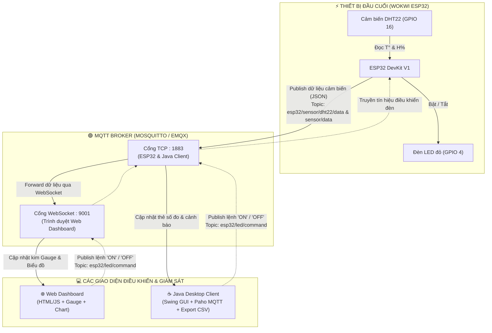

# ⚡ Hệ Thống Giám Sát IoT & Điều Khiển Thiết Bị Qua MQTT
### (Wokwi ESP32 — Mosquitto Broker — Web Gauge — Java Swing Desktop Client)

---

## 📖 1. Giới Thiệu Dự Án

Dự án được xây dựng dựa trên yêu cầu thực hành môn **Kỹ Thuật IoT (Trường Đại Học Sài Gòn - SGU)** và chuẩn hóa từ video demo thuyết trình thực tế trên lớp:
* **Mô phỏng phần cứng:** Vi điều khiển **ESP32** kết nối cảm biến nhiệt độ & độ ẩm **DHT22** và **đèn LED đỏ** (kèm điện trở 220Ω) trên nền tảng **Wokwi**.
* **Máy chủ điều phối trung tâm:** **Eclipse Mosquitto Broker** hỗ trợ đồng thời cả giao thức **TCP (port 1883)** và **WebSocket (port 9001)** có xác thực tài khoản.
* **Giao diện Web Dashboard:** HTML5 / CSS3 / JavaScript sử dụng Canvas vẽ **đồng hồ Gauge xoay**, biểu đồ đường biến thiên thời gian thực (**Chart.js**) và công tắc gạt bật/tắt đèn LED.
* **Ứng dụng Java Desktop Client:** Ứng dụng **Java Swing GUI** hiển thị thẻ số đo trực quan, cơ chế cảnh báo nhiệt độ cao (> 35°C), cụm nút điều khiển 2 chiều và tính năng **xuất báo cáo CSV** phục vụ nộp bài tập.

---

## 🏗️ 2. Sơ Đồ Kiến Trúc Hệ Thống (Khớp 100% Hình Vẽ Bảng Lớp)



---

## 📁 3. Cấu Trúc Thư Mục Dự Án

```text
d:\baitap1\IoT\
├── mosquitto/                      # Cấu hình Mosquitto Broker
│   ├── mosquitto.conf              # File config mở port 1883 TCP & 9001 WebSocket
│   ├── password.txt                # File mật khẩu xác thực (user1 / 123)
│   └── start_local_mosquitto.bat   # Script 1-click khởi chạy Mosquitto trên máy
│
├── wokwi/                          # Mạch mô phỏng & Firmware ESP32
│   ├── diagram.json                # Sơ đồ mạch linh kiện chuẩn Wokwi
│   ├── libraries.txt               # Danh sách thư viện nhúng cần thiết
│   └── sketch.ino                  # Code vi điều khiển ESP32 C++ (Pub/Sub)
│
├── web/                            # Giao diện Web Dashboard (HTML/CSS/JS)
│   ├── index.html                  # Giao diện chính (Gauge, Toggle LED, Chart, Logs)
│   ├── styles.css                  # Thiết kế giao diện Dark Modern Glassmorphism
│   └── app.js                      # MQTT WebSocket client & Canvas Gauge drawing
│
├── java-client/                    # Ứng dụng Desktop Java Swing Client
│   ├── lib/
│   │   └── org.eclipse.paho.client.mqttv3-1.2.5.jar  # Thư viện Eclipse Paho MQTT
│   ├── src/com/iot/
│   │   ├── App.java                # Điểm khởi chạy ứng dụng (Main class)
│   │   ├── MainFrame.java          # Cửa sổ giao diện đồ họa Swing & xử lý logic
│   │   └── MqttManager.java        # Lớp quản lý kết nối Paho MQTT
│   └── compile_and_run.bat         # Script biên dịch và chạy Java không cần Maven
│
├── shared/
│   └── mqtt_config.json            # File cấu hình trung tâm (Host, Port, Topics)
│
├── scripts/                        # Bộ script kiểm thử & giả lập
│   ├── mock_esp32_publisher.py     # Giả lập ESP32 gửi dữ liệu để test nhanh
│   ├── mock_led_subscriber.py      # Giả lập ESP32 nhận lệnh bật/tắt đèn
│   ├── test_broker_config.py       # Unit test cấu hình Broker
│   ├── test_firmware_syntax.py     # Unit test cú pháp firmware ESP32
│   ├── test_web_assets.py          # Unit test cấu trúc Web Dashboard
│   ├── test_java_compilation.py    # Unit test biên dịch mã nguồn Java
│   └── test_end_to_end.py          # Integration test luồng dữ liệu 2 chiều
│
└── README.md                       # Tài liệu hướng dẫn sử dụng toàn diện
```

---

## 🚀 4. Hướng Dẫn Vận Hành Hệ Thống

Hệ thống được thiết kế cực kỳ linh hoạt với **2 chế độ chạy**:

### 👉 Cách 1: Chạy Nhanh 100% Qua Public Broker (Khuyên dùng khi bắt đầu)
* **Không cần cài đặt Mosquitto trên máy tính.**
* Toàn bộ Wokwi, Web Dashboard và Java Client đều sử dụng chung máy chủ `broker.emqx.io`.
* **Bước 1:** Mở trang web [Wokwi.com](https://wokwi.com), tạo dự án ESP32 mới, dán nội dung `wokwi/diagram.json` vào tab **diagram.json** và `wokwi/sketch.ino` vào tab **sketch.ino**, sau đó bấm nút **Start Simulation (Play)**.
* **Bước 2:** Mở trực tiếp file `web/index.html` bằng trình duyệt (Chrome, Edge,...). Trên giao diện, bấm chọn nút **Public EMQX**, rồi bấm **Kết Nối**.
* **Bước 3:** Chạy file `java-client/compile_and_run.bat`. Trên cửa sổ Java hiện ra, bấm chọn nút **Public EMQX**, rồi bấm **Kết Nối**.
* **Kết quả:** Khi ESP32 chạy, số đo nhiệt độ/độ ẩm lập tức nhảy đồng thời trên cả Web và Java. Khi bấm nút BẬT/TẮT trên Web hoặc Java, đèn LED đỏ trên Wokwi sẽ phản hồi tức thì!

---

### 👉 Cách 2: Chạy Hoàn Toàn Local Bằng Mosquitto Trên Máy Tính
* **Áp dụng theo đúng chuẩn file tài liệu `2.TH.docx`.**
* **Bước 1 — Khởi động Mosquitto Broker:**
  * Chạy file `mosquitto/start_local_mosquitto.bat`.
  * Mosquitto sẽ mở đồng thời:
    * Cổng `1883` cho TCP.
    * Cổng `9001` cho WebSockets.
* **Bước 2 — Chạy mạch Wokwi:**
  * Trong file `wokwi/sketch.ino`, sửa `mqtt_server` thành địa chỉ IPv4 máy tính của bạn (vd: `192.168.1.10`).
  * Khởi động mô phỏng Wokwi.
* **Bước 3 — Mở Web Dashboard & Java Client:**
  * Mở `web/index.html`, để nguyên thông số mặc định `ws://localhost:9001`, bấm **Kết Nối**.
  * Chạy `java-client/compile_and_run.bat`, để nguyên `tcp://localhost:1883`, bấm **Kết Nối**.

---

## 🧪 5. Chạy Kiểm Thử Tự Động (Automated Testing Suite)

Dự án áp dụng quy trình kiểm thử nghiêm ngặt chuẩn TDD:

```bash
# 1. Kiểm tra cấu hình Mosquitto & MQTT
python scripts/test_broker_config.py

# 2. Kiểm tra sơ đồ mạch Wokwi & firmware ESP32
python scripts/test_firmware_syntax.py

# 3. Kiểm tra tài nguyên và giao diện Web Dashboard
python scripts/test_web_assets.py

# 4. Kiểm tra biên dịch mã nguồn Java Swing
python scripts/test_java_compilation.py

# 5. Kiểm tra tích hợp truyền nhận thông điệp 2 chiều End-to-End
python scripts/test_end_to_end.py
```

---

## 📊 6. Bảng Đối Chiếu Tính Năng Với Yêu Cầu Môn Học

| Thành Phần | Yêu Cầu Theo Tài Liệu & Video Lớp | Trạng Thái Trong Dự Án |
|---|---|---|
| **Mosquitto** | Mở cổng TCP 1883, WebSocket 9001, xác thực user/pass | ✅ Hoàn thành (`mosquitto.conf`, `password.txt`) |
| **Mạch Wokwi** | ESP32 + DHT22 (GPIO 16) + LED đỏ (GPIO 4) + Wi-Fi | ✅ Hoàn thành (`diagram.json`, `sketch.ino`) |
| **Topic Đo Đạc** | Publish JSON `{"temperature": xx, "humidity": yy}` | ✅ Hoàn thành (`esp32/sensor/dht22/data` & `sensor/data`) |
| **Topic Lệnh** | Subscribe nhận chuỗi `"ON"` hoặc `"OFF"` để bật tắt đèn | ✅ Hoàn thành (`esp32/led/command`) |
| **Web Dashboard** | Đồng hồ đo Gauge xoay + Nút Toggle điều khiển LED + Chart | ✅ Hoàn thành (`web/index.html`, `app.js`, `styles.css`) |
| **Java Client** | Giao diện Swing + Nhận số đo + Nút bấm LED + Xuất CSV | ✅ Hoàn thành (`java-client/`, `compile_and_run.bat`) |
| **Cảnh Báo** | Tự động cảnh báo màu đỏ khi nhiệt độ vượt ngưỡng > 35°C | ✅ Hoàn thành (Cả trên Web và Java) |

---
**Tác giả:** Nhóm Thực Hành Kỹ Thuật IoT — Đại Học Sài Gòn (SGU)
