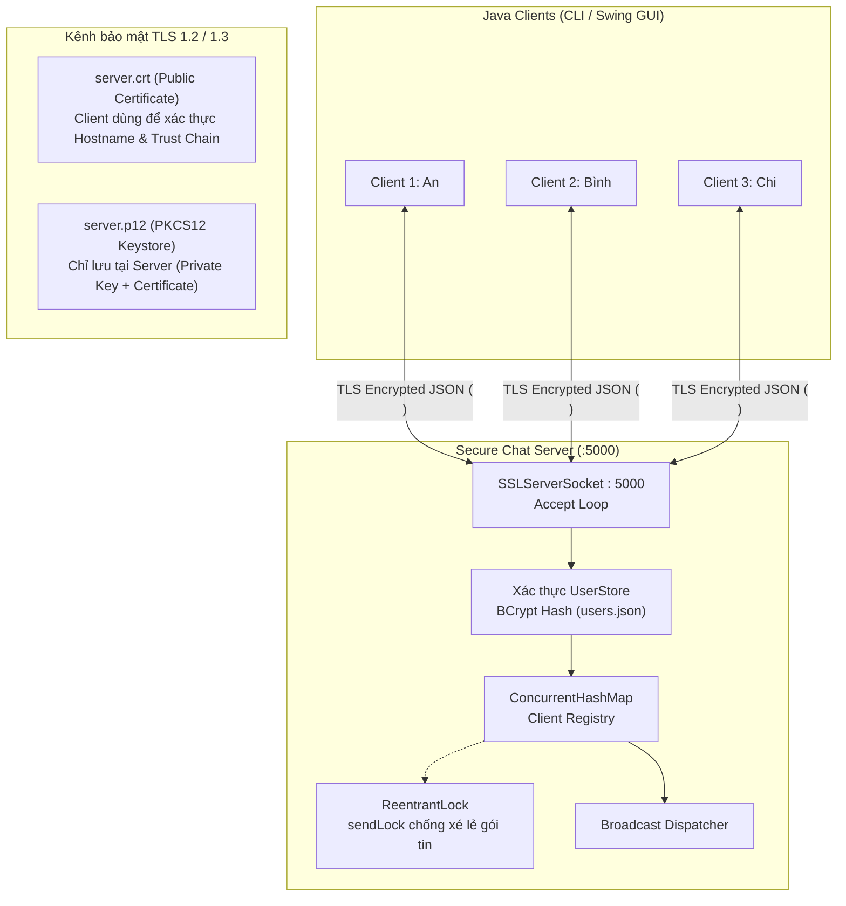

# Secure TCP Multi-Client Chat (Java TLS 1.3 / 1.2)

Hệ thống ứng dụng Chat TCP đa người dùng (Multi-Client) có bảo mật kênh truyền bằng **SSL/TLS (TLS 1.2 / TLS 1.3)**, xác thực mật khẩu băm **BCrypt**, cơ chế đồng bộ đa luồng **SendLock**, giao diện kép (**CLI** + **Java Swing GUI**), và bộ kiểm thử tự động 6 kịch bản an toàn bảo mật (đối chiếu chính xác **Slide 35** bài giảng Lập trình mạng - SGU).

---

## 1. Kiến trúc Hệ thống & Luồng hoạt động



### Các Đặc điểm Kỹ thuật Nổi bật:
1. **Bảo mật Kênh truyền TLS 1.3 / 1.2:** Mọi thông tin đăng nhập và nội dung chat đều đi qua luồng mã hóa của `SSLSocket`. Kênh truyền Plain TCP không mã hóa sẽ bị từ chối và đóng kết nối ngay lập tức.
2. **Quản lý Chứng chỉ Chuẩn hóa:** Keystore `server.p12` chứa Private Key tuyệt đối **chỉ nằm tại Server**. Client chỉ nắm giữ Public Certificate `server.crt` để thẩm tra tính hợp lệ của Server.
3. **Phân định Ranh giới Gói tin (Message Framing):** Giao thức TCP là dòng byte liên tục (byte stream). Hệ thống chuẩn hóa mỗi thông điệp là một chuỗi JSON hợp lệ kết thúc bằng ký tự xuống dòng `\n`. Giới hạn tối đa 4 KB/dòng chống tấn công làm tràn bộ nhớ (DoS).
4. **Xác thực Mật khẩu Băm BCrypt:** Không bao giờ lưu hay ghi log mật khẩu dạng rõ (plaintext). Mật khẩu được băm an toàn qua jBCrypt (cost factor 12).
5. **Cơ chế Chống Xung đột Đa luồng (SendLock):** Mỗi `ClientSession` sở hữu một `ReentrantLock` (`sendLock`). Khi Server broadcast tin nhắn đồng thời cho nhiều client, `sendLock` đảm bảo các byte không bị ghi đè xen kẽ làm hỏng cấu trúc khung tin JSON.
6. **Dọn dẹp Tài nguyên An toàn (Idempotent Cleanup):** Khi một client ngắt kết nối đột ngột hoặc gửi `DISCONNECT`, Server tự động bắt lỗi, giải phóng tài nguyên, gỡ bỏ client khỏi `ConcurrentHashMap`, và gửi broadcast `user_left` cho các client còn lại.

---

## 2. Cấu trúc Thư mục Dự án

```
TCP_secure/
├── pom.xml                                  # File cấu hình Maven tổng (Parent POM)
├── certificates/                            # Script tạo chứng chỉ TLS
│   ├── generate_certs.bat                   # Batch script sinh cert bằng keytool
│   └── generate_certs.ps1                   # PowerShell script sinh cert
├── lib/                                     # Thư viện phụ thuộc (.jar) độc lập
│   ├── model-1.0.0.jar                      # Thư viện mô hình thông điệp
│   ├── jackson-databind-2.15.2.jar          # Xử lý JSON
│   ├── jackson-core-2.15.2.jar
│   ├── jackson-annotations-2.15.2.jar
│   └── jbcrypt-0.4.jar                      # Băm mật khẩu an toàn
├── model/                                   # Mô-đun dùng chung (Shared Model)
│   ├── pom.xml
│   └── src/main/java/com/example/model/
│       ├── ChatMessage.java                 # Cấu trúc thông điệp JSON
│       └── MessageType.java                 # Enum loại thông điệp
├── server/                                  # Mô-đun Server
│   ├── pom.xml
│   ├── certificates/
│   │   ├── server.p12                       # PKCS12 Keystore (Private Key + Cert)
│   │   └── server.crt                       # Public Certificate
│   └── src/
│       ├── main/java/com/example/server/
│       │   ├── Program.java                 # Entry Point khởi chạy Server
│       │   ├── ChatServer.java              # Lắng nghe SSLServerSocket & Broadcast
│       │   ├── ClientSession.java           # Quản lý phiên và sendLock
│       │   ├── ClientHandler.java           # Luồng đọc JSON & kiểm soát bảo mật
│       │   └── UserStore.java               # Xác thực BCrypt & lưu trữ users.json
│       ├── main/resources/
│       │   └── users.json                   # Dữ liệu tài khoản đã băm BCrypt
│       └── test/java/com/example/server/
│           └── SecurityTestRunner.java      # Bộ test tự động 6 kịch bản bảo mật (Slide 35)
├── client/                                  # Mô-đun Client
│   ├── pom.xml
│   ├── certificates/
│   │   └── server.crt                       # Public Certificate tin cậy
│   └── src/main/java/com/example/client/
│       ├── Program.java                     # Entry Point khởi chạy Client (CLI / GUI)
│       ├── ChatClient.java                  # Quản lý kết nối SSLSocket & nhận ngầm
│       ├── ServerCertificateValidator.java  # Kiểm tra Hostname, SAN, Hạn dùng
│       ├── cli/
│       │   └── ConsoleChatClient.java       # Giao diện dòng lệnh Terminal
│       └── ui/
│           ├── LoginDialog.java             # Hộp thoại đăng nhập Swing (ẩn mật khẩu)
│           └── ChatWindow.java              # Cửa sổ phòng chat Swing đa chức năng
├── scripts/                                 # Các tập lệnh thực thi tiện ích
│   ├── compile_all.bat                      # Biên dịch toàn bộ dự án
│   ├── run_server.bat                       # Khởi động Chat Server (Port 5000)
│   ├── run_client_cli.bat                   # Khởi động Client giao diện CLI
│   ├── run_client_gui.bat                   # Khởi động Client giao diện đồ họa Swing
│   ├── run_3_clients_demo.bat               # 1-Click mở 1 Server + 3 Client mẫu
│   └── run_security_tests.bat               # Chạy bộ kiểm thử tự động TC01 -> TC06
└── README.md                                # Tài liệu hướng dẫn kỹ thuật
```

---

## 3. Hướng dẫn Khởi chạy & Sử dụng

### 3.1. Biên dịch toàn bộ dự án
Chạy lệnh sau tại thư mục gốc:
```cmd
scripts\compile_all.bat
```

### 3.2. Demo 1-Click: 1 Server + 3 Client (An, Bình, Chi)
Để quay video hoặc chụp ảnh báo cáo nộp bài nhanh chóng, hãy nhấp đúp hoặc chạy script:
```cmd
scripts\run_3_clients_demo.bat
```
Script sẽ tự động:
1. Mở cửa sổ **Server** lắng nghe trên cổng 5000.
2. Tự động mở 3 cửa sổ Client đăng nhập sẵn với 3 tài khoản mẫu:
   - Client 1: **An** (`pass123`)
   - Client 2: **Bình** (`pass456`)
   - Client 3: **Chi** (`pass789`)
3. Bạn có thể gõ tin nhắn ở bất kỳ cửa sổ nào, các client còn lại sẽ lập tức nhận được tin nhắn broadcast qua kênh truyền mã hóa TLS.

### 3.3. Khởi chạy thủ công từng thành phần
- **Khởi động Server:**
  ```cmd
  scripts\run_server.bat
  ```
- **Khởi động Client giao diện đồ họa (Swing GUI):**
  ```cmd
  scripts\run_client_gui.bat
  ```
- **Khởi động Client giao diện dòng lệnh (Console CLI):**
  ```cmd
  scripts\run_client_cli.bat
  ```

---

## 4. Kết quả Kiểm thử Bảo mật Đối chiếu (Slide 35)

Bộ kiểm thử tự động tại [`SecurityTestRunner.java`](server/src/test/java/com/example/server/SecurityTestRunner.java) được xây dựng để kiểm chứng độc lập và khách quan toàn bộ 6 kịch bản yêu cầu trong Slide 35.

Chạy kiểm thử bằng lệnh:
```cmd
scripts\run_security_tests.bat
```

### Bảng Kết quả Kiểm thử Thực tế:

| TC | Kịch bản kiểm thử | Hành động thực hiện | Kết quả mong đợi | Trạng thái thực tế |
| :---: | :--- | :--- | :--- | :---: |
| **TC01** | **Đăng nhập đúng** | Username/Password hợp lệ (`an:pass123`) | `LOGIN_SUCCESS`, cấp Client ID, vào phòng chat | **`[PASS]`** |
| **TC02** | **Sai mật khẩu** | Nhập Password không đúng (`an:wrongpass`) | `LOGIN_FAILED`, từ chối tạo Session, đóng kết nối | **`[PASS]`** |
| **TC03** | **Chứng chỉ sai tên** | TargetHost không khớp SAN (`untrusted.domain.vn`) | TLS Handshake thất bại, Client hủy kết nối | **`[PASS]`** |
| **TC04** | **Chứng chỉ không tin cậy** | Dùng TrustStore rỗng / Cert lạ không tin cậy | Client từ chối bắt tay TLS (`SSLHandshakeException`) | **`[PASS]`** |
| **TC05** | **Kết nối không TLS** | Gửi TCP rõ trực tiếp tới cổng TLS 5000 | Server không hoàn tất TLS; đóng kết nối ngay | **`[PASS]`** |
| **TC06** | **Client ngắt bất thường** | Tắt kết nối Socket đột ngột | Server dọn dẹp Client lỗi; Client khác vẫn hoạt động | **`[PASS]`** |

> **TỔNG KẾT:** **6/6 TEST CASES ĐẠT [PASS] (100%)**

---

## 5. Tài khoản Đăng nhập Thử nghiệm

Dữ liệu tài khoản được lưu trữ tại [`server/src/main/resources/users.json`](server/src/main/resources/users.json) dưới dạng mật khẩu băm BCrypt:

| Username | Mật khẩu (Dạng rõ) | Mã băm BCrypt trong users.json | Vai trò |
| :--- | :--- | :--- | :--- |
| **`an`** | `pass123` | `$2a$12$8n4tgVMkioq9arfEPHVyv.hmo2PJSAAtWrTgUS83Hp7Nr6iz1NckS` | Client 1 |
| **`binh`** | `pass456` | `$2a$12$hJvlkHcFkFQNnHDEMBZSquG5kexDa3MxM7eLmGC/hmqYmOD8VUmPu` | Client 2 |
| **`chi`** | `pass789` | `$2a$12$/I42tsNHmcbpjDdCIwh4iu9xSs7V5UyfaS.S/rTgi15O/62SvtX96` | Client 3 |
