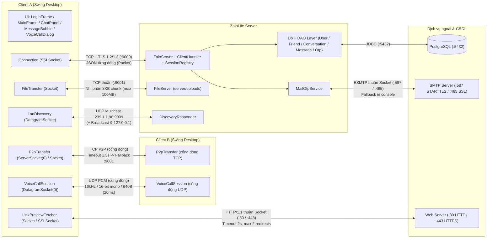
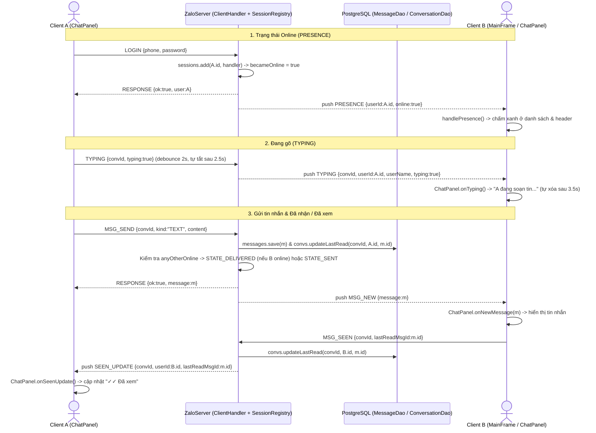
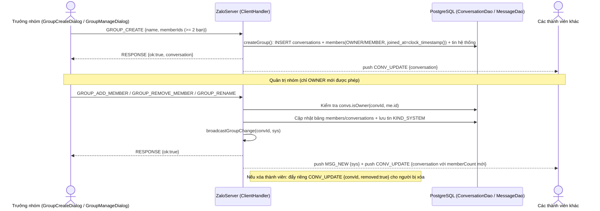
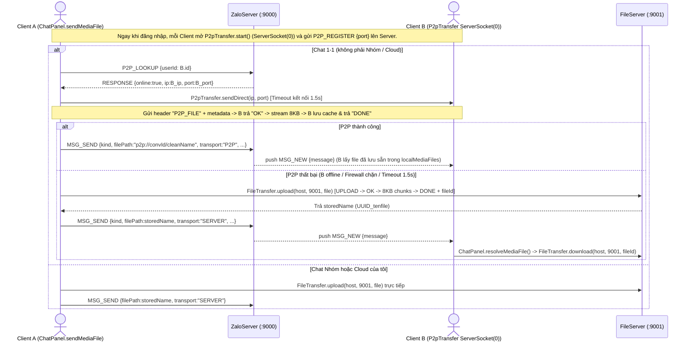
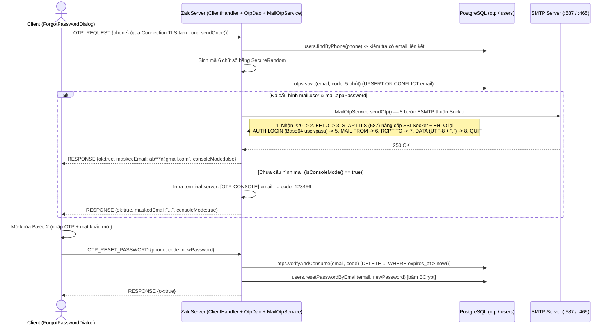

# Sổ Tay Kiến Trúc & Vấn Đáp Hệ Thống — ZaloLite

> **Mục tiêu tài liệu:** Giúp nắm trọn kiến trúc mạng, giao thức, vị trí hàm Gửi/Nhận và câu trả lời vấn đáp của đồ án **ZaloLite** (Java 17, Swing + FlatLaf, Socket thuần + TLS + UDP + PostgreSQL JDBC).
>
> **Mẹo tra cứu nhanh trong IDE khi bảo vệ:** Nhấn `Ctrl+Shift+F` (tìm toàn project) với 4 thẻ đánh dấu chuẩn có sẵn trong mã nguồn:
> - `[GỬI]` — nơi Client hoặc Server đóng gói & gửi dữ liệu ra mạng
> - `[NHẬN]` — nơi đọc dữ liệu từ socket, phân loại gói tin hoặc nhận sự kiện đẩy (push)
> - `[CỔNG/GIAO THỨC]` — nơi khởi tạo `SSLServerSocket`, `ServerSocket`, `MulticastSocket`, `DatagramSocket`, `Socket`
> - `[CSDL]` — nơi thao tác PostgreSQL qua JDBC (`Db`, `*Dao`)

---

## 1. Tổng quan & Sơ đồ kiến trúc tổng thể

ZaloLite được thiết kế theo mô hình **Client–Server kết hợp P2P trực tiếp**, phân tách rõ **kênh điều khiển (Control Plane)** và **kênh dữ liệu nặng / thời gian thực (Data & Media Plane)**:



### Danh mục đầy đủ các cổng & giao thức

| Thành phần | Giao thức & Cổng | Vai trò chính | Cặp lớp xử lý (Server ↔ Client) |
| :--- | :--- | :--- | :--- |
| **Kênh Chat & Báo hiệu** | `TCP + TLS 1.2/1.3 (:9000)` | Auth, Hồ sơ, Bạn bè/Chặn, Hội thoại, Nhóm, Tin nhắn, Trạng thái (Online/Typing/Seen), Đăng ký P2P, Báo hiệu gọi thoại (`CALL_*`). Gói tin JSON 1 dòng (`\n`), tối đa `64KB/dòng`. | `ZaloServer` / `ClientHandler` ↔ `Connection` |
| **Kênh Truyền Tệp** | `TCP thuần (:9001)` | Upload/Download Ảnh, File, Video, Tin nhắn thoại (`.wav`) theo luồng nhị phân `8KB` chunk (`DataInputStream`/`DataOutputStream`), giới hạn `100MB`, chống Path Traversal. | `FileServer` ↔ `FileTransfer` |
| **Truyền Tệp P2P** | `TCP P2P (cổng động ServerSocket(0))` | Truyền file trực tiếp Client ↔ Client trong LAN (header `"P2P_FILE"`), timeout kết nối `1.5s` (`CONNECT_TIMEOUT_MS = 1500`), lỗi/offline tự động fallback sang `:9001`. | `P2pTransfer` ↔ `P2pTransfer` (tra IP:port qua `SessionRegistry`) |
| **Tự động tìm Server LAN** | `UDP Multicast (239.1.1.90:9009)` | Client gửi probe `"ZALOLITE_DISCOVER"` (đồng thời tới Multicast, Broadcast `255.255.255.255` và `127.0.0.1`), Server trả `"ZALOLITE_SERVER:<tcpPort>:<filePort>"`. | `DiscoveryResponder` ↔ `LanDiscovery` |
| **Gọi thoại 1-1 Realtime** | `UDP PCM (cổng động DatagramSocket(0))` | Truyền giọng nói trực tiếp hai chiều không qua server, định dạng PCM `16000Hz`, `16-bit`, `mono`, signed little-endian, mỗi frame `20ms = 640 bytes`. | `VoiceCallSession` ↔ `VoiceCallSession` |
| **Gửi OTP Quên mật khẩu** | `ESMTP thuần Socket (:587 STARTTLS / :465 SSL)` | Tự nói chuyện giao thức SMTP 8 bước (`EHLO`, `STARTTLS`, `AUTH LOGIN`, `MAIL FROM`, `RCPT TO`, `DATA`, `QUIT`) không dùng JavaMail; tự chuyển chế độ in console `[OTP-CONSOLE]` khi chưa cấu hình mail. | `MailOtpService` ↔ SMTP Server |
| **Xem trước đường link** | `HTTP/1.1 thuần Socket (:80 / :443 SSL)` | Tự gửi request `GET ... HTTP/1.1`, theo tối đa `2` redirect, đọc tối đa `64KB` đầu để tách thẻ `<title>`, timeout `2s`, chặn SSRF (loopback/site-local). | `LinkPreviewFetcher` ↔ Web Server |
| **Lưu trữ bền vững** | `PostgreSQL JDBC (:5432)` | Lưu trữ 7 bảng (`users`, `friendships`, `conversations`, `members`, `messages`, `reactions`, `otp`), tự tạo DB & chạy `schema.sql` khi khởi động. | `Db`, `UserDao`, `FriendDao`, `ConversationDao`, `MessageDao`, `OtpDao` |

---

## 2. Bảng đối chiếu: Chức năng Zalo ↔ Giao thức / Cổng ↔ Kiến thức Lập trình mạng

| Nhóm chức năng ZaloLite | Giao thức / Cổng sử dụng | Tái dùng từ mô hình / bài học Lập trình mạng |
| :--- | :--- | :--- |
| **Đăng ký / Đăng nhập / Hồ sơ / Đổi mật khẩu** | `TCP + TLS 1.2/1.3 (:9000)` + `PostgreSQL JDBC (:5432)` | Mô hình **Client–Server đa luồng** (`SSLServerSocket` + `ExecutorService`), xác thực bằng `BCrypt`, chứng chỉ PKCS12 (`server.p12` / `truststore.p12`). |
| **Bạn bè & Chặn** (Tìm SĐT/tên, Kết bạn, Chấp nhận/Từ chối, Huỷ, Chặn/Bỏ chặn) | `TCP + TLS (:9000)` (Request/Response + Push `FRIEND_EVENT`) | Mô hình **Request–Response kết hợp Server Push** (quản lý phiên online qua `ConcurrentHashMap` trong `SessionRegistry`). |
| **Chat 1-1 / Chat nhóm / Cloud của tôi** | `TCP + TLS (:9000)` + `PostgreSQL (:5432)` | **Multi-room Chat Server** đa luồng: định tuyến tin nhắn theo danh sách thành viên (`members`), đồng bộ nhiều thiết bị của cùng 1 user. |
| **Reply / Forward / React / Recall / Emoji / Tìm kiếm / Phân trang** | `TCP + TLS (:9000)` (JSON `Packet`) | **Application-layer Framing** (JSON line-delimited protocol), khóa `reqId` ghép cặp Request–Response bằng `CompletableFuture`. |
| **Trạng thái Online / Đang gõ / Đã nhận / Đã xem** | `TCP + TLS (:9000)` (`PRESENCE`, `TYPING`, `MSG_SEEN`, `SEEN_UPDATE`, `MSG_DELIVERED`) | **Presence & Event Broadcast** (quản lý trạng thái phiên kết nối thời gian thực, đẩy sự kiện không đồng bộ). |
| **Gửi Ảnh / File / Video / Tin nhắn thoại (`.wav`)** | `TCP thuần (:9001)` (`8KB` chunk) + metadata qua `:9000` | **FTP-style Dual-Channel Architecture**: tách riêng kênh điều khiển (`:9000`) và kênh truyền nhị phân (`:9001`) để không nghẽn chat. |
| **Truyền file P2P trực tiếp** | `TCP P2P (ServerSocket(0))` + tra cứu qua `:9000` + fallback `:9001` | **Hybrid P2P (kiểu Napster / LAN Direct Transfer)**: Server giữ danh bạ `IP:port`, hai Client truyền thẳng dữ liệu nhị phân, có cơ chế Fallback. |
| **Gọi thoại 1-1 realtime** | Báo hiệu `TCP + TLS (:9000)` + Âm thanh `UDP PCM (DatagramSocket(0))` | **VoIP Signaling + Media Separation (kiểu SIP + RTP rút gọn)**: dùng TCP tin cậy để đổ chuông/trao đổi `IP:udpPort`, dùng UDP tốc độ cao để truyền PCM audio. |
| **Quên mật khẩu bằng OTP** | `TCP + TLS (:9000)` + `ESMTP thuần Socket (:587 / :465)` | **SMTP Client từ Socket thô** (RFC 5321/3207): tự nâng cấp TCP thường lên `SSLSocket` bằng lệnh `STARTTLS`, mã hóa Base64 cho `AUTH LOGIN`. |
| **Tự động tìm Server trong LAN** | `UDP Multicast (239.1.1.90:9009)` + Broadcast | **Service Discovery qua UDP Multicast/Broadcast** (`MulticastSocket.joinGroup`, gửi probe nhận phản hồi unicast kèm cổng). |
| **Xem trước đường link (Link Preview)** | `HTTP/1.1 thuần Socket (:80 / :443 SSL)` | **HTTP Client viết từ Socket thô**: tự dựng header `GET /path HTTP/1.1`, đọc status line, xử lý redirect `301/302/307/308`, parse HTML `<title>`. |

---

## 3. Bảng tra nhanh khi thầy hỏi "Gửi chỗ nào? Nhận chỗ nào?"

| Chức năng / Câu hỏi của thầy | Phía Client gửi ở đâu (`File` + `Hàm`) | Phía Server nhận & xử lý ở đâu (`File` + `Hàm`) | Phía Client nhận kết quả / Push ở đâu (`File` + `Hàm`) |
| :--- | :--- | :--- | :--- |
| **Tầng gửi/nhận lõi TLS (:9000)** | `Connection.java` → `request()`, `send()` | `ZaloServer.java` → `start()` accept;<br>`ClientHandler.java` → `run()`, `handle()`, `send()` | `Connection.java` → `readLoop()` (tách `RESPONSE` theo `reqId` vs Push gửi tới `listeners`) |
| **Tìm Server LAN tự động** | `LoginFrame.java` → `discoverLan()`;<br>`LanDiscovery.java` → `discover()`, `sendProbe()` | `DiscoveryResponder.java` → `listenLoop()` (nhận `"ZALOLITE_DISCOVER"`, gửi `"ZALOLITE_SERVER:..."`) | `LanDiscovery.java` → `discover()`, `parseReply()` |
| **Đăng ký / Đăng nhập / Đăng xuất** | `RegisterDialog.java` (nút `ok` → `REGISTER`);<br>`LoginFrame.java` → `doLogin()` (`LOGIN`);<br>`MainFrame.java` → `doLogout()` (`LOGOUT`) | `ClientHandler.java` → `register()`, `login()`, `logout()` + `UserDao` | `LoginFrame.java` → mở `MainFrame`;<br>`MainFrame.java` → `onPush()` → `handlePresence()` |
| **Cập nhật hồ sơ / Đổi mật khẩu** | `ProfileDialog.java` (`PROFILE_UPDATE`, `PASSWORD_CHANGE`) | `ClientHandler.java` → `profileUpdate()`, `passwordChange()` + `UserDao` | `ProfileDialog.java` callback `onUpdated` → cập nhật `MainFrame` |
| **Quên mật khẩu OTP (ESMTP)** | `ForgotPasswordDialog.java` → `sendOnce()` (`OTP_REQUEST`, `OTP_RESET_PASSWORD`) | `ClientHandler.java` → `otpRequest()`, `otpResetPassword()`;<br>`OtpDao.java` → `save()`, `verifyAndConsume()`;<br>`MailOtpService.java` → `sendOtp()` | `ForgotPasswordDialog.java` → mở khóa Bước 2 / báo thành công |
| **Tìm bạn / Kết bạn / Chấp nhận / Huỷ / Chặn** | `FriendPanel.java` → `doSearch()`, `buildSearchRow()`, `handleInvite()`, `showFriendMenu()`, `renderBlocked()` | `ClientHandler.java` → `userSearch()`, `friendList()`, `friendRequest()`, `friendAccept()`, `friendReject()`, `friendRemove()`, `userBlock()`, `userUnblock()`, `blockList()` + `FriendDao` | `MainFrame.java` → `onPush()` → `handleFriendEvent()` → `friendPanel.refresh()` + toast |
| **Danh sách hội thoại / Mở chat 1-1 / Ghim** | `MainFrame.java` → `loadConversations()`, `togglePin()`;<br>`FriendPanel.java` → `openDirectChat()` | `ClientHandler.java` → `convList()`, `convOpenDirect()`, `convPin()` + `ConversationDao` | `MainFrame.java` → `renderConversations()`, `openConversation()`, `handleConvUpdate()` |
| **Tạo nhóm / Quản lý thành viên / Đổi tên / Rời nhóm** | `GroupCreateDialog.java` → `doCreate()`;<br>`GroupManageDialog.java` → `loadMembers()`, `doRename()`, `doAddMember()`, `doRemoveMember()`, `doLeave()` | `ClientHandler.java` → `groupCreate()`, `groupMembers()`, `groupAddMember()`, `groupRemoveMember()`, `groupLeave()`, `groupRename()`, `broadcastGroupChange()` + `ConversationDao` | `MainFrame.java` → `handleConvUpdate()`, `handleMsgNew()`;<br>`ChatPanel.java` → `updateConversation()` |
| **Gửi tin nhắn chữ / Reply / Forward** | `ChatPanel.java` → `sendMessage()`, `forwardMessage()` (`MSG_SEND`) | `ClientHandler.java` → `msgSend()` + `MessageDao.save()` + đẩy `MSG_NEW` | Người gửi: `ChatPanel.java` → `appendMessageToView()`;<br>Người nhận: `MainFrame.java` → `handleMsgNew()` → `ChatPanel.onNewMessage()` |
| **Tải lịch sử / Phân trang / Tìm tin nhắn** | `ChatPanel.java` → `loadInitialHistory()`, `loadOlderHistory()` (`MSG_HISTORY`), `runSearch()` (`MSG_SEARCH`) | `ClientHandler.java` → `msgHistory()`, `msgSearch()` + `MessageDao.history()`, `search()` | `ChatPanel.java` → `rebuildMessageList()`, `scrollToMessage()` |
| **Thu hồi / Thả cảm xúc (Reaction)** | `ChatPanel.java` → `sendRecall()` (`MSG_RECALL`), `sendReact()` (`MSG_REACT`) | `ClientHandler.java` → `msgRecall()`, `msgReact()` + `MessageDao` + đẩy `MSG_RECALLED` / `MSG_REACTED` | `MainFrame.java` → `onPush()` → `ChatPanel.onMessageRecalled()`, `onMessageReacted()` → `MessageBubble` |
| **Online / Đang gõ / Đã xem** | `ChatPanel.java` → `sendTypingState()` (`TYPING`), `sendSeen()` (`MSG_SEEN`) | `ClientHandler.java` → `notifyPresence()` (`PRESENCE`), `typing()` (`TYPING`), `msgSeen()` (`SEEN_UPDATE`) | `MainFrame.java` → `handlePresence()`, `onPush()` → `ChatPanel.onTyping()`, `onSeenUpdate()`, `onDelivered()` |
| **Gửi Ảnh / File / Video / Thoại (P2P → Server)** | `MainFrame.java` → `startP2pListener()` (`P2P_REGISTER`);<br>`ChatPanel.java` → `sendMediaFile()` (`P2P_LOOKUP` → `P2pTransfer.sendDirect()` hoặc `FileTransfer.upload()` → `MSG_SEND`) | `ClientHandler.java` → `p2pRegister()`, `p2pLookup()`, `msgSend()`;<br>`FileServer.java` → `handleUpload()`, `handleDownload()` | P2P: `P2pTransfer.handleIncoming()` → `MainFrame.onP2pFileReceived()`;<br>Server: `ChatPanel.resolveMediaFile()` → `FileTransfer.download()` |
| **Gọi thoại 1-1 realtime (TLS + UDP)** | `MainFrame.java` → `startOutgoingCall()` (`CALL_OFFER`), `handleCallOffer()` (`CALL_ANSWER`/`CALL_REJECT`), `endActiveCall()` (`CALL_END`);<br>`VoiceCallSession.java` → `runCaptureLoop()` | `ClientHandler.java` → `callOffer()`, `callAnswer()`, `callReject()`, `callEnd()` (tự lấy IP từ socket) | `MainFrame.java` → `handleCallOffer()`, `handleCallAnswer()`, `onPush()` (`CALL_REJECT`/`CALL_END`);<br>`VoiceCallSession.java` → `runReceiveLoop()` |
| **Link Preview (HTTP/1.1 thuần)** | `MessageBubble.java` → `attachLinkPreviewAsync()`;<br>`LinkPreviewFetcher.java` → `extractFirstUrl()`, `fetch()`, `openSocket()` | *(Client kết nối thẳng Web Server `:80/:443`, không qua ZaloServer)* | `LinkPreviewFetcher.java` → `extractTitle()` trả `Preview` → `MessageBubble` vẽ thẻ link |

---

## 4. Luồng hoạt động chi tiết của 6 kịch bản hay bị hỏi nhất

### Kịch bản 1: Chat 1-1 & Trạng thái (Online, Đang gõ, Đã nhận / Đã xem)



- **Điểm cần nhớ khi vấn đáp:**
  - `SessionRegistry` dùng `Map<Long, Set<ClientHandler>>` nên 1 user đăng nhập nhiều máy vẫn nhận đủ sự kiện; chỉ khi đóng **kết nối cuối cùng** (`set.isEmpty()`) thì `remove()` mới trả `true` để phát `PRESENCE online=false`.
  - Khi gửi `TYPING` và `MSG_SEEN`, Client dùng `conn.send(...)` (fire-and-forget, không cần chờ `RESPONSE` block UI).

---

### Kịch bản 2: Chat nhóm (Phân quyền trưởng nhóm, `joined_at`, `memberCount`)



- **3 cơ chế quan trọng trong DB (`ConversationDao` & `MessageDao`):**
  1. **Phân quyền ở Server (`isOwner`)**: Không chỉ ẩn nút trên UI (`GroupManageDialog`), Server luôn kiểm tra `convs.isOwner(convId, me.id)` trước khi cho phép thêm/xóa thành viên hoặc đổi tên nhóm.
  2. **Ẩn tin nhắn cũ bằng `joined_at`**: Mỗi dòng trong bảng `members` lưu `joined_at = clock_timestamp()`. Khi truy vấn lịch sử (`MessageDao.history()`), tìm kiếm (`MessageDao.search()`), hay đếm tin chưa đọc (`CONV_SELECT`), SQL luôn lọc `m.created_at >= vm.joined_at` → thành viên mới vào **không xem được tin nhắn trước lúc gia nhập**.
  3. **Cập nhật `memberCount` & Chuyển quyền tự động**: `CONV_SELECT` tính `member_count = (SELECT COUNT(*) FROM members ...)` và đẩy `CONV_UPDATE` để header cập nhật ngay `"X thành viên"`. Nếu **Trưởng nhóm rời nhóm** (`ConversationDao.leaveGroup()`), trong cùng transaction SQL, Server chọn người vào sớm nhất (`ORDER BY joined_at ASC, user_id ASC LIMIT 1`) lên làm `OWNER` mới; nếu không còn ai thì xóa luôn hội thoại nhóm.

---

### Kịch bản 3: Gửi Ảnh / File / Video / Thoại (Ưu tiên P2P trực tiếp → Fallback `FileServer :9001`)



- **Chi tiết kỹ thuật cần nắm:**
  - Nếu chuyển tiếp (`forwardMessage`) một tin nhắn gốc được gửi qua `p2p://`, Client tự động upload bản file cục bộ lên `FileServer :9001` trước khi gửi `MSG_SEND` sang hội thoại đích để người nhận mới tải được.
  - Tin nhắn thoại (`AudioHelper`) ghi âm PCM `16kHz / 16-bit / mono` tối đa `60s`, đóng gói thành file `.wav` tạm rồi gửi theo đúng luồng media ở trên.

---

### Kịch bản 4: Gọi thoại 1-1 Realtime (Báo hiệu TLS `:9000` + Âm thanh UDP PCM)

```mermaid
sequenceDiagram
    actor A as Client A (Người gọi)
    participant S as ZaloServer (:9000 TLS)
    actor B as Client B (Người nghe)

    A->>A: Tạo VoiceCallSession() -> mở DatagramSocket(0) lấy udpPort_A
    A->>S: CALL_OFFER {targetId:B.id, udpPort:udpPort_A}
    S->>S: Kiểm tra chặn (isBlockedEitherWay) & B đang online; lấy callerIp từ socket
    S-->>B: push CALL_OFFER {callerId:A.id, callerName, callerIp, udpPort:udpPort_A}
    S-->>A: RESPONSE {ok:true}
    B->>B: Mở VoiceCallDialog.incoming() (nếu đang bận tự gửi CALL_REJECT)

    alt B bấm "Nghe máy"
        B->>B: Tạo VoiceCallSession() -> mở DatagramSocket(0) lấy udpPort_B
        B->>B: startAudio(callerIp, udpPort_A) (bật 2 luồng voice-capture & voice-receive)
        B->>S: CALL_ANSWER {callerId:A.id, udpPort:udpPort_B}
        S->>S: Lấy calleeIp từ socket
        S-->>A: push CALL_ANSWER {calleeId:B.id, calleeIp, udpPort:udpPort_B}
        A->>A: startAudio(calleeIp, udpPort_B) -> chuyển VoiceCallDialog sang "Đang trong cuộc gọi"
        A<<->>B: Luồng UDP PCM trực tiếp (16kHz, 16-bit, mono, 640 bytes / 20ms)
        Note over A,B: Nút Tắt mic chỉ chặn gửi packet ở runCaptureLoop(), vẫn nghe bình thường
    else B bấm "Từ chối"
        B->>S: CALL_REJECT {callerId:A.id, reason}
        S-->>A: push CALL_REJECT -> đóng dialog & socket UDP
    end

    A->>S: CALL_END {peerId:B.id} (khi 1 bên cúp máy)
    S-->>B: push CALL_END -> endActiveCall() đóng VoiceCallSession & VoiceCallDialog
```

- **Tính chịu lỗi khi demo trên máy không có micro/loa:** Trong `VoiceCallSession.runCaptureLoop()` và `runReceiveLoop()`, nếu máy không có micro hoặc loa (`LineUnavailableException`), phiên gọi không bị crash mà tự chuyển sang chế độ chỉ nghe / chỉ gửi.

---

### Kịch bản 5: Quên mật khẩu bằng OTP (ESMTP 8 bước thuần Socket + Console Fallback)



- **Lưu ý bảo mật:**
  - `OtpDao.verifyAndConsume()` dùng câu lệnh `DELETE ... WHERE email = ? AND code = ? AND expires_at > now()` nguyên tử (atomic) nên mỗi mã OTP **chỉ dùng được đúng 1 lần** và tự vô hiệu sau 5 phút.
  - `MailOtpService.sendOtp()` kiểm tra `toEmail` không chứa `\r` hoặc `\n` để chống **SMTP Header Injection**.

---

### Kịch bản 6: Xem trước đường link — Link Preview (HTTP/1.1 thuần `Socket` / `SSLSocket`)

1. Khi vẽ bong bóng tin nhắn chữ (`MessageBubble.renderBubbleBody()`), Client gọi `LinkPreviewFetcher.extractFirstUrl(msg.content)` bằng regex `https?://[^\s<>"]+` (và cắt bỏ dấu câu thừa ở cuối như `.`, `,`, `)`).
2. Nếu có URL, `MessageBubble.attachLinkPreviewAsync()` chạy ngầm trên luồng nền (`Theme.runAsync`) để **không làm đơ giao diện Swing**, gọi `LinkPreviewFetcher.fetch(url)`.
3. Trong `LinkPreviewFetcher.fetch()`:
   - Chỉ chấp nhận scheme `http` (mặc định cổng `80`) hoặc `https` (mặc định cổng `443`).
   - Phân giải DNS qua `resolveAllowedAddress()` và **chặn mọi địa chỉ nội bộ / SSRF** (`isLoopbackAddress`, `isSiteLocalAddress`, `isLinkLocalAddress`, `isAnyLocalAddress`, `isMulticastAddress`).
   - Mở `Socket` thường với `TIMEOUT_MS = 2000ms`; nếu là `https` thì bọc tiếp bằng `SSLSocketFactory.getDefault().createSocket(...)` và gọi `startHandshake()`.
   - Gửi trực tiếp chuỗi HTTP/1.1:
     ```http
     GET /path HTTP/1.1
     Host: example.com
     User-Agent: ZaloLite/1.0
     Accept: text/html
     Connection: close
     ```
   - Đọc status line và các header: nếu gặp mã chuyển hướng `301/302/303/307/308` có header `Location`, tự nối URL tương đối (`uri.resolve(location)`) và đi tiếp tối đa `MAX_REDIRECTS = 2` lần.
   - Nếu mã trạng thái `2xx`, chỉ đọc tối đa `MAX_BODY_BYTES = 64KB` đầu tiên, dùng regex `<title[^>]*>(.*?)</title>` giải mã các HTML entity cơ bản (`&amp;`, `&quot;`, `&#39;`, `&lt;`, `&gt;`, `&nbsp;`) để lấy tiêu đề.
4. Trả `Preview(url, host, title)` về EDT để gắn thêm thẻ bấm-mở-trình-duyệt (`Desktop.getDesktop().browse(...)`) vào ngay dưới nội dung tin nhắn.

---

## 5. Bộ câu hỏi Q&A vấn đáp mẫu với thầy (10 câu hay gặp)

### Câu 1: Tại sao Chat dùng TCP (+ TLS) còn Gọi thoại 1-1 lại dùng UDP?
> **Trả lời:** Tin nhắn chat cần **độ tin cậy tuyệt đối** (đủ byte, đúng thứ tự, không mất chữ) và cần mã hóa nên em dùng **TCP + TLS 1.2/1.3** ở cổng `:9000`. Ngược lại, gọi thoại realtime cần **độ trễ cực thấp**: nếu 1 gói âm thanh `20ms` (`640 bytes`) bị rớt trên mạng, việc chờ TCP phát lại (retransmission) sẽ gây khựng/trễ tiếng rất khó chịu; bỏ qua gói lỗi và phát tiếp gói kế tiếp bằng **UDP** (`VoiceCallSession`) sẽ giữ hội thoại mượt mà theo thời gian thực.

### Câu 2: Tại sao phải tách riêng cổng File (`:9001`) ra khỏi cổng Chat (`:9000`)?
> **Trả lời:** Để tránh hiện tượng **nghẽn đầu hàng (Head-of-Line Blocking)** và tránh quá tải bộ nhớ. Cổng `:9000` chuyên truyền gói JSON nhỏ (`MAX_LINE = 64KB`) cần phản hồi tức thì (chat, typing, seen, báo hiệu cuộc gọi). Nếu gửi file `100MB` nhúng Base64 vào JSON trên cổng `:9000` thì dung lượng tăng ~33%, tốn RAM parse JSON và làm tắc toàn bộ tin nhắn đang gửi cùng kết nối. Tách sang `FileServer :9001` cho phép truyền luồng nhị phân thuần theo từng mảnh `8KB` độc lập song song với chat.

### Câu 3: Tại sao Server tự lấy IP từ `socket.getInetAddress().getHostAddress()` khi đăng ký P2P và gọi thoại, thay vì tin IP do Client tự gửi lên?
> **Trả lời:** Vì hai lý do: **chống giả mạo** và **đúng thực tế mạng**. Một máy Client có thể có nhiều card mạng (Wi-Fi, LAN, VirtualBox, WSL, loopback `127.0.0.1`) nên IP mà Client tự khai báo rất dễ sai hoặc bị giả mạo để tấn công chuyển hướng. Khi Server lấy trực tiếp từ `socket.getInetAddress().getHostAddress()` trên kết nối TLS đang hoạt động (`ClientHandler.p2pRegister`, `callOffer`, `callAnswer`), đó chính xác là địa chỉ IP mà mạng định tuyến tới được Client đó.

### Câu 4: Làm sao chống lỗ hổng Path Traversal (`../../...`) khi Upload/Download file và nhận file P2P?
> **Trả lời:** Em bảo vệ theo **3 lớp** ở cả `FileServer` và `P2pTransfer`:
> 1. Kiểm tra chuỗi đầu vào (`isUnsafeToken` trong `FileServer`): từ chối ngay nếu chứa `..`, `/`, `\`, hoặc ký tự null `\0`.
> 2. Làm sạch tên file (`sanitizeName` / `sanitizeFileName`): chỉ giữ `[a-zA-Z0-9._-]`, cắt tối đa 120 ký tự, và gắn tiền tố `UUID.randomUUID()` để tránh trùng/ghi đè.
> 3. Chuẩn hóa đường dẫn thực tế: `target = storageDir.resolve(storedName).normalize()` và bắt buộc kiểm tra `target.startsWith(storageDir)` trước khi mở luồng đọc/ghi; nếu nằm ngoài thư mục lưu trữ thì trả lỗi `ERR` ngay.

### Câu 5: Client vừa gửi request vừa nhận tin nhắn đẩy (push) đồng thời thì xử lý đa luồng thế nào để không đụng độ và không treo giao diện Swing?
> **Trả lời:**
> - **Phía Client (`Connection.java`)**: Có 1 luồng nền `server-reader` đọc liên tục từ `SSLSocket`. Mỗi request gửi đi được gán `reqId` tăng dần (`AtomicLong`) và lưu một `CompletableFuture<Packet>` vào `ConcurrentHashMap pending`. Khi gói về có `reqId` khớp, luồng đọc `complete()` future đó; nếu không có `reqId` (gói push như `MSG_NEW`, `TYPING`), luồng đọc đẩy sang **Swing EDT** bằng `SwingUtilities.invokeLater(...)` để vẽ UI an toàn.
> - **Ghi dữ liệu không bị trộn dòng**: Cả `Connection.send()` ở Client và `ClientHandler.send()` ở Server đều được đánh dấu `synchronized` để nhiều luồng cùng ghi JSON không bị đan xen ký tự vào nhau.
> - **Không treo UI**: Mọi thao tác mạng từ nút bấm đều chạy qua `Theme.runAsync(...)` (background thread), chỉ cập nhật giao diện trong callback EDT.

### Câu 6: Nếu Firewall hoặc NAT chặn kết nối P2P trực tiếp giữa 2 máy thì sao?
> **Trả lời:** Hệ thống tự động chuyển dự phòng (**Graceful Fallback**) mà người dùng không cần thao tác lại. Trong `ChatPanel.sendMediaFile()`, Client A gọi `P2pTransfer.sendDirect()` với `CONNECT_TIMEOUT_MS = 1500ms`. Nếu đối phương offline, sai mạng, hoặc Windows Firewall chặn cổng động, ngoại lệ được bắt lại và hàm tự động chuyển sang gọi `FileTransfer.upload()` lên `FileServer :9001`, gắn nhãn `[Server]` thay vì `[P2P ⚡]`.

### Câu 7: Nếu lúc bảo vệ không có Internet hoặc không cấu hình Gmail App Password thì chức năng Quên mật khẩu OTP có chạy được không?
> **Trả lời:** Vẫn demo trọn vẹn được. `MailOtpService` tự kiểm tra `isConsoleMode()` (khi `mail.user` hoặc `mail.appPassword` trong `server.properties` để trống). Lúc đó thay vì mở socket SMTP ra ngoài, Server vẫn sinh mã OTP 6 số, lưu PostgreSQL với hạn 5 phút và in `[OTP-CONSOLE] email=... code=xxxxxx` ra console Server, đồng thời trả cờ `consoleMode: true` để giao diện báo người dùng lấy mã từ console Server. Khi điền đầy đủ Gmail + App Password thì tự chạy ESMTP `:587 STARTTLS` gửi mail thật.

### Câu 8: Tại sao khi thêm thành viên mới vào nhóm, người đó không thấy tin nhắn cũ? Và nếu Trưởng nhóm rời nhóm thì nhóm có bị "mồ côi" không?
> **Trả lời:**
> - Trong bảng `members`, mỗi thành viên có cột `joined_at` ghi thời điểm gia nhập (`clock_timestamp()`). Mọi câu SQL đọc lịch sử (`MessageDao.history`), tìm kiếm (`MessageDao.search`) và đếm tin chưa đọc (`ConversationDao.CONV_SELECT`) đều có điều kiện `created_at >= vm.joined_at`, nên người mới chỉ thấy tin từ lúc vào nhóm trở đi.
> - Khi Trưởng nhóm rời nhóm (`ConversationDao.leaveGroup()`), trong một **Database Transaction**, Server tự động tìm thành viên gia nhập sớm nhất còn lại (`ORDER BY joined_at ASC, user_id ASC LIMIT 1`) để thăng làm `OWNER` mới và cập nhật `conversations.owner_id`. Nếu người rời đi là thành viên cuối cùng thì xóa luôn nhóm.

### Câu 9: Chức năng Link Preview tự viết bằng `Socket` có rủi ro bảo mật (SSRF) hoặc làm treo app không?
> **Trả lời:** Em đã xử lý đầy đủ 4 rủi ro phổ biến của Link Preview:
> 1. **Chống SSRF**: `LinkPreviewFetcher.resolveAllowedAddress()` kiểm tra toàn bộ IP phân giải từ DNS, từ chối kết nối nếu là `loopback (127.x)`, `site-local (10.x/192.168.x/172.16.x)`, `link-local`, `any-local` hoặc `multicast`.
> 2. **Chống treo luồng**: Chạy bất đồng bộ ngoài EDT với timeout kết nối và đọc chỉ `2000ms`.
> 3. **Chống vòng lặp chuyển hướng**: Giới hạn tối đa `MAX_REDIRECTS = 2` lần.
> 4. **Chống tràn RAM khi gặp file/trang lớn**: Chỉ đọc tối đa `MAX_BODY_BYTES = 64KB` đầu tiên để tìm thẻ `<title>`, rồi đóng socket ngay.

### Câu 10: Hệ thống đảm bảo an toàn thông tin ở những tầng nào?
> **Trả lời:** Bảo mật 4 lớp từ truyền tải đến lưu trữ:
> 1. **Đường truyền**: Kênh chính `:9000` bắt buộc **TLS 1.2 / TLS 1.3** (`SSLServerSocket` + `SSLSocket`), Client ghim chứng chỉ công khai qua `truststore.p12` (chống nghe lén và giả mạo server).
> 2. **Mật khẩu**: Không lưu plaintext; băm một chiều có salt ngẫu nhiên bằng **BCrypt** (`UserDao`).
> 3. **CSDL**: 100% câu truy vấn dùng `PreparedStatement` tham số hóa (chống **SQL Injection**); kiểm tra quyền sở hữu/thành viên (`isMember`, `isOwner`, `sender_id = me.id`, `isBlockedEitherWay`) hoàn toàn ở phía Server.
> 4. **File & Mail & Web**: Chống **Path Traversal** ở `FileServer`/`P2pTransfer`, chống **SMTP Header Injection** (`\r\n`) ở `MailOtpService`, và chống **SSRF** ở `LinkPreviewFetcher`.
